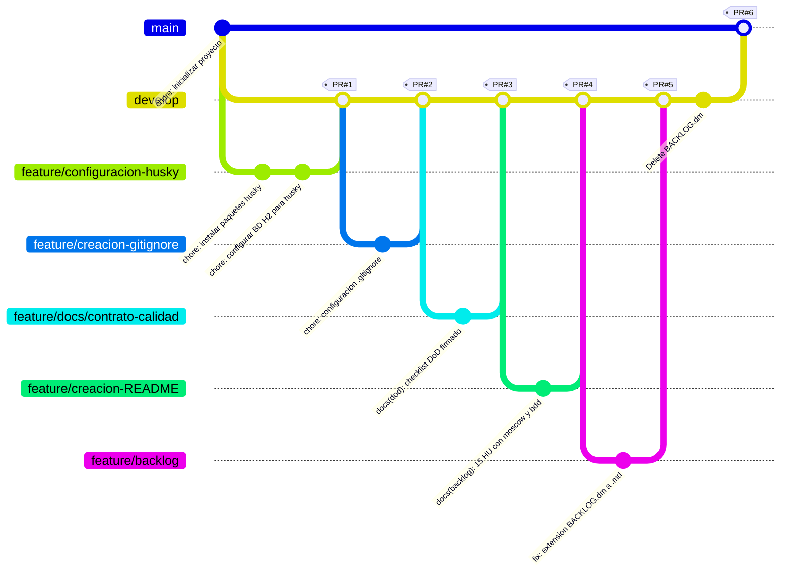
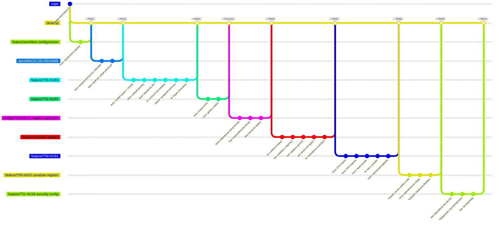

[](https://github.com/Angel-uniajc/AgrovalleConnect/actions/workflows/ci.yml)


# AgroValle Connect

Plataforma web que conecta directamente a los productores agrícolas del Valle del Cauca con la demanda comercial urbana, eliminando la intermediación innecesaria en la cadena de comercialización.

**Ingeniería de Software II** · Institución Universitaria Antonio José Camacho · Docente: Paola Andrea Bedoya Toro · Periodo 2-2026

**Versión actual en `main`:** `0.3.0` (sprints 1 a 4). El despliegue continuo a staging está en diseño ([ADR-001](docs/architecture-decisions/ADR-001-despliegue-staging-paas.md)) y todavía no está en servicio.

## Declaración de Visión del Producto

> Para **productores agrícolas del Valle del Cauca**, que **necesitan vender directamente a comerciantes y restaurantes sin intermediarios**, **AgroValle Connect** es **una plataforma web desarrollada en Java 25 / Spring Boot**, que **conecta la oferta agrícola con la demanda comercial urbana a precio justo y en tiempo real**. A diferencia de **los intermediarios tradicionales y las cadenas de comercialización largas**, nuestro producto **garantiza trazabilidad logística, transparencia de precios y contratos de API abiertos entre productores y compradores**.

## Integrantes del equipo

| Nombre completo | Rol |
|---|---|
| _Angel Isaac Castillo Cuesta_ | Scrum Master |
| _Sebastian Martinez Rodriguez_ | Backend / DBA |
| _Juan David Taborda Cruz_ | Frontend |
| _Joel Mina Orejuela_ | QA / Pruebas |

## Estrategia de Control de Versiones: GitFlow

El equipo adoptó **GitFlow** como estrategia de branching. Se eligió sobre Trunk-Based Development porque el proyecto contempla entregas versionadas por sprint (incrementos funcionales evaluados en cortes académicos), y GitFlow permite mantener una rama `develop` estable para integración continua del equipo mientras se preparan `release/` específicos, sin exponer `main` a código en progreso. Esto reduce los tiempos de espera al aislar el trabajo individual en `feature/` de corta duración por Historia de Usuario, y previene conflictos de fusión extensos al integrar seguido contra `develop` en lugar de acumular cambios.

### Sprint 0 — Configuración inicial



### Sprint 1 — Registro de agricultores e inicio de sesión (HU-01 y HU-16)

Una rama `feature/` por tarea, integrada a `develop` mediante Pull Request revisado por un compañero.



## Stack Tecnológico

- **Lenguaje:** Java 25
- **Framework:** Spring Boot 4.1.1 (Spring Web, Spring Data JPA, Bean Validation)
- **Seguridad:** Spring Security con JWT (HS256) y contraseñas con BCrypt
- **Gestor de dependencias:** Maven (Maven Wrapper)
- **Base de datos:** PostgreSQL; H2 en memoria para las pruebas
- **Calidad de código:** Checkstyle con reglas basadas en Google Java Style ([`checkstyle.xml`](checkstyle.xml))
- **Automatización de commits:** Husky (pre-commit hooks)
- **Pruebas:** JUnit 5, Mockito, AssertJ y MockMvc (cobertura mínima del 60 % en instrucciones y ramas, verificada con JaCoCo)
- **Integración continua:** GitHub Actions ([`ci.yml`](.github/workflows/ci.yml)): Checkstyle, pruebas y JaCoCo en cada PR y en cada push a `main`

## Cómo levantar el proyecto localmente

```bash
git clone https://github.com/Angel-uniajc/AgrovalleConnect.git
cd AgrovalleConnect
./mvnw clean verify        # Checkstyle, pruebas y JaCoCo (en Windows: .\mvnw.cmd clean verify)
./mvnw spring-boot:run     # levanta el backend en http://localhost:8080
```

Requiere Java 25. Antes de `spring-boot:run`, configura la conexión a PostgreSQL (`spring.datasource.url`, `spring.datasource.username` y `spring.datasource.password`) en `src/main/resources/application.properties` o como variables de entorno, y define `JWT_SECRET` con una clave propia. `clean verify` no necesita PostgreSQL porque las pruebas usan H2.

## Ejemplo: registro e inicio de sesión de un comprador (HU-17)

Con el proyecto corriendo en `http://localhost:8080`. Los datos son de prueba: el dominio `example.com` está reservado para ejemplos, así que no corresponden a una persona real. En Windows se puede enviar el mismo cuerpo JSON desde Postman.

**1. Registro** (`POST /api/v1/auth/register`, responde `201 Created`):

```bash
curl -X POST http://localhost:8080/api/v1/auth/register \
  -H "Content-Type: application/json" \
  -d '{"nombre":"Restaurante La Ceiba","correo":"compras.laceiba@example.com","password":"Segura@2026","rol":"COMPRADOR","tipo_comprador":"restaurante","documento":"900123456"}'
```

```json
{
  "nombre": "Restaurante La Ceiba",
  "rol": "COMPRADOR",
  "tipo_comprador": "RESTAURANTE",
  "mensaje": "Comprador registrado exitosamente"
}
```

Si el correo o el documento ya existen, responde `409 Conflict`; si falta un campo o tiene un formato inválido, `400 Bad Request`. Sin el campo `rol`, el mismo endpoint registra un agricultor (HU-01).

**2. Inicio de sesión** (`POST /api/v1/auth/login`, responde `200 OK`):

```bash
curl -X POST http://localhost:8080/api/v1/auth/login \
  -H "Content-Type: application/json" \
  -d '{"email":"compras.laceiba@example.com","password":"Segura@2026"}'
```

```json
{
  "token": "eyJhbGciOiJIUzI1NiJ9...",
  "tipo": "Bearer"
}
```

El token lleva el rol `COMPRADOR` y el `perfil_id` del comprador, y se envía en la cabecera `Authorization: Bearer <token>` para las rutas protegidas. El detalle está en el [contrato de HU-17](./docs/contrato-registro-hu17.md) y en la [secuencia del registro y el login](./docs/architecture/secuencia-registro-comprador-hu17.md).

## Consultar el catálogo de cosechas (HU-04)

En Postman, configura `baseUrl` con la dirección del backend y selecciona **Authorization → Bearer Token**. Usa el token que devuelve `POST /api/v1/auth/login`. Tanto compradores como agricultores pueden consultar.

```http
GET {{baseUrl}}/api/v1/productos?municipio=Dagua&categoria=Frutas
GET {{baseUrl}}/api/v1/productos?municipio=Dagua
GET {{baseUrl}}/api/v1/productos
```

Cada filtro es opcional. Juntos deben coincidir con la misma oferta. La consulta compara nombres completos, ignora mayúsculas y espacios periféricos, y trata un filtro vacío como ausente. Devuelve productos activos con stock positivo por ID ascendente. Ejemplo ficticio de respuesta `200 OK`:

```json
[{"id":12,"tipo":"Mango","cantidad_disponible":25.50,"precio_unitario":3200,"fecha_cosecha":"2026-11-24","categoria":"Frutas","finca_id":4,"municipio":"Dagua"}]
```

Sin coincidencias devuelve `200` con `[]`. Una petición sin token válido recibe `401`. [Contrato del catálogo](docs/contrato-catalogo-hu04.md) · [Recorrido de demostración del Sprint 3](docs/sprints/sprint-3/planning.md)

## Enviar contacto sobre una oferta (HU-05)

Con un JWT de un comprador, envía `POST /api/v1/contacto/mensaje`. El comprador se toma del token; el cuerpo no acepta una identidad alternativa:

```json
{
  "id_producto": 12,
  "mensaje": "Estoy interesado en comprar esta cosecha."
}
```

La respuesta `200 OK` contiene `id`, `id_producto` y `fecha_envio`. El mensaje se persiste en `mensaje_contacto`, no modifica el stock ni crea pedidos. Sin token válido responde `401`; un agricultor responde `403`; un producto inexistente responde `404`; una oferta inactiva, agotada o con stock cero responde `400`. [Contrato de HU-05](docs/contrato-contacto-hu05.md) · [Secuencia y recorrido de demostración](docs/diseno/diagrama-secuencia.md#11-hu-05--contacto-directo-del-comprador) · [Evidencia](docs/evidencias/sprint3-contacto.md)

## Convención de Commits

Este repositorio sigue el estándar de **Conventional Commits**:

- `feat:` nueva funcionalidad
- `fix:` corrección de error
- `docs:` cambios en documentación
- `test:` pruebas
- `chore:` mantenimiento/configuración
- `refactor:` reorganización de código sin cambio de comportamiento

## Sprints y backlog

| Sprint | Historias | SP completados | Documentos |
|---|---|---:|---|
| Sprint 0 · Configuración | — | — | [Planning](docs/sprints/sprint-0/planning.md) · [Review](docs/sprints/sprint-0/review.md) · [Retro](docs/sprints/sprint-0/retrospective.md) |
| Sprint 1 · Registro y login | HU-01, HU-16 | 5 de 8 | [Planning](docs/sprints/sprint-1/planning.md) · [Review](docs/sprints/sprint-1/review.md) · [Retro](docs/sprints/sprint-1/retrospective.md) |
| Sprint 2 · Fincas y cosechas | HU-14, HU-02 | 10 de 10 | [Planning](docs/sprints/sprint-2/planning.md) · [Review](docs/sprints/sprint-2/review.md) · [Retro](docs/sprints/sprint-2/retrospective.md) |
| Sprint 3 · Comprador, catálogo y contacto | HU-17, HU-04, HU-05 | 11 de 11 | [Planning](docs/sprints/sprint-3/planning.md) · [Review](docs/sprints/sprint-3/review.md) · [Retro](docs/sprints/sprint-3/retrospective.md) |
| Sprint 4 · Pedidos y stock | HU-12, HU-08 | 8 de 8 | [Planning](docs/sprints/sprint-4/planning.md) · [Review](docs/sprints/sprint-4/review.md) · [Retro](docs/sprints/sprint-4/retrospective.md) |

El backlog completo tiene 17 historias y 72 SP ([`BACKLOG.md`](BACKLOG.md)). Van terminadas 10 historias (37 SP). Quedan HU-03, HU-06, HU-07, HU-09, HU-10, HU-11, HU-13 y HU-15 (35 SP). La velocidad, el burndown, el CFD y los tiempos de flujo están en el [reporte de métricas](docs/metrics/sprint-metrics-corte3.md).

## Mapa de la documentación

| Tema | Documentos |
|---|---|
| Producto y requisitos | [`BACKLOG.md`](BACKLOG.md) (17 HU con MoSCoW, BDD y Story Points) · [IEEE 29148 de HU-01](docs/ieee29148-req01.md) · [Trazabilidad BDD → JUnit](docs/trazabilidad-bdd.md) |
| Contratos de la API | [Registro de comprador HU-17](docs/contrato-registro-hu17.md) · [Catálogo HU-04](docs/contrato-catalogo-hu04.md) · [Contacto HU-05](docs/contrato-contacto-hu05.md) · [Pedido HU-12](docs/contrato-pedido-hu12.md) · [Stock HU-08](docs/contrato-stock-hu08.md) · [Pago HU-07 (planificado)](docs/contrato-pago-hu07.md) |
| Diseño y arquitectura | [`docs/diseno/`](docs/diseno/) (MER, DER, `schema.sql`, MVC y patrones GoF, componentes, despliegue, secuencias, colaboración, mockups) · [`docs/architecture/`](docs/architecture/) (UML de la sesión 13 y secuencias de HU-17, HU-12 y HU-08) |
| Decisiones de arquitectura | [ADR-001 · Staging en un PaaS](docs/architecture-decisions/ADR-001-despliegue-staging-paas.md) · [ADR-002 · Estrategia de despliegue a producción](docs/architecture-decisions/ADR-002-estrategia-despliegue-produccion.md) |
| Gestión ágil | [Sprints](docs/sprints/README.md) · [Bitácora de Daily Scrums](docs/bitacora-daily-scrum.md) · [Métricas del tercer corte](docs/metrics/sprint-metrics-corte3.md) |
| Calidad | [Definition of Done](docs/dod.md) · [Lista de chequeo de Clean Code](docs/clean-code-checklist.md) · Plantillas de issues para [errores](.github/ISSUE_TEMPLATE/bug_report.md) y [cambios de alcance](.github/ISSUE_TEMPLATE/feature_request.md) |
| Evidencias | [`docs/evidencias/`](docs/evidencias/) |
