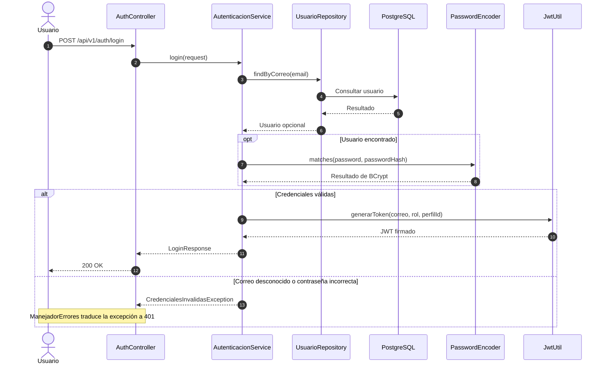
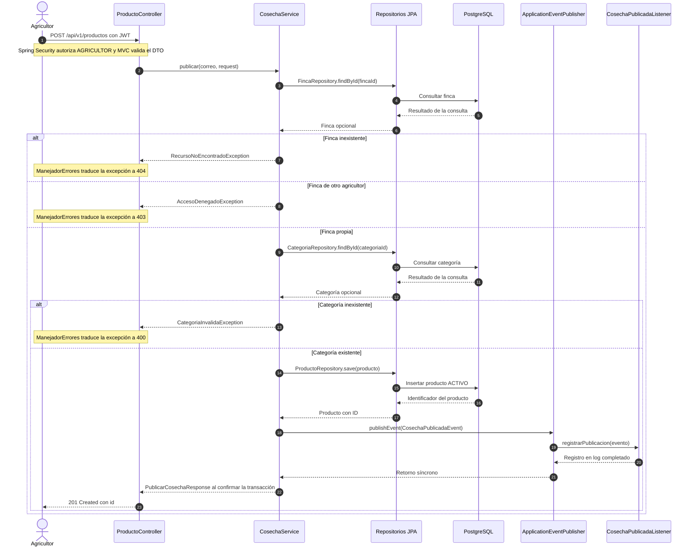
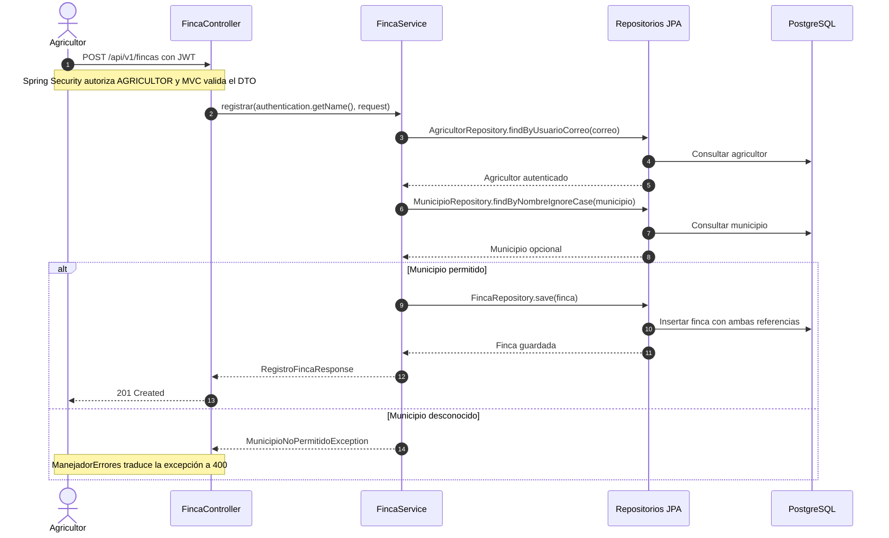
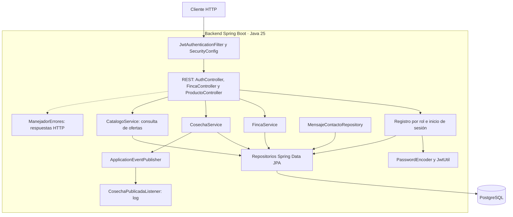
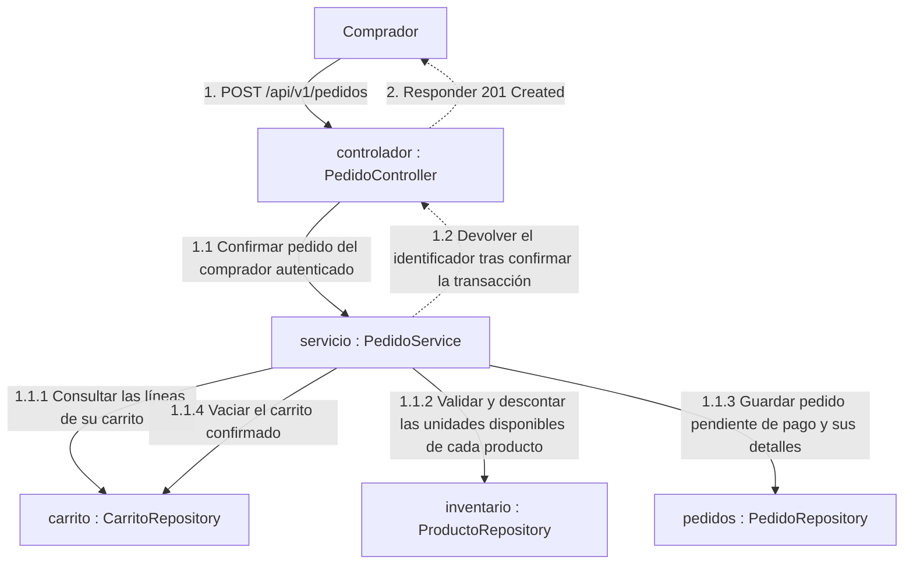
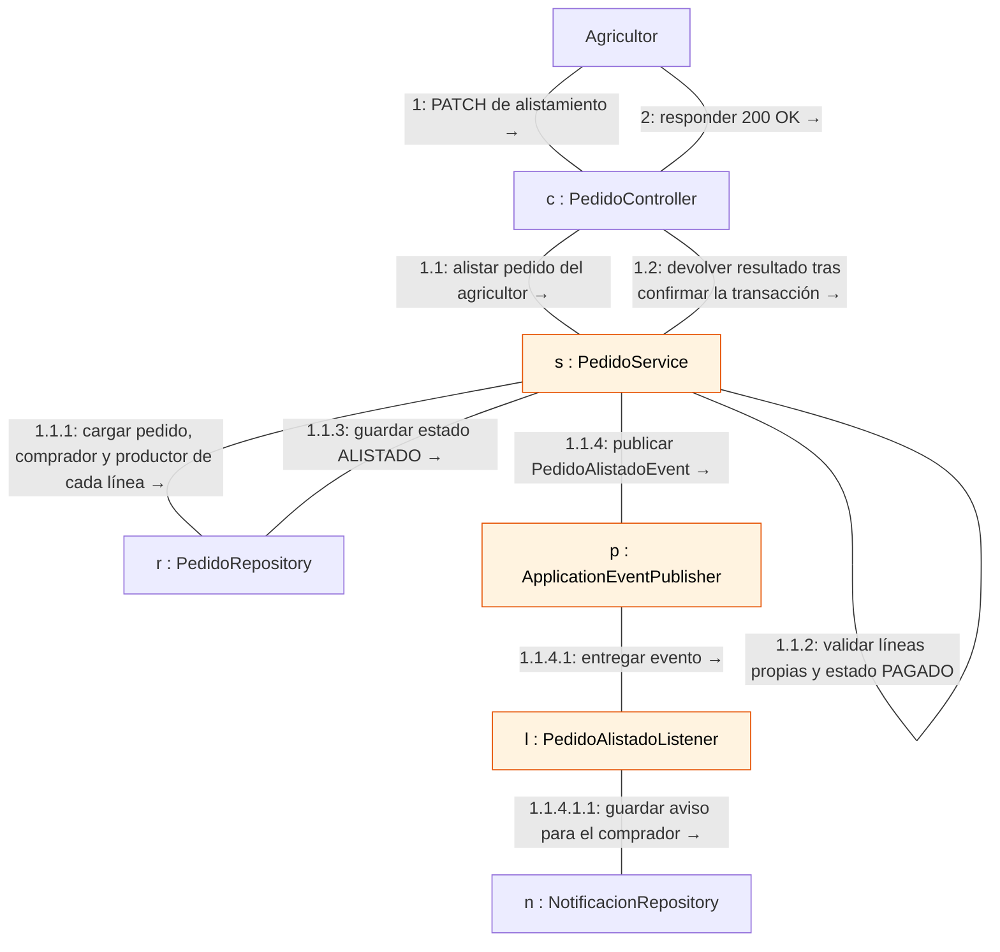
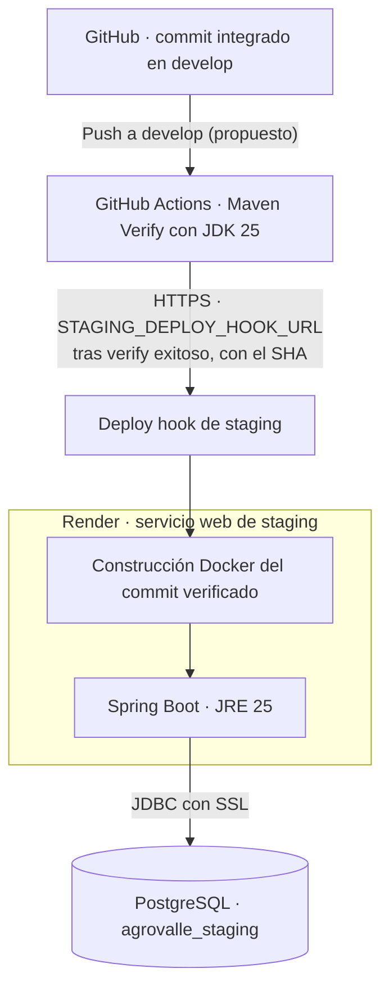

# Diagramas UML de AgroValle Connect

Consolidado de la sesión 13. Las secuencias de las secciones 1 a 3 describen la versión de `develop` en `5d99ab6`. Los escenarios proceden del [backlog](../../BACKLOG.md). La [matriz de trazabilidad BDD](../trazabilidad-bdd.md) recoge las pruebas de login y la [planificación del Sprint 2](../sprint-2-planning.md) recoge las de cosechas y fincas.

## 1. Secuencia de inicio de sesión · HU-16

**Dado** un usuario registrado, **cuando** envía su `email` y `password` a `POST /api/v1/auth/login`, **entonces** recibe un JWT con HTTP 200 si las credenciales son válidas. Tanto un correo desconocido como una contraseña incorrecta producen el mismo 401. Spring MVC rechaza con 400 una petición inválida antes de invocar el servicio.

El JWT tiene una vigencia configurada de **una hora**. El servicio incluye en el token el identificador del perfil correspondiente al rol del usuario (agricultor o comprador). Si el usuario carece de ese perfil, se omite el campo `perfil_id`. [Configuración](../../src/main/resources/application.properties) · [Secuencia detallada](../diseno/diagrama-secuencia.md)

## 2. Secuencia de publicación de cosecha · HU-02

**Dado** un agricultor autenticado con una finca propia, **cuando** publica una cosecha con categoría existente, cantidad y precio positivos y fecha de hoy o posterior, **entonces** la API guarda el producto y devuelve su identificador con HTTP 201. Una fecha pasada produce 400 durante la validación del DTO y un token ausente o vencido produce 401 en la cadena de seguridad.

El servicio verifica la finca y la categoría antes de guardar el producto. El listener se ejecuta dentro de la transacción. [Pruebas de HU-02 en la sección 7 del Sprint 2](../sprint-2-planning.md) · [Alternativas y orden del Observer](../diseno/diagrama-secuencia.md) · [Colaboración de cosechas](../diseno/diagrama-colaboracion.md)

## 3. Secuencia de registro de finca · HU-14

**Dado** un agricultor autenticado, **cuando** registra su finca en un municipio permitido, **entonces** la finca queda vinculada a ese agricultor y municipio y recibe HTTP 201. Si el municipio no está en el catálogo, recibe 400.

[Pruebas de HU-14 en la sección 3 del Sprint 2](../sprint-2-planning.md)

## 4. Componentes del backend

Vista general adaptada del [diagrama de componentes](../diseno/diagrama-de-componentes.md). El backend usa **Java 25**. Los controladores reciben HTTP y delegan en servicios, que aplican reglas de negocio y delimitan transacciones. Los repositorios JPA acceden a PostgreSQL. [Configuración de compilación](../../pom.xml)

En `develop` (`caf1151`), compradores y agricultores autenticados consultan el catálogo mediante `GET /api/v1/productos`. El controlador delega los filtros de municipio y categoría en `CatalogoService`. El contacto del comprador tiene su propia ruta, `POST /api/v1/contacto/mensaje`. [Secuencia de consulta del catálogo](../diseno/diagrama-secuencia.md#10-hu-04--consulta-del-catálogo)

## 5. Colaboración para confirmar un pedido · HU-12

**Diseño propuesto.** HU-12 describe el momento en que el comprador selecciona pagar. Se propone incorporar `PedidoController`, `PedidoService` y los repositorios de carrito y pedido. `ProductoRepository` ya existe y tendría que admitir la reserva de existencias. [HU-12 en el backlog](../../BACKLOG.md) · [T14-DIS](https://github.com/Angel-uniajc/AgrovalleConnect/issues/184)

**Dado** un comerciante autenticado con productos disponibles en su carrito, **cuando** selecciona pagar y envía `POST /api/v1/pedidos`, **entonces** el sistema crea un pedido en estado «Pendiente de pago», reserva temporalmente las unidades, vacía el carrito y responde `201 Created`.

El descuento representa una **reserva temporal**. El servicio debe comprobar la disponibilidad al descontar cada línea para impedir que dos pedidos reserven las mismas unidades. La reserva, el guardado del pedido con sus detalles y el vaciado del carrito se confirman en una sola transacción.

Si el carrito está vacío, HU-12 prevé `400 Bad Request` tras el paso 1.1.1. Si las unidades solicitadas superan las disponibles, HU-08 prevé `400` con el stock disponible en el paso 1.1.2. En ese caso se revierten los descuentos parciales, se conserva el carrito y no se crea el pedido. [Escenarios de HU-12 y HU-08](../../BACKLOG.md)

## 6. Colaboración para notificar el alistamiento · HU-15

**Diseño propuesto.** El ejemplo de alistamiento aparece como HU-13 en la guía de la sesión 13. En el backlog de AgroValle Connect corresponde a **HU-15, Confirmación de Alistamiento de Lote**. El equipo reserva HU-13 para la consulta de la ruta de envío. [Historias de usuario](../../BACKLOG.md) · [T15-DIS](https://github.com/Angel-uniajc/AgrovalleConnect/issues/185)

**Dado** un agricultor con un pedido pagado de su producción, **cuando** marca el lote como alistado mediante `PATCH /api/v1/pedidos/{id}/alistamiento`, **entonces** el pedido pasa de `PAGADO` a `ALISTADO`, queda disponible para la asignación de transporte y la API responde `200 OK`. Para notificar al comprador, se propone registrar un aviso asociado al pedido mediante el [patrón Observer usado en HU-02](../diseno/diagrama-colaboracion.md).

**Alcance del alistamiento.** El esquema guarda el estado del pedido completo. Para este PATCH se propone exigir al menos un detalle y que **todas** sus líneas correspondan al agricultor autenticado. El servicio obtiene el comprador de `pedido.comprador_id` y recorre `detalle_pedido → producto → finca → agricultor` para verificar quién produjo cada línea. Un pedido mixto requiere un diseño de alistamiento parcial antes de que cada productor pueda confirmar su parte. [Esquema de datos](../diseno/schema.sql)

**Componentes propuestos.** La entidad `Notificacion`, la tabla `notificacion` y `NotificacionRepository` se incorporarían para registrar el aviso al comprador. También se propone restringir este PATCH al rol `AGRICULTOR` en `SecurityConfig`, siguiendo la regla de publicación de productos. El servicio verificaría además la titularidad de las líneas.

El servicio publica un evento con los identificadores del pedido y del comprador. El listener registra el aviso en la misma transacción que el cambio de estado. Si falla el registro, ambos cambios se revierten. El controlador devuelve el `200` después de confirmarse la transacción.

**Rechazos.** HU-15 establece `400 Bad Request` para un pedido en `PENDIENTE_PAGO`. Para los demás casos se propone:

| Condición | Respuesta |
|---|---|
| El pedido no existe | `404 Not Found` |
| El usuario autenticado carece del rol agricultor o alguna línea pertenece a otro agricultor (incluidos los pedidos mixtos) | `403 Forbidden` |
| El pedido carece de detalles o está en `ALISTADO`, `EN_CAMINO`, `ENTREGADO` o `CANCELADO` | `409 Conflict` |

En todos los rechazos se conserva el estado existente y se omite la publicación del evento. Repetir el PATCH sobre un pedido ya alistado tampoco duplica el aviso.

## 7. Despliegue de staging

**Diseño propuesto.** El flujo parte del commit integrado en `develop`. Hoy GitHub Actions ejecuta Maven Verify en los PR y en los envíos a `main`. La verificación posterior al merge en `develop`, el despliegue y la conexión con la base de staging quedan como propuesta. [Workflow vigente](../../.github/workflows/ci.yml) · [ADR-001: elección del PaaS para staging](../architecture-decisions/ADR-001-despliegue-staging-paas.md)

El servicio recibe la configuración de conexión y la clave JWT como variables del entorno de staging. La URL del hook se guarda como secreto de GitHub Actions. [Arquitectura de despliegue de referencia](../diseno/diagrama_de_despliegue.md)
