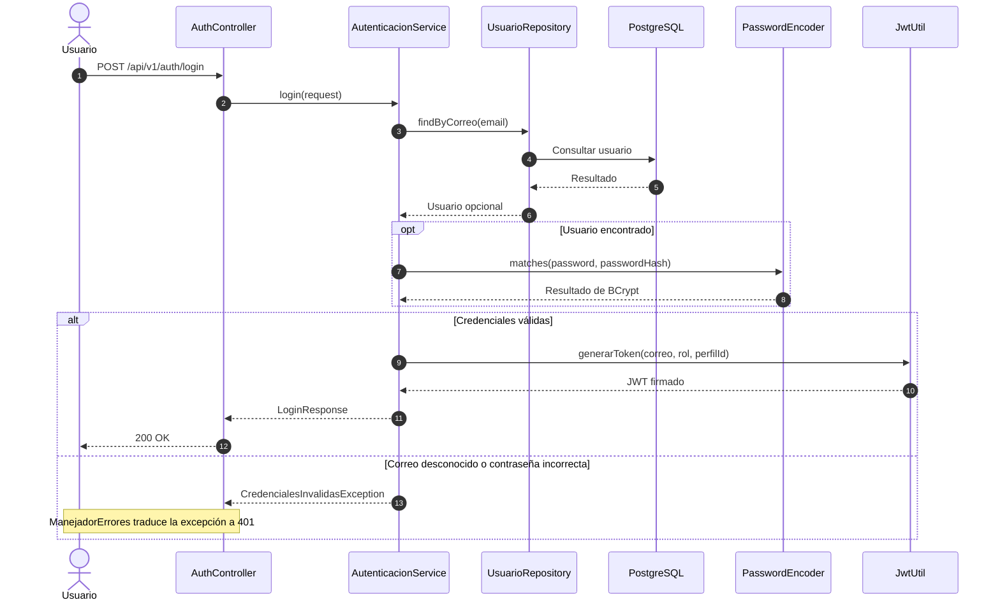
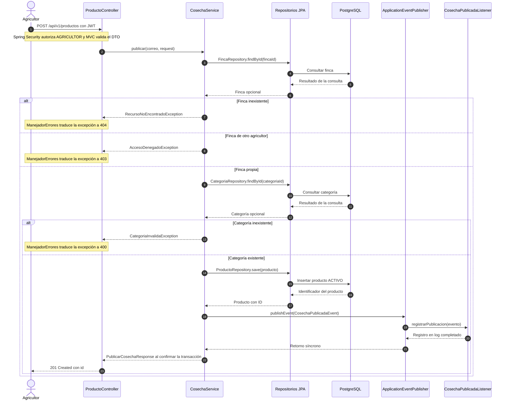
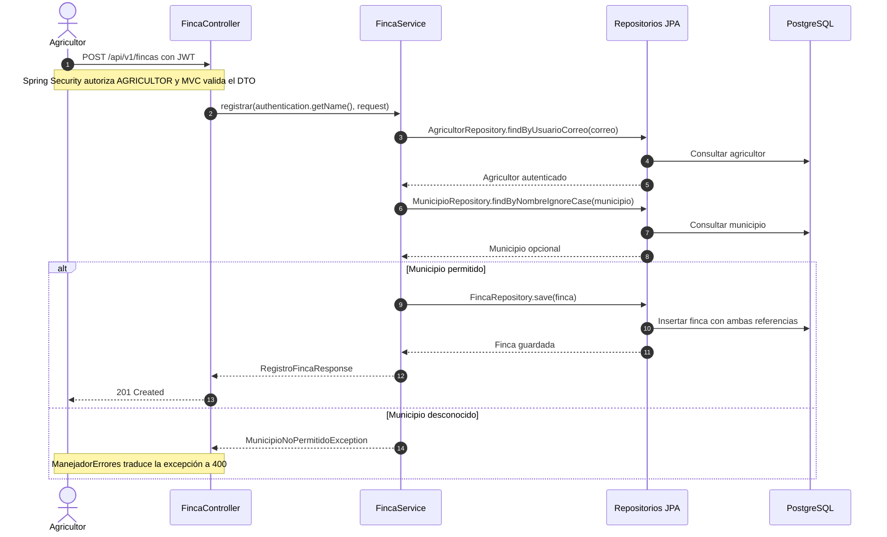
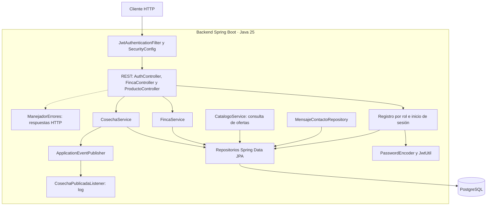

# Diagramas UML de AgroValle Connect

Consolidado de la sesión 13. Las vistas de secuencia y componentes describen la versión de `develop` en `5d99ab6`. Los escenarios proceden del [backlog](../../BACKLOG.md). La [matriz de trazabilidad BDD](../trazabilidad-bdd.md) recoge las pruebas de login y la [planificación del Sprint 2](../sprint-2-planning.md) recoge las de cosechas y fincas.

## 1. Secuencia de inicio de sesión · HU-16

**Dado** un usuario registrado, **cuando** envía su `email` y `password` a `POST /api/v1/auth/login`, **entonces** recibe un JWT con HTTP 200 si las credenciales son válidas. Tanto un correo desconocido como una contraseña incorrecta producen el mismo 401. Spring MVC rechaza con 400 una petición inválida antes de invocar el servicio.

El JWT tiene una vigencia configurada de **una hora**. El servicio incluye en el token el identificador del perfil correspondiente al rol del usuario (agricultor o comprador). Si el usuario carece de ese perfil, se omite el campo `perfil_id`. [Configuración](../../src/main/resources/application.properties) · [Secuencia detallada](../diseno/diagrama-secuencia.md)

## 2. Secuencia de publicación de cosecha · HU-02

**Dado** un agricultor autenticado con una finca propia, **cuando** publica una cosecha con categoría existente, cantidad y precio positivos y fecha de hoy o posterior, **entonces** la API guarda el producto y devuelve su identificador con HTTP 201. Una fecha pasada produce 400 durante la validación del DTO y un token ausente o vencido produce 401 en la cadena de seguridad.

El servicio verifica la finca y la categoría antes de guardar el producto. El listener se ejecuta dentro de la transacción. [Pruebas de HU-02 en la sección 7 del Sprint 2](../sprint-2-planning.md) · [Alternativas y orden del Observer](../diseno/diagrama-secuencia.md) · [Colaboración de cosechas](../diseno/diagrama-colaboracion.md)

## 3. Secuencia de registro de finca · HU-14

**Dado** un agricultor autenticado, **cuando** registra su finca en un municipio permitido, **entonces** la finca queda vinculada a ese agricultor y municipio y recibe HTTP 201. Si el municipio no está en el catálogo, recibe 400.

[Pruebas de HU-14 en la sección 3 del Sprint 2](../sprint-2-planning.md)

## 4. Componentes del backend

Vista general adaptada del [diagrama de componentes](../diseno/diagrama-de-componentes.md). El backend usa **Java 25**. Los controladores reciben HTTP y delegan en servicios, que aplican reglas de negocio y delimitan transacciones. Los repositorios JPA acceden a PostgreSQL. [Configuración de compilación](../../pom.xml)

En esta versión el registro por rol, el login, las fincas y la publicación tienen rutas REST. El catálogo cuenta con servicio de lectura y el contacto con entidad, DTO y repositorio. Las rutas para consultar el catálogo y enviar mensajes corresponden a tareas posteriores.

## 5. Colaboración para confirmar un pedido · HU-12

Diseño pendiente en [T14-DIS](https://github.com/Angel-uniajc/AgrovalleConnect/issues/184).

## 6. Colaboración para notificar el alistamiento · HU-15

Diseño pendiente en [T15-DIS](https://github.com/Angel-uniajc/AgrovalleConnect/issues/185).

## 7. Despliegue de staging

El [diagrama de despliegue existente](../diseno/diagrama_de_despliegue.md) describe la arquitectura de referencia. El diagrama de staging y el ADR sobre la elección del PaaS corresponden a [T16-DIS](https://github.com/Angel-uniajc/AgrovalleConnect/issues/186).
