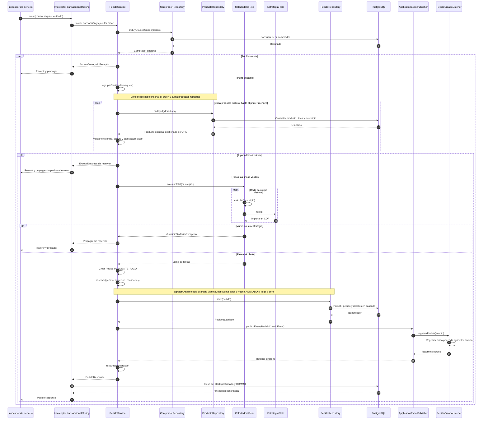

# Secuencia de creación de pedidos · HU-12

Entrega de [T08-HU12 #206](https://github.com/Angel-uniajc/AgrovalleConnect/issues/206), que actualiza el diseño de T14-DIS. Línea base: `develop` en `021d81e`, con el servicio de T05-HU12 (#203) y las excepciones de T02-HU08 (#208) fusionados.

## 1. Alcance y entrada

El [contrato de HU-12](../contrato-pedido-hu12.md) define `POST /api/v1/pedidos`, exclusivo para compradores, y una lista `items` con `id_producto` y `cantidad`. No hay repositorio de carrito ni se ejecuta un pago. `comprador_id` se ignora: la identidad procede del correo autenticado.

El diagrama muestra el servicio **ya implementado**. La capa HTTP (`PedidoController`, validación con `@Valid`, autorización COMPRADOR y respuesta 201) se incorpora en [T06-HU12 #204](https://github.com/Angel-uniajc/AgrovalleConnect/issues/204); no existe todavía en esta línea base. Su contrato prevé 401 sin JWT válido, 403 para otro rol y 400 para un cuerpo inválido, antes de llamar al servicio.

## 2. Secuencia del servicio implementado

El diagrama representa las operaciones lógicas, no un orden fijo de sentencias SQL: Hibernate puede ejecutar inserciones o un flush antes del commit. `ProductoRepository.save` no se invoca para la reserva; JPA detecta los cambios de los productos gestionados dentro de la transacción.

## 3. Strategy, reserva y respuesta

- `CalculadoraFlete` recibe las implementaciones `FleteDagua`, `FletePalmira` y `FleteBuga` de `EstrategiaFlete`. Las tarifas son 12000.00, 10000.00 y 15000.00 COP, respectivamente. Cobra una tarifa por municipio distinto.
- Todas las líneas se validan y el flete se calcula **antes** de modificar existencias. Ante un rechazo no hay reservas parciales, pedido, detalles ni evento.
- Un producto repetido se consolida en un detalle con la cantidad total; respeta la clave `(pedido_id, producto_id)` de `DetallePedido`.
- El precio unitario se copia al detalle. `subtotal` suma cantidad por precio; `total` suma subtotal y `costo_flete`. La respuesta incluye `id`, `estado`, `items`, `subtotal`, `costo_flete` y `total`.
- No se implementan liberación de reservas ni protección frente a reservas concurrentes de distintos compradores; son límites explícitos del [contrato de HU-08](../contrato-stock-hu08.md#6-fuera-de-alcance).

## 4. Observer y errores

`PedidoCreadoEvent` es un record sin entidades JPA: contiene `pedidoId`, `compradorId` y una copia inmutable de `agricultoresIds`. Se emite una sola vez después de `PedidoRepository.save`, **antes del commit**. `PedidoCreadoListener` usa `@EventListener` y solo registra avisos en el log; no envía correo ni guarda notificaciones.

Una excepción del guardado o de un listener síncrono se propaga y revierte la transacción. Un mensaje ya escrito en el log no se revierte ni demuestra que el commit se haya confirmado. Los efectos externos futuros deben ejecutarse después del commit, por ejemplo con `@TransactionalEventListener(phase = AFTER_COMMIT)`.

En la línea base, un producto inexistente lanza `RecursoNoEncontradoException`; un producto inactivo, agotado o con stock insuficiente lanza `ProductoNoDisponibleException` con el mensaje correspondiente. Las excepciones con los datos de HU-08 ya existen, pero su uso en el servicio corresponde a [T03-HU08 #210](https://github.com/Angel-uniajc/AgrovalleConnect/issues/210). Los caminos detallados de rechazo se documentarán en [T05-HU08 #212](https://github.com/Angel-uniajc/AgrovalleConnect/issues/212), enlazando esta secuencia para evitar duplicarla.

El contrato exige 400 con `{"error":"Municipio sin tarifa de flete"}` para una tarifa ausente. Su traducción HTTP se incorpora en #204; en esta línea base aún no hay manejador para `MunicipioSinTarifaException`.

## 5. Código y verificación

| Evidencia | Qué verifica |
|---|---|
| [PedidoService](../../src/main/java/com/agrovalleconnect/agrovalle_connect/service/PedidoService.java) | Validación, flete, reserva, guardado y evento |
| [CalculadoraFlete](../../src/main/java/com/agrovalleconnect/agrovalle_connect/service/flete/CalculadoraFlete.java) | Selección de Strategy y municipios distintos |
| [PedidoServiceTest](../../src/test/java/com/agrovalleconnect/agrovalle_connect/service/PedidoServiceTest.java) | Reserva antes de guardar, evento después del guardado y rechazos sin evento |
| [PedidoServiceIntegrationTest](../../src/test/java/com/agrovalleconnect/agrovalle_connect/service/PedidoServiceIntegrationTest.java) | Persistencia, listener real y rollback ante fallo del observador |
| [PedidoCreadoEventTest](../../src/test/java/com/agrovalleconnect/agrovalle_connect/event/PedidoCreadoEventTest.java) | Inmutabilidad de los destinatarios |

La [colaboración del pedido](diagramas-uml.md#5-colaboración-para-confirmar-un-pedido--hu-12) muestra los mismos participantes y mensajes numerados. Las pruebas BDD HTTP completas siguen asignadas a T07-HU12 y T04-HU08; este documento no las da por realizadas.
