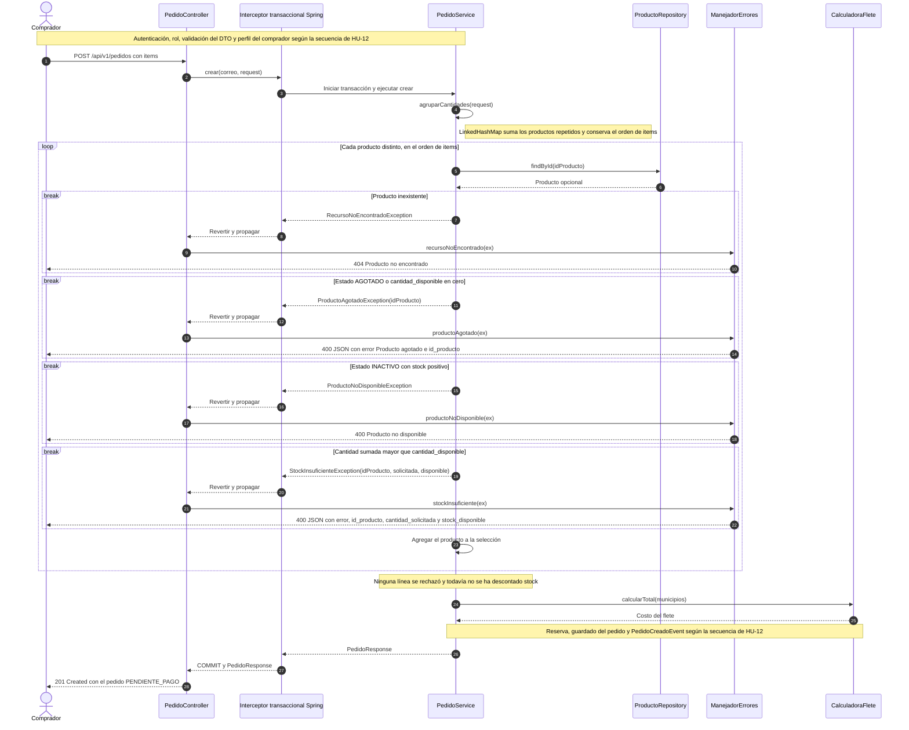

# Secuencia del rechazo por stock · HU-08

Entrega de [T05-HU08 #212](https://github.com/Angel-uniajc/AgrovalleConnect/issues/212). Línea base: `develop` en `b91b40e`, con la validación de T03-HU08 (#210, PR #225) fusionada.

## 1. Alcance

Este diagrama detalla solo la validación de las líneas del pedido dentro de `PedidoService.crear`. El recorrido completo de `POST /api/v1/pedidos` (JWT, rol `COMPRADOR`, `@Valid`, perfil del comprador, flete, reserva, guardado y evento) está en la [secuencia de creación de pedidos de HU-12](secuencia-pedido-hu12.md) y no se repite aquí.

Las reglas vienen del [contrato de HU-08](../contrato-stock-hu08.md):

- Todas las líneas se validan **antes** de calcular el flete y de reservar.
- Un producto repetido en varias líneas se valida con la **suma** de sus cantidades.
- Se reporta solo el **primer** rechazo, en el orden de `items`.
- Ante cualquier rechazo no hay reservas parciales, pedido, detalles ni `PedidoCreadoEvent`.

## 2. Secuencia

Cada bloque `break` corta el recorrido de las líneas: las comprobaciones se hacen en ese orden para cada producto y la primera que falla termina la petición. Como la excepción sale antes de `reservar`, no hay stock que devolver; la transacción se revierte sin cambios en la base de datos.

## 3. Respuestas de rechazo

| Condición | Excepción | Respuesta |
|---|---|---|
| El producto no existe | `RecursoNoEncontradoException` | `404` con el texto `Producto no encontrado` |
| Estado `AGOTADO` o `cantidad_disponible` en cero (incluye `INACTIVO` con cero) | `ProductoAgotadoException` | `400` con `{"error": "Producto agotado", "id_producto": 12}` |
| Estado `INACTIVO` con stock positivo | `ProductoNoDisponibleException` | `400` con el texto `Producto no disponible` (PED-07 de HU-12) |
| Cantidad pedida (sumada si se repite) mayor que `cantidad_disponible` | `StockInsuficienteException` | `400` con `{"error": "Stock insuficiente", "id_producto": 12, "cantidad_solicitada": 16.00, "stock_disponible": 10.00}` |

Los dos cuerpos JSON los arma `ManejadorErrores` con los datos de la excepción (T02-HU08, #208). El 404 y el 400 de producto no disponible conservan el texto plano de los mapeos que ya existían.

## 4. Escenarios del contrato

| Escenario | Camino del diagrama |
|---|---|
| STK-01 y STK-11 | `break` de stock insuficiente (16 con 10; 10.01 con 10.00) |
| STK-02, STK-03 y STK-10 | Todas las líneas válidas: `201` |
| STK-04, STK-05 y STK-06 | `break` de producto agotado |
| STK-07 | La línea válida pasa y la insuficiente corta en el `break` de stock: no se reserva ninguna |
| STK-08 | Se reporta el rechazo de la primera línea en el orden de `items` |
| STK-09 | La suma de las líneas repetidas supera el stock: `break` de stock insuficiente |

## 5. Código y verificación

| Evidencia | Qué verifica |
|---|---|
| [PedidoService](../../src/main/java/com/agrovalleconnect/agrovalle_connect/service/PedidoService.java) | `agruparCantidades` y el orden de las comprobaciones en `validarProductos` |
| [ManejadorErrores](../../src/main/java/com/agrovalleconnect/agrovalle_connect/exception/ManejadorErrores.java) | `stockInsuficiente` y `productoAgotado` con su JSON |
| [PedidoServiceTest](../../src/test/java/com/agrovalleconnect/agrovalle_connect/service/PedidoServiceTest.java) | Pedido mixto, repetido, agotado y stock en cero sin guardar, sin flete y sin evento |
| [ManejadorErroresTest](../../src/test/java/com/agrovalleconnect/agrovalle_connect/exception/ManejadorErroresTest.java) | Cuerpos de error de stock insuficiente y producto agotado |

Las pruebas de integración de STK-01 a STK-11 son de [T04-HU08 #211](https://github.com/Angel-uniajc/AgrovalleConnect/issues/211) y están enlazadas en la [trazabilidad BDD](../trazabilidad-bdd.md#hu-08--validación-de-stock) a [StockPedidoIntegrationTest](../../src/test/java/com/agrovalleconnect/agrovalle_connect/controller/StockPedidoIntegrationTest.java).
