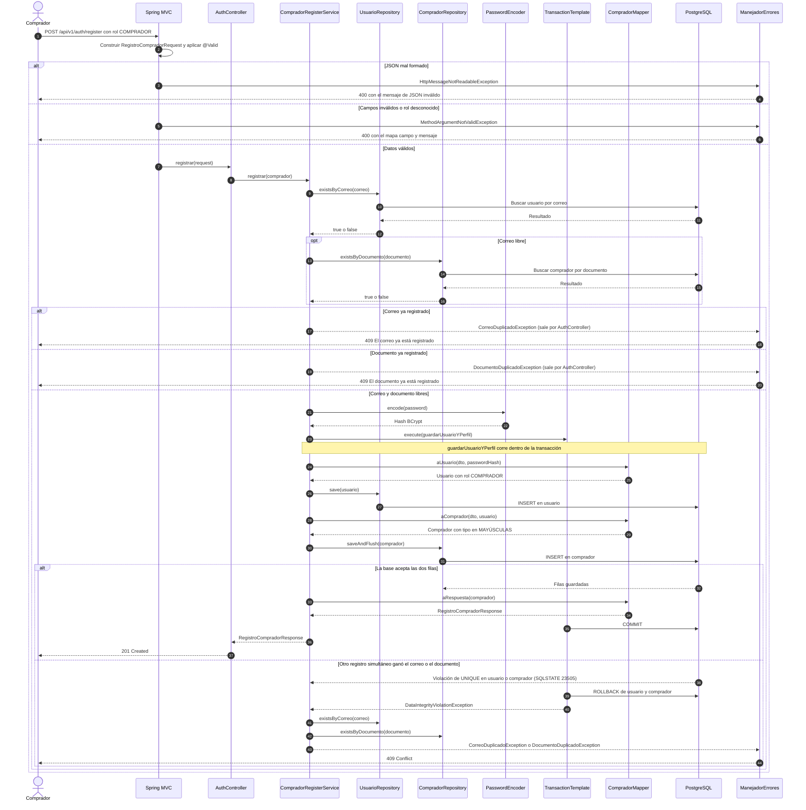
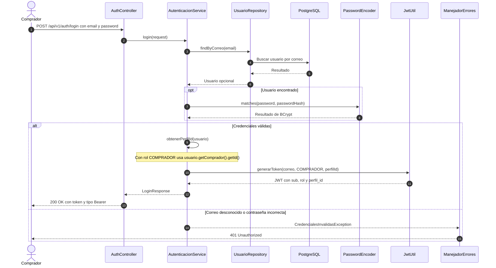

# Secuencia del registro y el login del comprador · HU-17

Documento de la tarea **T08-HU17 (#159)**, parte de **HU-17 (#44)**. Describe el código de `develop` en `62f037a`. Las reglas de cada campo están en el [contrato de registro de HU-17](../contrato-registro-hu17.md), y las pruebas que verifican cada camino, en la [matriz de trazabilidad BDD](../trazabilidad-bdd.md#hu-17--registro-de-comprador). Las demás secuencias del proyecto están en [diagramas-uml.md](diagramas-uml.md).

## 1. Participantes

| Participante | Capa | Qué hace en HU-17 |
| --- | --- | --- |
| Comprador | Externo | Persona, comercio o restaurante que se registra y luego inicia sesión |
| Spring MVC | Presentación / REST | Convierte el JSON en `RegistroRequest` según el campo `rol` (`@JsonTypeInfo`) y aplica `@Valid` antes de llamar al controlador |
| `AuthController` | Presentación / REST | Recibe `POST /api/v1/auth/register` y `POST /api/v1/auth/login`, y envía cada tipo de registro a su servicio |
| `CompradorRegisterService` | Servicio / Dominio | Revisa duplicados, cifra la contraseña y guarda `Usuario` y `Comprador` en una sola transacción |
| `CompradorMapper` | Servicio / Dominio | Arma `Usuario` y `Comprador` a partir del DTO y construye `RegistroCompradorResponse` |
| `PasswordEncoder` | Servicio / Dominio | Genera el hash BCrypt al registrar y lo compara al iniciar sesión |
| `TransactionTemplate` | Infraestructura de Spring | Abre la transacción del registro y la confirma o la deshace |
| `AutenticacionService` | Servicio / Dominio | Verifica las credenciales y busca el perfil del comprador para el token |
| `JwtUtil` | Servicio / Dominio | Firma el JWT con el correo, el rol y el `perfil_id` |
| `UsuarioRepository` y `CompradorRepository` | Repositorio / Acceso a datos | Consultan si el correo o el documento ya existen y guardan las dos filas |
| `ManejadorErrores` | Presentación / REST | Traduce las excepciones a 400, 401 o 409 |
| PostgreSQL | Persistencia | Tablas `usuario` y `comprador`, con `UNIQUE` en `usuario.correo` y `comprador.documento` |

## 2. Registro de comprador

**Dado** un visitante sin cuenta, **cuando** envía sus datos con `rol` igual a `COMPRADOR` a `POST /api/v1/auth/register`, **entonces** se crean su usuario y su perfil de comprador y recibe `201 Created`. Si los datos no son válidos responde 400, y si el correo o el documento ya existen, 409. En ningún rechazo queda guardado un usuario ni un comprador.

Ejemplo de petición (datos de prueba, no son de una persona real):

```json
{
  "nombre": "Restaurante La Ceiba",
  "correo": "compras.laceiba@example.com",
  "password": "Segura@2026",
  "rol": "COMPRADOR",
  "tipo_comprador": "restaurante",
  "documento": "900123456"
}
```



Respuesta `201 Created` (sin contraseña, hash ni documento):

```json
{
  "nombre": "Restaurante La Ceiba",
  "rol": "COMPRADOR",
  "tipo_comprador": "RESTAURANTE",
  "mensaje": "Comprador registrado exitosamente"
}
```

Notas del flujo:

- **Rol:** si `rol` falta, Jackson construye un `RegistroAgricultorRequest` (compatibilidad con HU-01). Si el rol es desconocido, como `"ADMIN"`, también usa ese DTO, pero su validación exige que `rol` sea nulo o `AGRICULTOR`, así que responde 400 y no registra nada.
- **Orden de las revisiones:** primero el correo, que es único entre todos los usuarios, y después el documento, que es único solo entre compradores (puede coincidir con la cédula de un agricultor). Las dos se hacen **antes** de calcular el hash, porque BCrypt es costoso y no vale la pena gastarlo en un registro que se va a rechazar.
- **Transacción:** `Usuario` y `Comprador` se guardan juntos. `saveAndFlush` obliga a que la base responda dentro de la transacción: si rechaza el perfil, el usuario también se deshace.
- **Registros simultáneos:** si dos personas usan el mismo correo o documento al mismo tiempo, las dos pueden pasar la primera revisión, pero el `UNIQUE` de la base frena a la segunda. El servicio usa `TransactionTemplate` en vez de `@Transactional` para volver a consultar **después** del `ROLLBACK`, porque PostgreSQL no permite consultas dentro de una transacción que ya falló. Solo responde 409 si confirma el duplicado; cualquier otra violación de la base se propaga sin cambios.
- **`tipo_comprador`:** se acepta en minúsculas, mayúsculas o mezcladas, y se guarda y se devuelve en MAYÚSCULAS para cumplir el `CHECK` de la tabla `comprador`.

## 3. Login del comprador

**Dado** un comprador registrado, **cuando** envía su `email` y `password` a `POST /api/v1/auth/login`, **entonces** recibe un JWT con `rol` igual a `COMPRADOR` y su `perfil_id`. Es el mismo login de HU-16; lo que cambia con HU-17 es de dónde sale el perfil.

Ejemplo de petición (las mismas credenciales de prueba del registro):

```json
{
  "email": "compras.laceiba@example.com",
  "password": "Segura@2026"
}
```



Respuesta `200 OK` (el token se recorta en el ejemplo):

```json
{
  "token": "eyJhbGciOiJIUzI1NiJ9...",
  "tipo": "Bearer"
}
```

Con ese token, `JwtAuthenticationFilter` arma el permiso `ROLE_COMPRADOR`. Con él, el comprador puede consultar el catálogo de HU-04 (abierto a cualquier usuario autenticado) y enviar el contacto directo de HU-05, que en `SecurityConfig` es exclusivo de ese rol. Si un usuario con rol `COMPRADOR` no tuviera perfil, el token sale sin `perfil_id` en vez de fallar.

## 4. Resumen de respuestas

| Caso | Quién lo decide | Código |
| --- | --- | --- |
| Registro válido | `CompradorRegisterService` | 201 |
| JSON mal formado | Spring MVC y `ManejadorErrores` | 400 |
| Campo faltante o inválido, `tipo_comprador` o rol no permitido | `@Valid` en Spring MVC y `ManejadorErrores` | 400 |
| Correo ya registrado (de un comprador o de un agricultor) | `CompradorRegisterService` | 409 |
| Documento ya registrado por otro comprador | `CompradorRegisterService` | 409 |
| Duplicado que llega al mismo tiempo que otro registro | `UNIQUE` de PostgreSQL y `CompradorRegisterService` | 409 |
| Login con credenciales válidas | `AutenticacionService` | 200 |
| Login con correo desconocido o contraseña incorrecta | `AutenticacionService` y `ManejadorErrores` | 401 |
