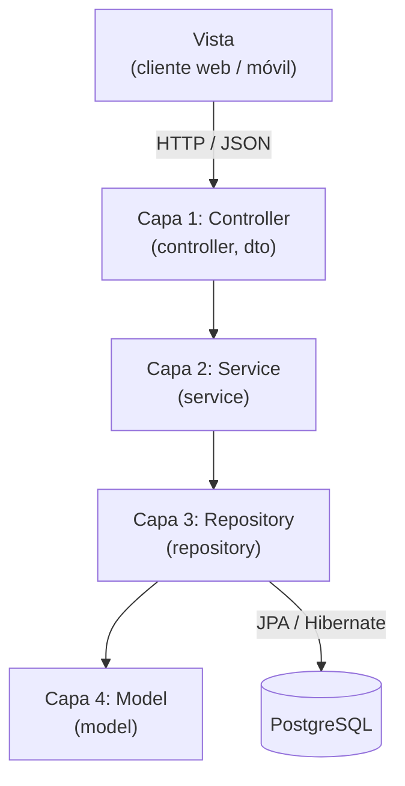
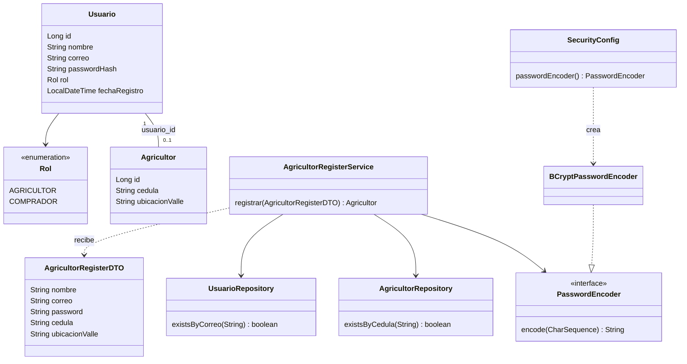
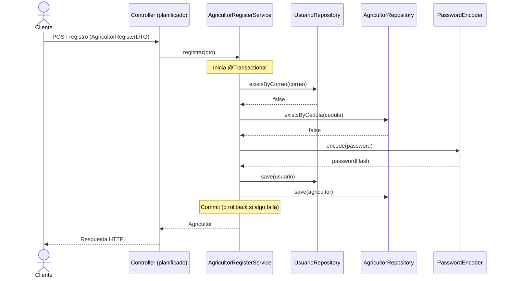

# Arquitectura MVC de 4 capas y patrones GoF - AgroValle Connect

Documento de diseño asociado a la tarea **T03-DIS (#76)**, parte del Sprint de Diseño (#73).

## 1. Contexto y objetivo

AgroValle Connect es una aplicación backend construida con **Java 17, Spring Boot, JPA y PostgreSQL**. Este documento describe cómo se organiza el sistema en cuatro capas siguiendo el patrón MVC, qué responsabilidad tiene cada una y qué patrones de diseño GoF (Gang of Four) se aplican en el código.

Objetivos del diseño:

- **Mantenibilidad**: separar responsabilidades para que un cambio afecte a una sola capa.
- **Adecuación funcional**: concentrar las reglas de negocio en un punto único y testeable.

## 2. Arquitectura en 4 capas

El sistema es una API REST, por lo que la **Vista (View)** es el cliente externo (aplicación web o móvil) que consume los endpoints. El backend se organiza en cuatro capas:

| # | Capa | Rol en MVC | Responsabilidad | Paquete |
|---|---|---|---|---|
| 1 | Presentación | Controller | Recibir peticiones HTTP, validar los DTO de entrada y devolver respuestas | `controller` y `dto` |
| 2 | Lógica de negocio | (Servicio) | Reglas de negocio, validaciones de unicidad, control transaccional | `service` |
| 3 | Acceso a datos | (Persistencia) | Consultas y persistencia mediante Spring Data JPA | `repository` |
| 4 | Dominio | Model | Entidades JPA y sus relaciones | `model` |

Los paquetes `config` (beans y configuración, por ejemplo `SecurityConfig`) son transversales a las capas.

> **Estado actual:** las capas 2, 3 y 4 ya existen en el código. La capa de presentación (`controller`) está planificada; hoy solo existe el DTO `AgricultorRegisterDTO`.

### 2.1 Diagrama de capas



### 2.2 Reglas de dependencia

- Cada capa solo se comunica con la capa inmediatamente inferior (Controller → Service → Repository → Model).
- Un `Controller` **nunca** accede directamente a un `Repository`.
- Las entidades (`model`) no se exponen en las respuestas de la API; se usan DTO para entrada y salida.
- La lógica de negocio y el manejo de transacciones (`@Transactional`) viven únicamente en `service`.

### 2.3 Estructura de paquetes

```
src/main/java/com/agrovalleconnect/agrovalle_connect/
├── AgrovalleConnectApplication.java
├── config/
│   └── SecurityConfig.java
├── controller/                  (planificado)
├── dto/
│   └── AgricultorRegisterDTO.java
├── model/
│   ├── Agricultor.java
│   └── Usuario.java
├── repository/
│   ├── AgricultorRepository.java
│   └── UsuarioRepository.java
└── service/
    └── AgricultorRegisterService.java
```

## 3. Diagrama de clases



La relación `Usuario` - `Agricultor` es `@OneToOne`. `Agricultor` es el lado dueño de la relación (columna `usuario_id`, `unique`, `nullable = false`) y `Usuario` la mapea con `mappedBy`.

## 4. Flujo de ejemplo: registro de un agricultor



Si la validación de correo o cédula falla, se lanza `IllegalArgumentException` y no se persiste nada. Si falla cualquier guardado, la transacción revierte tanto `Usuario` como `Agricultor`.

## 5. Patrones GoF aplicados

| Patrón | Tipo | Dónde se aplica | Justificación |
|---|---|---|---|
| **Builder** | Creacional | `@Builder` de Lombok en `Usuario` y `Agricultor` | Construcción legible de entidades con muchos atributos, sin constructores largos |
| **Singleton** | Creacional | Beans de Spring (`@Service`, `@Configuration`) | El contenedor de Spring crea una única instancia por bean (alcance singleton por defecto) |
| **Strategy** | Comportamiento | `PasswordEncoder` (interfaz) y `BCryptPasswordEncoder` (estrategia concreta) | El algoritmo de hash se puede cambiar modificando solo el bean de `SecurityConfig` |
| **Proxy** | Estructural | `@Transactional` en `AgricultorRegisterService` | Spring envuelve el servicio en un proxy (AOP) que abre, confirma o revierte la transacción |
| **Facade** | Estructural | `AgricultorRegisterService.registrar(...)` | Un único punto de entrada que oculta la coordinación de dos repositorios, el hash y la transacción |

Nota: en el caso de **Singleton**, la instancia única la gestiona el contenedor de Spring y no una implementación manual con constructor privado.

### 5.1 Patrones propuestos para futuras historias

| Patrón | Propuesta de uso |
|---|---|
| **Factory Method** | Crear usuarios según el `Rol` (`AGRICULTOR`, `COMPRADOR`) cuando se agregue el registro de compradores |
| **Observer** | Publicar eventos (por ejemplo, "usuario registrado") con `ApplicationEventPublisher` para notificaciones sin acoplar el servicio |

## 6. Relación con atributos de calidad (ISO 25010)

| Atributo | Cómo lo respalda la arquitectura |
|---|---|
| Mantenibilidad | La separación en capas y la inyección de dependencias permiten modificar una capa sin afectar a las demás |
| Adecuación funcional | Las reglas de negocio (unicidad, hash de contraseña, atomicidad) se concentran en la capa `service` |

## 7. Decisiones de diseño

- **Contraseñas:** nunca se almacenan en texto plano; se guarda solo `passwordHash` generado con BCrypt.
- **Atomicidad:** el registro de `Usuario` y `Agricultor` ocurre en una sola transacción.
- **DTO en la entrada:** los datos del cliente se validan con anotaciones de Jakarta Validation (`@NotBlank`, `@Size`, `@Email`) antes de llegar a la capa de negocio.
- **Calidad automatizada:** Checkstyle y los hooks de Husky se ejecutan en cada commit, según el Definition of Done del equipo.
