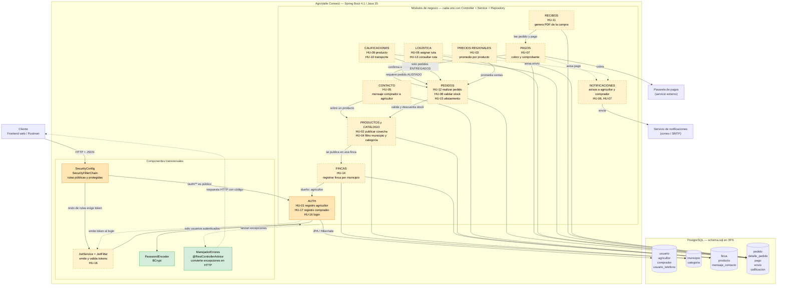
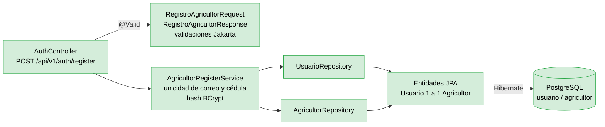

# Diagrama de Componentes — AgroValle Connect

---

## 1. Vista general del sistema

---

## 2. Detalle por capas del módulo implementado (AUTH / HU-01)

Todos los demás módulos seguirán este mismo patrón de capas.

---

## 3. Catálogo de componentes

| Componente | HU | Responsabilidad | Tablas que usa | Estado |
| :--- | :---: | :--- | :--- | :---: |
| **SecurityConfig** | HU-16 | Define rutas públicas y protegidas; sesión sin estado. Falta conectar el filtro JWT. | — | parcial |
| **PasswordEncoder (BCrypt)** | HU-01 | Hash irreversible de contraseñas. | `usuario.password_hash` | ✅ |
| **ManejadorErrores** | todas | Traduce excepciones a códigos HTTP. Hoy solo maneja `IllegalArgumentException` → 409. | — | ✅ |
| **JwtService / JwtFilter** | HU-16 | Genera token HS256 con `rol` y `perfil_id`; lo valida en cada petición. | — | Pendiente |
| **AUTH** | HU-01, 16, 17 | Registro de agricultor (hecho), registro de comprador y login (pendientes). | `usuario`, `agricultor`, `comprador`, `usuario_telefono` |  parcial |
| **FINCAS** | HU-14 | Registrar fincas asociadas a un municipio del Valle. | `finca`, `municipio` | Pendiente |
| **PRODUCTOS y CATÁLOGO** | HU-02, 04 | Publicar cosechas; filtrar por municipio y categoría. | `producto`, `finca`, `categoria`, `municipio` | Pendiente |
| **CONTACTO** | HU-05 | Mensaje directo del comprador al agricultor. | `mensaje_contacto` | Pendiente |
| **PEDIDOS** | HU-12, 08, 15 | Crear pedido, validar stock, marcar alistamiento. | `pedido`, `detalle_pedido`, `producto` | Pendiente |
| **PAGOS** | HU-07 | Cobrar vía pasarela y registrar el pago. | `pago`, `pedido` | Pendiente |
| **LOGÍSTICA** | HU-06, 13 | Programar ruta, generar código de seguimiento, consultarlo. | `envio`, `pedido` | Pendiente |
| **CALIFICACIONES** | HU-09, 10 | Calificar producto y transporte (una por tipo y pedido). | `calificacion`, `pedido` | Pendiente |
| **RECIBOS** | HU-11 | Generar el PDF de la compra. | `pedido`, `detalle_pedido`, `pago` | Pendiente |
| **PRECIOS REGIONALES** | HU-03 | Calcular el precio promedio por producto. | `detalle_pedido`, `producto` | Pendiente |
| **NOTIFICACIONES** | HU-06, 07 | Avisar a agricultor y comprador. | — | Pendiente |

## 4. Reglas de arquitectura

1. **Las flechas solo bajan:** Controller → Service → Repository → BD. Un controller nunca toca la BD (atributo ISO 25010 de **Mantenibilidad**).
2. **Un módulo habla con otro por su Service**, nunca por su Repository, para que cada módulo proteja sus propias reglas.
3. **Seguridad y manejo de errores son transversales:** se escriben una vez y aplican a todos los módulos.
4. **Los servicios externos** (pasarela, correo) quedan aislados en su propio componente para poder cambiarlos o simularlos en las pruebas.
