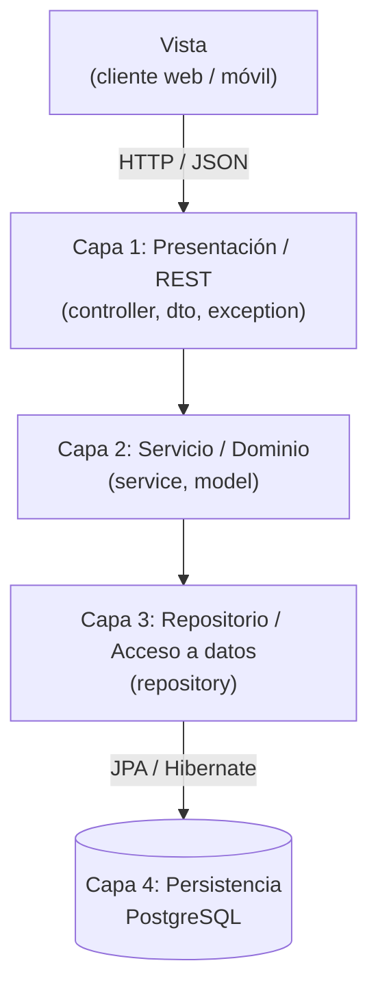
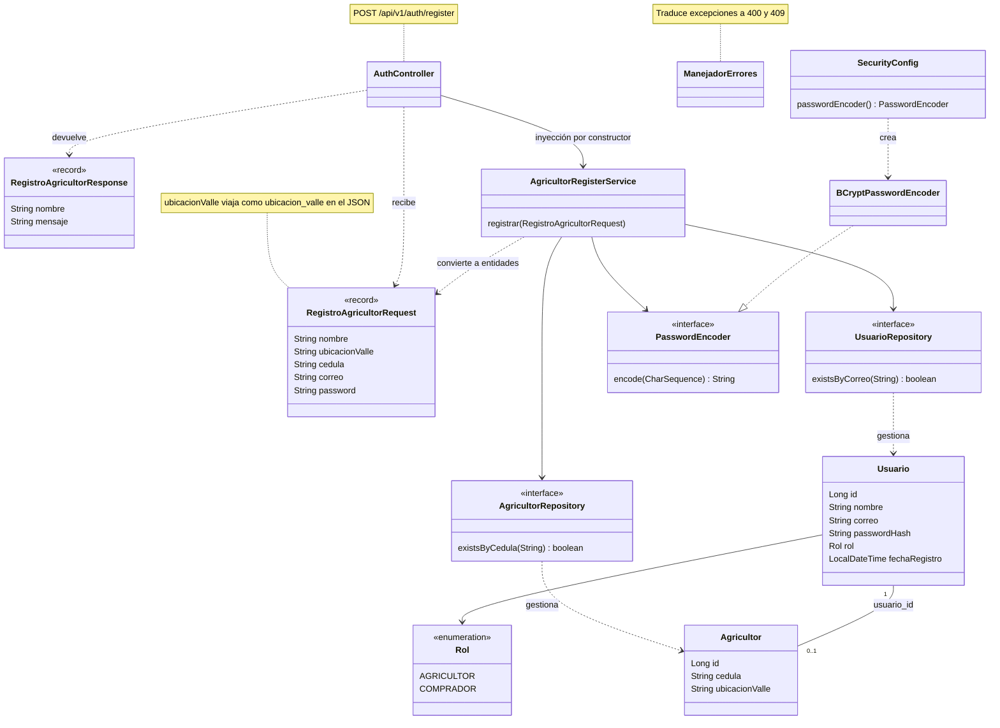
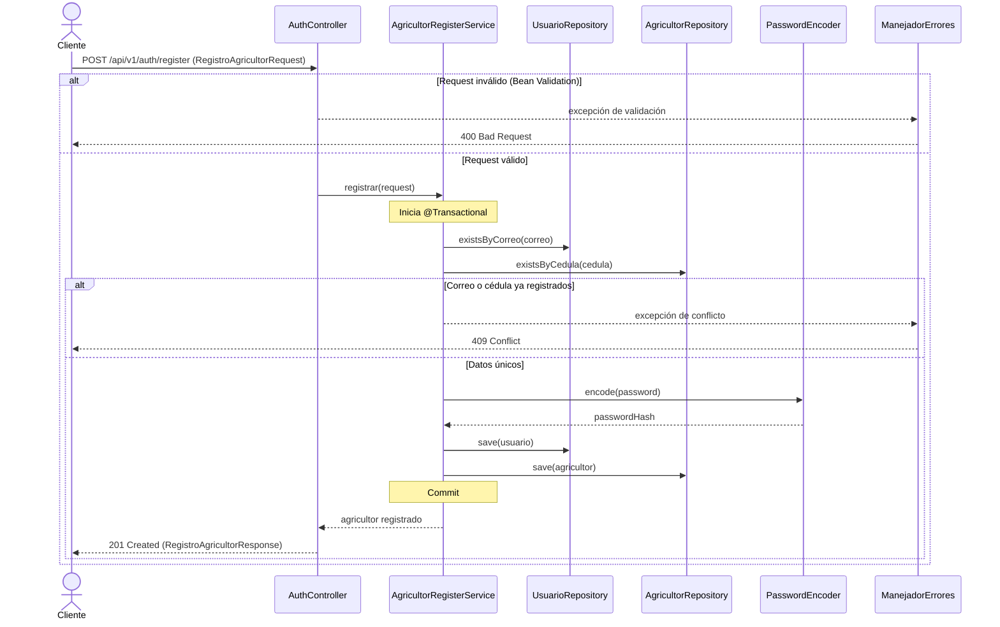

# Arquitectura MVC de 4 capas y patrones de diseño - AgroValle Connect

Documento de diseño asociado a la tarea **T03-DIS (#76)**, parte del Sprint de Diseño (#73).

## 1. Contexto y objetivo

AgroValle Connect es una aplicación backend construida con **Java 17, Spring Boot, JPA y PostgreSQL**, que expone una API REST versionada (`/api/v1`). Este documento describe cómo se organiza el sistema en cuatro capas siguiendo el patrón MVC, qué responsabilidad tiene cada una y qué patrones de diseño se aplican en el código.

Objetivos del diseño:

- **Mantenibilidad**: separar responsabilidades para que un cambio afecte a una sola capa.
- **Adecuación funcional**: concentrar las reglas de negocio en un punto único y testeable.

> **Estado actual:** las cuatro capas están implementadas en `develop`. El flujo de referencia es el registro de agricultores: `AuthController` (`POST /api/v1/auth/register`) → `AgricultorRegisterService` → repositorios → PostgreSQL, con `ManejadorErrores` como manejador central de errores.

## 2. Arquitectura en 4 capas

Al ser una API REST, la **Vista (View)** es el cliente externo (aplicación web o móvil) que consume los endpoints JSON. El backend se organiza en cuatro capas:

| # | Capa | Responsabilidad | Paquetes / componentes |
|---|---|---|---|
| 1 | Presentación / REST | Recibir peticiones HTTP, validar los DTO de entrada, devolver respuestas y traducir errores a códigos HTTP | `controller` (`AuthController`), `dto` (`RegistroAgricultorRequest`, `RegistroAgricultorResponse`), `exception` (`ManejadorErrores`) |
| 2 | Servicio / Dominio | Reglas de negocio, validaciones de unicidad, hash de contraseña, control transaccional y entidades del dominio | `service` (`AgricultorRegisterService`), `model` (`Usuario`, `Agricultor`) |
| 3 | Repositorio / Acceso a datos | Consultas y persistencia mediante Spring Data JPA | `repository` (`UsuarioRepository`, `AgricultorRepository`) |
| 4 | Persistencia | Almacenamiento relacional | PostgreSQL |

El paquete `config` (por ejemplo `SecurityConfig`, que declara el bean de `PasswordEncoder`) es transversal a las capas.

Las entidades de `model` pertenecen al **Dominio**: el repositorio las usa para mapearlas a las tablas, pero nunca salen por la API.

### 2.1 Diagrama de capas



### 2.2 Reglas de dependencia

- Cada capa solo se comunica con la capa inmediatamente inferior (Presentación → Servicio → Repositorio → Persistencia).
- Un `Controller` **nunca** accede directamente a un `Repository`.
- Las entidades (`model`) no se exponen en la API: la entrada y la salida usan DTO (`Request` y `Response`).
- La lógica de negocio y el manejo de transacciones (`@Transactional`) viven únicamente en `service`.
- Los errores se traducen a respuestas HTTP en un único punto (`ManejadorErrores`), no en cada controlador.

### 2.3 Estructura de paquetes

```
src/main/java/com/agrovalleconnect/agrovalle_connect/
├── AgrovalleConnectApplication.java
├── config/
│   └── SecurityConfig.java
├── controller/
│   └── AuthController.java
├── dto/
│   ├── RegistroAgricultorRequest.java
│   └── RegistroAgricultorResponse.java
├── exception/
│   └── ManejadorErrores.java
├── model/
│   ├── Agricultor.java
│   └── Usuario.java
├── repository/
│   ├── AgricultorRepository.java
│   └── UsuarioRepository.java
└── service/
    └── AgricultorRegisterService.java
```

## 3. Diagrama de clases



La relación `Usuario` - `Agricultor` es `@OneToOne`. `Agricultor` es el lado dueño de la relación (columna `usuario_id`, `unique`, `nullable = false`) y `Usuario` la mapea con `mappedBy`.

## 4. Flujo de ejemplo: registro de un agricultor



Respuestas posibles del endpoint:

| Código | Situación |
|---|---|
| 201 Created | Usuario y agricultor registrados correctamente |
| 400 Bad Request | El request no cumple las validaciones (campos vacíos, tamaños, formato de correo) |
| 409 Conflict | El correo o la cédula ya están registrados |

Si falla cualquier guardado, la transacción revierte tanto `Usuario` como `Agricultor`.

### 4.1 Contrato del endpoint

**Request** (`RegistroAgricultorRequest`), validado con Jakarta Validation:

| Campo (JSON) | Reglas |
|---|---|
| `nombre` | Obligatorio, máximo 50 caracteres |
| `ubicacion_valle` | Obligatoria, máximo 15 caracteres |
| `cedula` | Obligatoria, entre 6 y 10 dígitos |
| `correo` | Obligatorio, máximo 50 caracteres, formato válido (`@Pattern`) |
| `password` | Obligatoria, mínimo 8 caracteres con una mayúscula, una minúscula, un número y un carácter especial (`@$!%*?&`) |

**Response** (`RegistroAgricultorResponse`): contiene únicamente `nombre` y `mensaje`. No se devuelve el `id`, el correo ni el hash de la contraseña.

## 5. Patrones de diseño aplicados

Los patrones provienen de distintos catálogos: algunos son GoF (Gang of Four) y otros son patrones de arquitectura empresarial o principios de diseño comunes en Spring.

| Patrón | Catálogo | Dónde se aplica | Justificación |
|---|---|---|---|
| **Repository** | Arquitectura empresarial (PoEAA) | `UsuarioRepository` y `AgricultorRepository` (`JpaRepository`) | Abstrae el acceso a datos: el servicio trabaja con una interfaz de colección y no con SQL |
| **DTO** | Arquitectura empresarial (PoEAA) | `RegistroAgricultorRequest` y `RegistroAgricultorResponse` | Son `record` de Java (inmutables) que aíslan las entidades de la API: solo viaja lo necesario y el modelo interno puede cambiar sin romper el contrato |
| **IoC / inyección por constructor** | Principio de diseño (Spring) | `AuthController` y `AgricultorRegisterService` | El contenedor de Spring crea y entrega las dependencias; las clases no se instancian entre sí, lo que facilita las pruebas |
| **Builder** | GoF (creacional) | `@Builder` de Lombok en `Usuario` y `Agricultor`, usado en `registrar` | Construcción legible de entidades con muchos atributos, sin constructores largos |
| **Mapper** | Arquitectura empresarial (PoEAA) | Conversión de `RegistroAgricultorRequest` a `Usuario` y `Agricultor` dentro de `registrar` | Centraliza el paso de DTO a entidad en el servicio, no en el controlador |
| **Singleton** | GoF (creacional) | Beans de Spring (`@Service`, `@RestController`, `@Configuration`) | El contenedor crea una única instancia por bean (alcance singleton por defecto) |
| **Strategy** | GoF (comportamiento) | `PasswordEncoder` (interfaz) y `BCryptPasswordEncoder` (estrategia concreta) | El algoritmo de hash se puede cambiar modificando solo el bean de `SecurityConfig` |
| **Proxy** | GoF (estructural) | `@Transactional` en `AgricultorRegisterService` | Spring envuelve el servicio en un proxy (AOP) que abre, confirma o revierte la transacción |
| **Facade** | GoF (estructural) | `AgricultorRegisterService.registrar(...)` | Un único punto de entrada que oculta la coordinación de dos repositorios, el hash y la transacción |

Nota: en **Singleton**, la instancia única la gestiona el contenedor de Spring y no una implementación manual con constructor privado.

### 5.1 Patrones propuestos para futuras historias

| Patrón | Propuesta de uso |
|---|---|
| **Factory Method** | Crear usuarios según el `Rol` (`AGRICULTOR`, `COMPRADOR`) cuando se agregue el registro de compradores |
| **Observer** | Publicar eventos (por ejemplo, "usuario registrado") con `ApplicationEventPublisher` para notificaciones sin acoplar el servicio |

## 6. Relación con atributos de calidad (ISO 25010)

| Atributo | Cómo lo respalda la arquitectura |
|---|---|
| Mantenibilidad | La separación en capas, los DTO y la inyección de dependencias permiten modificar una capa sin afectar a las demás |
| Adecuación funcional | Las reglas de negocio (unicidad, hash de contraseña, atomicidad) se concentran en la capa `service` |

## 7. Decisiones de diseño

- **Contraseñas:** nunca se almacenan en texto plano; se guarda solo `passwordHash` generado con BCrypt.
- **Atomicidad:** el registro de `Usuario` y `Agricultor` ocurre en una sola transacción.
- **DTO de entrada y salida:** el cliente nunca recibe ni envía entidades. Los datos se validan con Jakarta Validation (`@NotBlank`, `@Size` y `@Pattern` para la cédula, el formato del correo y la complejidad de la contraseña) antes de llegar a la capa de negocio. La respuesta expone solo `nombre` y `mensaje`, nunca el hash ni el `id`.
- **Manejo centralizado de errores:** `ManejadorErrores` traduce las excepciones a respuestas HTTP coherentes (400 para validación y 409 para duplicados).
- **API versionada:** los endpoints cuelgan de `/api/v1` para poder evolucionar el contrato sin romper a los clientes existentes.
- **Calidad automatizada:** Checkstyle y los hooks de Husky se ejecutan en cada commit, según el Definition of Done del equipo.
