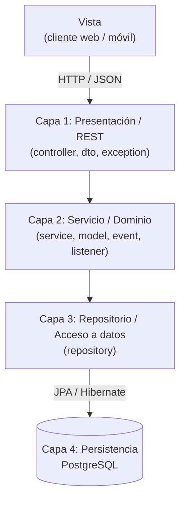
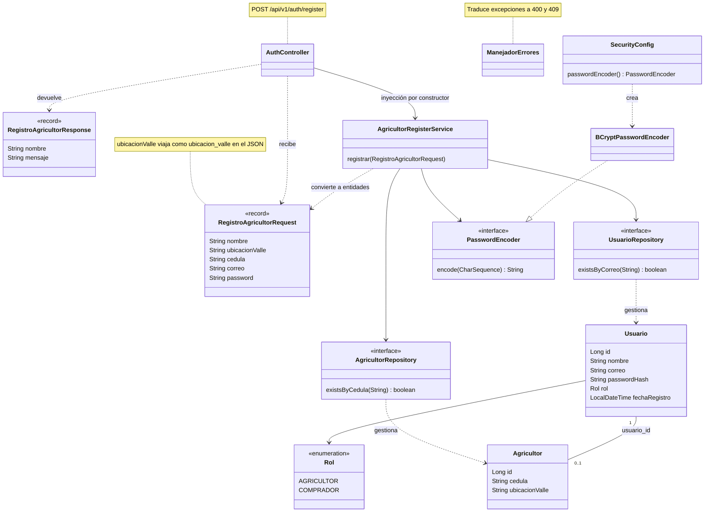
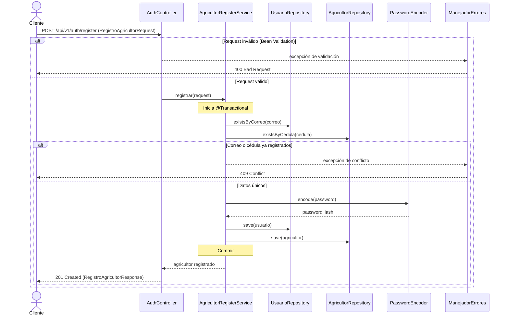
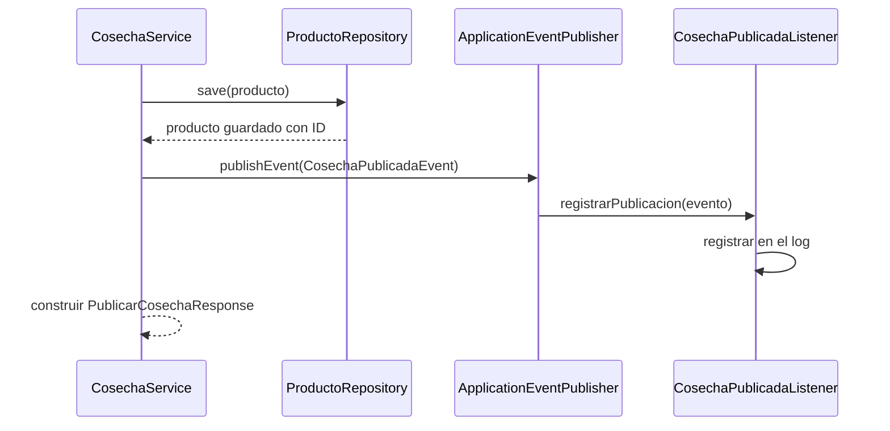
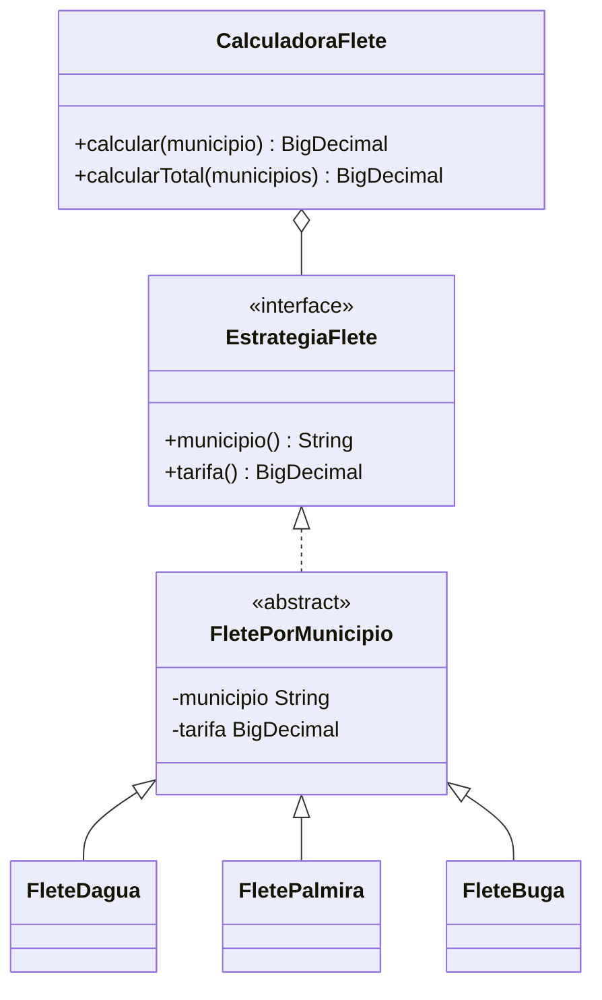

# Arquitectura MVC de 4 capas y patrones de diseño - AgroValle Connect

Documento de diseño asociado a la tarea **T03-DIS (#76)**, parte del Sprint de Diseño (#73).

## 1. Contexto y objetivo

AgroValle Connect es una aplicación backend construida con **Java 25, Spring Boot, JPA y PostgreSQL**, que expone una API REST versionada (`/api/v1`). Este documento describe cómo se organiza el sistema en cuatro capas siguiendo el patrón MVC, qué responsabilidad tiene cada una y qué patrones de diseño se aplican en el código.

Objetivos del diseño:

- **Mantenibilidad**: separar responsabilidades para que un cambio afecte a una sola capa.
- **Adecuación funcional**: concentrar las reglas de negocio en un punto único y testeable.

> **Estado actual:** las cuatro capas están implementadas en `develop`. El flujo de referencia es el registro de agricultores: `AuthController` (`POST /api/v1/auth/register`) → `AgricultorRegisterService` → repositorios → PostgreSQL, con `ManejadorErrores` como manejador central de errores.

## 2. Arquitectura en 4 capas

Al ser una API REST, la **Vista (View)** es el cliente externo (aplicación web o móvil) que consume los endpoints JSON. El backend se organiza en cuatro capas:

| # | Capa | Responsabilidad | Paquetes / componentes |
|---|---|---|---|
| 1 | Presentación / REST | Recibir peticiones HTTP, validar los DTO de entrada, devolver respuestas y traducir errores a códigos HTTP | `controller` (`AuthController`, `FincaController`, `ProductoController`, `ContactoController`), `dto` (un `record` de entrada y otro de salida por caso de uso; el registro usa el tipo común `RegistroRequest` con `RegistroAgricultorRequest` y `RegistroCompradorRequest`), `exception` (`ManejadorErrores` y las excepciones de negocio, como `RecursoDuplicadoException` y sus subclases) |
| 2 | Servicio / Dominio | Reglas de negocio, validaciones de unicidad, hash de contraseña, control transaccional, entidades y comunicación por eventos | `service` (`AgricultorRegisterService`, `CompradorRegisterService`, `AutenticacionService`, `FincaService`, `CosechaService`, `CatalogoService`, `ContactoService`), `mapper` (`AgricultorMapper`, `CompradorMapper`, `CatalogoMapper`), `model` (`Usuario`, `Agricultor`, `Comprador`, `Finca`, `Municipio`, `Categoria`, `Producto`, `MensajeContacto`), `event` (`CosechaPublicadaEvent`), `listener` (`CosechaPublicadaListener`) |
| 3 | Repositorio / Acceso a datos | Consultas y persistencia mediante Spring Data JPA | `repository` (`UsuarioRepository`, `AgricultorRepository`, `CompradorRepository`, `FincaRepository`, `MunicipioRepository`, `CategoriaRepository`, `ProductoRepository`, `MensajeContactoRepository`) |
| 4 | Persistencia | Almacenamiento relacional | PostgreSQL |

Los paquetes `config` (`SecurityConfig`, que declara el bean de `PasswordEncoder`, y los cargadores de municipios y categorías) y `security` (`JwtAuthenticationFilter` y `JwtUtil`) son transversales a las capas.

Las entidades de `model` pertenecen al **Dominio**: el repositorio las usa para mapearlas a las tablas, pero nunca salen por la API.

### 2.1 Diagrama de capas



### 2.2 Reglas de dependencia

- Cada capa solo se comunica con la capa inmediatamente inferior (Presentación → Servicio → Repositorio → Persistencia).
- Un `Controller` **nunca** accede directamente a un `Repository`.
- Las entidades (`model`) no se exponen en la API: la entrada y la salida usan DTO (`Request` y `Response`).
- La lógica de negocio y el manejo de transacciones (`@Transactional`) viven únicamente en `service`.
- Los errores se traducen a respuestas HTTP en un único punto (`ManejadorErrores`), no en cada controlador.

### 2.3 Estructura de paquetes

```
src/main/java/com/agrovalleconnect/agrovalle_connect/
├── AgrovalleConnectApplication.java
├── config/
│   ├── CargadorCategorias.java
│   ├── CargadorMunicipios.java
│   └── SecurityConfig.java
├── controller/
│   ├── AuthController.java
│   ├── ContactoController.java
│   ├── FincaController.java
│   └── ProductoController.java
├── dto/
│   ├── LecturaJsonEstricta.java
│   ├── LoginRequest.java
│   ├── LoginResponse.java
│   ├── MensajeContactoRequest.java
│   ├── MensajeContactoResponse.java
│   ├── OfertaCatalogoResponse.java
│   ├── PublicarCosechaRequest.java
│   ├── PublicarCosechaResponse.java
│   ├── RegistroAgricultorRequest.java
│   ├── RegistroAgricultorResponse.java
│   ├── RegistroCompradorRequest.java
│   ├── RegistroCompradorResponse.java
│   ├── RegistroFincaRequest.java
│   ├── RegistroFincaResponse.java
│   ├── RegistroRequest.java
│   └── ReglasRegistro.java
├── event/
│   └── CosechaPublicadaEvent.java
├── exception/
│   ├── AccesoDenegadoException.java
│   ├── CategoriaInvalidaException.java
│   ├── CedulaDuplicadaException.java
│   ├── CorreoDuplicadoException.java
│   ├── CredencialesInvalidasException.java
│   ├── DocumentoDuplicadoException.java
│   ├── ManejadorErrores.java
│   ├── MunicipioNoPermitidoException.java
│   ├── ProductoNoDisponibleException.java
│   ├── RecursoDuplicadoException.java
│   └── RecursoNoEncontradoException.java
├── listener/
│   └── CosechaPublicadaListener.java
├── mapper/
│   ├── AgricultorMapper.java
│   ├── CatalogoMapper.java
│   └── CompradorMapper.java
├── model/
│   ├── Agricultor.java
│   ├── Categoria.java
│   ├── Comprador.java
│   ├── Finca.java
│   ├── MensajeContacto.java
│   ├── Municipio.java
│   ├── Producto.java
│   └── Usuario.java
├── repository/
│   ├── AgricultorRepository.java
│   ├── CategoriaRepository.java
│   ├── CompradorRepository.java
│   ├── FincaRepository.java
│   ├── MensajeContactoRepository.java
│   ├── MunicipioRepository.java
│   ├── ProductoRepository.java
│   └── UsuarioRepository.java
├── security/
│   ├── JwtAuthenticationFilter.java
│   └── JwtUtil.java
└── service/
    ├── AgricultorRegisterService.java
    ├── AutenticacionService.java
    ├── CatalogoService.java
    ├── CompradorRegisterService.java
    ├── ContactoService.java
    ├── CosechaService.java
    ├── FincaService.java
    └── flete/
        ├── CalculadoraFlete.java
        ├── EstrategiaFlete.java
        ├── FleteBuga.java
        ├── FleteDagua.java
        ├── FletePalmira.java
        └── FletePorMunicipio.java
```

## 3. Diagrama de clases



La relación `Usuario` - `Agricultor` es `@OneToOne`. `Agricultor` es el lado dueño de la relación (columna `usuario_id`, `unique`, `nullable = false`) y `Usuario` la mapea con `mappedBy`.

## 4. Flujo de ejemplo: registro de un agricultor



Respuestas posibles del endpoint:

| Código | Situación |
|---|---|
| 201 Created | Usuario y agricultor registrados correctamente |
| 400 Bad Request | El request no cumple las validaciones (campos vacíos, tamaños, formato de correo) |
| 409 Conflict | El correo o la cédula ya están registrados |

Si falla cualquier guardado, la transacción revierte tanto `Usuario` como `Agricultor`.

### 4.1 Contrato del endpoint

**Request** (`RegistroAgricultorRequest`), validado con Jakarta Validation:

| Campo (JSON) | Reglas |
|---|---|
| `nombre` | Obligatorio, máximo 50 caracteres |
| `ubicacion_valle` | Obligatoria, máximo 15 caracteres |
| `cedula` | Obligatoria, entre 6 y 10 dígitos |
| `correo` | Obligatorio, máximo 50 caracteres, formato válido (`@Pattern`) |
| `password` | Obligatoria, mínimo 8 caracteres con una mayúscula, una minúscula, un número y un carácter especial (`@$!%*?&`) |

**Response** (`RegistroAgricultorResponse`): contiene únicamente `nombre` y `mensaje`. No se devuelve el `id`, el correo ni el hash de la contraseña.

## 5. Patrones de diseño aplicados

Los patrones provienen de distintos catálogos: algunos son GoF (Gang of Four) y otros son patrones de arquitectura empresarial o principios de diseño comunes en Spring.

| Patrón | Catálogo | Dónde se aplica | Justificación |
|---|---|---|---|
| **Repository** | Arquitectura empresarial (PoEAA) | `UsuarioRepository` y `AgricultorRepository` (`JpaRepository`) | Abstrae el acceso a datos: el servicio trabaja con una interfaz de colección y no con SQL |
| **DTO** | Arquitectura empresarial (PoEAA) | `RegistroAgricultorRequest` y `RegistroAgricultorResponse` | Son `record` de Java (inmutables) que aíslan las entidades de la API: solo viaja lo necesario y el modelo interno puede cambiar sin romper el contrato |
| **IoC / inyección por constructor** | Principio de diseño (Spring) | `AuthController` y `AgricultorRegisterService` | El contenedor de Spring crea y entrega las dependencias; las clases no se instancian entre sí, lo que facilita las pruebas |
| **Builder** | GoF (creacional) | `@Builder` de Lombok en `Usuario` y `Agricultor`, usado en `registrar` | Construcción legible de entidades con muchos atributos, sin constructores largos |
| **Mapper** | Arquitectura empresarial (PoEAA) | `AgricultorMapper` convierte `RegistroAgricultorRequest` en `Usuario` y `Agricultor`, `CompradorMapper` convierte `RegistroCompradorRequest` en `Usuario` y `Comprador` y arma la respuesta, y `CatalogoMapper` convierte `Producto` en `OfertaCatalogoResponse` | Separa el paso entre DTO y entidad del servicio y del controlador |
| **Singleton** | GoF (creacional) | Beans de Spring (`@Service`, `@RestController`, `@Configuration`) | El contenedor crea una única instancia por bean (alcance singleton por defecto) |
| **Strategy** | GoF (comportamiento) | `PasswordEncoder` (interfaz) y `BCryptPasswordEncoder` (estrategia concreta) | El algoritmo de hash se puede cambiar modificando solo el bean de `SecurityConfig` |
| **Proxy** | GoF (estructural) | `@Transactional` en `AgricultorRegisterService` | Spring envuelve el servicio en un proxy (AOP) que abre, confirma o revierte la transacción |
| **Template Method** | GoF (comportamiento) | `TransactionTemplate` en `CompradorRegisterService` | Spring fija los pasos de la transacción (abrir, confirmar o deshacer) y el servicio solo aporta el paso de guardar `Usuario` y `Comprador`. Se usa en vez de `@Transactional` para poder revisar duplicados después del `ROLLBACK` |
| **Facade** | GoF (estructural) | `AgricultorRegisterService.registrar(...)` | Un único punto de entrada que oculta la coordinación de dos repositorios, el hash y la transacción |
| **Observer** | GoF (comportamiento) | `CosechaService`, `CosechaPublicadaEvent` y `CosechaPublicadaListener` | El servicio publica un evento de Spring tras guardar el producto; los observadores reaccionan sin que el servicio conozca sus implementaciones |
| **Strategy** | GoF (comportamiento) | `EstrategiaFlete`, `FletePorMunicipio`, `FleteDagua`, `FletePalmira`, `FleteBuga` y el contexto `CalculadoraFlete` | El flete depende del municipio de la finca: cada municipio es una estrategia propia y la calculadora elige cuál aplicar, sin `if` ni `switch`. Un municipio nuevo es una clase nueva (ver 5.4) |

Nota: en **Singleton**, la instancia única la gestiona el contenedor de Spring y no una implementación manual con constructor privado.

### 5.1 Patrones propuestos para futuras historias

| Patrón | Propuesta de uso |
|---|---|
| **Factory Method** | Ya no hace falta para HU-17: el registro de compradores se resolvió con el tipo común `RegistroRequest` (interfaz *sealed*), `@JsonTypeInfo` construye el DTO según `rol` y `AuthController` envía cada caso a su servicio con un `switch`. Se puede retomar si aparecen más tipos de usuario |
| **Observer para usuario registrado** | Propuesta de un evento de registro de usuarios para futuras notificaciones; es un flujo distinto de `CosechaPublicadaEvent`, ya implementado para HU-02 en la sección 5.2 |

### 5.2 Observer en la publicación de cosechas (T04-HU02)

`CosechaService.publicar(...)` conserva las validaciones de finca, propietario y categoría de T03-HU02. Después de que `ProductoRepository.save(...)` devuelve el producto guardado, llama a `ApplicationEventPublisher.publishEvent(...)` con un `CosechaPublicadaEvent` del paquete `event`.

El evento es un `record` inmutable con `productoId`, `tipo`, `fincaId` y `municipio` (nombre del catálogo). Transporta valores simples, sin entidades JPA ni relaciones de carga diferida. `CosechaPublicadaListener`, en el paquete `listener`, es un componente de Spring cuyo método `@EventListener` registra esos datos en el log.



Si falla una validación o el guardado lanza una excepción, el servicio termina antes de emitir el evento. Con la configuración actual de Spring, la entrega al listener es síncrona y ocurre dentro de la transacción del servicio, antes de su commit. El log registra la ejecución de esa etapa; una excepción posterior todavía puede revertir la transacción.

Si un listener síncrono lanza una excepción no controlada, esta se propaga a `CosechaService` y provoca el rollback de la publicación completa conforme a las reglas de `@Transactional`. Por ello, un fallo de un observador puede impedir que se guarde la cosecha; los listeners síncronos deben reservarse para operaciones que puedan participar en esa transacción.

Para futuras notificaciones a compradores, se pueden añadir observadores del mismo evento sin modificar `CosechaService`. Los efectos externos, como correos y notificaciones, deberán ejecutarse después de confirmar la transacción mediante `@TransactionalEventListener(phase = TransactionPhase.AFTER_COMMIT)`, para evitar enviar avisos de cosechas cuyo registro se revierta.

`CosechaServiceTest` comprueba el orden guardar → emitir, el contenido del evento y su ausencia ante finca inexistente, finca ajena, categoría inválida o fallo de guardado. `CosechaPublicadaIntegrationTest` crea sus propios datos de municipio y categoría, sin depender de los catálogos sembrados al arrancar, y verifica con Spring y H2 el producto persistido, la emisión del evento y la ejecución del listener de log.

### 5.3 Principios SOLID

| Principio | Aplicación en el código | Evidencia |
|---|---|---|
| **S: responsabilidad única** | `AgricultorMapper` construye `Usuario` y `Agricultor`. `AgricultorRegisterService` orquesta validaciones y guardado. `AuthController` atiende HTTP, delega en servicios y no conoce entidades. | PR #128 y #129 |
| **O: abierto/cerrado** | `ManejadorErrores` responde 409 para `RecursoDuplicadoException`. Un duplicado nuevo se agrega como subclase, sin modificar el manejador. Un observador nuevo se agrega sin modificar `CosechaService`. Un municipio nuevo con tarifa de flete se agrega como una clase `@Component` nueva, sin modificar `CalculadoraFlete`. | PR #128, #130 y T04-HU12 |
| **L: sustitución de Liskov** | `CorreoDuplicadoException`, `CedulaDuplicadaException` y `DocumentoDuplicadoException` sustituyen a su clase base. El manejador las atiende por igual y conserva el contrato: 409 con el mensaje de la excepción. | `rechazaCorreoDuplicado` y `rechazaCedulaDuplicada` |
| **I: segregación de interfaces** | `CosechaService` depende de `ApplicationEventPublisher`, que solo publica eventos, y no del contexto completo de Spring. Los DTO separan la entrada y la salida de cada caso de uso. | `CosechaService` y paquete `dto` |
| **D: inversión de dependencias** | `AgricultorRegisterService` depende de la interfaz `PasswordEncoder` y `SecurityConfig` define la implementación BCrypt. Los servicios reciben por constructor las interfaces de repositorio, lo que permite aislarlos con Mockito. | `SecurityConfig` y pruebas de servicio |

### 5.4 Strategy en el cálculo del flete (T04-HU12)

El costo de envío de un pedido depende del municipio de la finca de cada producto. En vez de un `if` o un `switch` por municipio dentro del servicio de pedidos, cada tarifa vive en su propia clase y una calculadora elige cuál usar. Esto es el patrón **Strategy**: una familia de algoritmos intercambiables detrás de una misma interfaz.

| Pieza | Rol en el patrón | Responsabilidad |
|---|---|---|
| `EstrategiaFlete` | Estrategia (interfaz) | Declara `municipio()` y `tarifa()` |
| `FletePorMunicipio` | Base común | Guarda el municipio y la tarifa y evita repetir código en las estrategias |
| `FleteDagua`, `FletePalmira`, `FleteBuga` | Estrategias concretas | Cada una declara su municipio y su tarifa: 12 000.00, 10 000.00 y 15 000.00 pesos colombianos |
| `CalculadoraFlete` | Contexto | Recibe por constructor todas las estrategias que Spring encuentra, las indexa por municipio y aplica la que corresponde |



`CalculadoraFlete.calcular(municipio)` devuelve la tarifa de ese municipio. `calcularTotal(municipios)` quita los municipios repetidos y suma una tarifa por cada municipio distinto, como define el contrato de pedidos (sección 3 de [`contrato-pedido-hu12.md`](../contrato-pedido-hu12.md)). Si algún municipio no tiene estrategia, lanza `MunicipioSinTarifaException` con el mensaje `Municipio sin tarifa de flete`. Con eso el pedido se rechaza completo: no se reserva stock, no se crea el pedido y no se publica el evento. La traducción de esa excepción a `400 Bad Request` en `ManejadorErrores` corresponde a las tareas posteriores de HU-12, que son las que la usan desde `PedidoService`.

**Cómo se agrega un municipio nuevo:** se crea una clase `@Component` que extienda `FletePorMunicipio` con el nombre y la tarifa, por ejemplo `super("Cali", "9000.00")`. Spring la entrega sola a `CalculadoraFlete`, así que no cambia ninguna clase existente (principio abierto/cerrado). Hoy las tarifas son valores fijos de negocio para el Sprint 4; si llegaran a cambiar sin tocar el código, se podrían mover a una tabla o a la configuración.

**Cómo se hizo con TDD (T04-HU12):** `CalculadoraFleteTest` tiene 6 pruebas, una por municipio, una para el municipio sin tarifa, y dos para el total con municipios repetidos y con un municipio sin tarifa. Los tres commits de la rama muestran las fases: Red (pruebas con clases vacías), Green (tarifas y lógica) y Refactor (extraer `FletePorMunicipio` para quitar el código repetido de las tres estrategias).

---

## 6. Relación con atributos de calidad (ISO 25010)

| Atributo | Cómo lo respalda la arquitectura |
|---|---|
| Mantenibilidad | La separación en capas, los DTO y la inyección de dependencias permiten modificar una capa sin afectar a las demás |
| Adecuación funcional | Las reglas de negocio (unicidad, hash de contraseña, atomicidad) se concentran en la capa `service` |

## 7. Decisiones de diseño

- **Contraseñas:** nunca se almacenan en texto plano; se guarda solo `passwordHash` generado con BCrypt.
- **Atomicidad:** el registro de `Usuario` y `Agricultor` ocurre en una sola transacción.
- **DTO de entrada y salida:** el cliente nunca recibe ni envía entidades. Los datos se validan con Jakarta Validation (`@NotBlank`, `@Size` y `@Pattern` para la cédula, el formato del correo y la complejidad de la contraseña) antes de llegar a la capa de negocio. La respuesta expone solo `nombre` y `mensaje`, nunca el hash ni el `id`.
- **Manejo centralizado de errores:** `ManejadorErrores` traduce las excepciones a respuestas HTTP coherentes (400 para validación y 409 para duplicados).
- **API versionada:** los endpoints cuelgan de `/api/v1` para poder evolucionar el contrato sin romper a los clientes existentes.
- **Calidad automatizada:** Checkstyle y los hooks de Husky se ejecutan en cada commit, según el Definition of Done del equipo.
