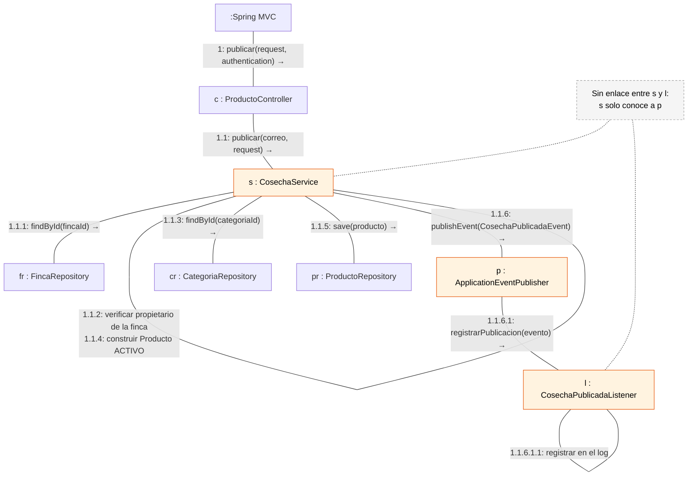

# Diagrama de colaboración (HU-02: publicación de cosechas) - AgroValle Connect

> Documento asociado a **T12-DIS (#147)**. Complementa el diagrama de secuencia de **T11-DIS (#146)**, sección 9 de [`diagrama-secuencia.md`](diagrama-secuencia.md), y el Observer de la sección 5.2 de [`arquitectura-mvc-gof.md`](arquitectura-mvc-gof.md).

> **Notación:** diagrama de colaboración (comunicación) UML simplificado en Mermaid. Cada caja es un objeto (`nombre : Clase`), cada línea es un enlace entre objetos y cada etiqueta es un mensaje numerado con su sentido (`→`). La numeración es jerárquica: `1.1` es un mensaje que se envía mientras se atiende `1`.

## 1. Contexto y objetivo

HU-02 permite que un agricultor autenticado publique una cosecha con `POST /api/v1/productos`. Es la historia más compleja implementada hasta ahora y la única que aplica el patrón **Observer**: al guardar el producto, `CosechaService` emite `CosechaPublicadaEvent` y un listener lo recibe.

El diagrama de secuencia muestra **cuándo** ocurre cada mensaje. Este diagrama muestra **qué objetos se conocen entre sí** y por qué enlaces viajan los mensajes. Así se ve que `CosechaService` no tiene enlace con `CosechaPublicadaListener`.

## 2. Objetos y enlaces

| Objeto | Capa | Enlaces |
|---|---|---|
| `:Spring MVC` | Presentación / REST (framework) | Invoca a `c` con el request ya validado y la autenticación |
| `c : ProductoController` | Presentación / REST | `s` |
| `s : CosechaService` | Servicio / Dominio | `fr`, `cr`, `pr` y `p` |
| `fr : FincaRepository` | Repositorio / Acceso a datos | `s` |
| `cr : CategoriaRepository` | Repositorio / Acceso a datos | `s` |
| `pr : ProductoRepository` | Repositorio / Acceso a datos | `s` |
| `p : ApplicationEventPublisher` | Infraestructura de eventos de Spring | `s` y `l` |
| `l : CosechaPublicadaListener` | Servicio / Dominio | `p` |

`:Spring MVC` aparece solo como origen del mensaje `1`. La autenticación JWT, la autorización por rol y la validación del DTO ocurren antes, en los pasos 1 a 10 del diagrama de secuencia.

## 3. Diagrama de colaboración (camino exitoso)

Los objetos resaltados participan en el Observer: `s` es el sujeto que publica, `p` distribuye el evento y `l` es el observador.

## 4. Mensajes numerados y correspondencia con el diagrama de secuencia

La última columna indica el paso de la numeración automática del diagrama de la sección 9.2 de [`diagrama-secuencia.md`](diagrama-secuencia.md) (T11-DIS) donde aparece el mismo mensaje.

| Nº | Emisor → receptor | Mensaje | Retorno | Paso en secuencia |
|---|---|---|---|---|
| 1 | `:Spring MVC` → `c` | `publicar(request, authentication)` | `ResponseEntity` con `201 Created` | 11 (retorno 45) |
| 1.1 | `c` → `s` | `publicar(authentication.getName(), request)` | `PublicarCosechaResponse(id)` | 12 (retorno 44) |
| 1.1.1 | `s` → `fr` | `findById(fincaId)` | `Optional<Finca>` | 13 (retorno 16) |
| 1.1.2 | `s` → `s` | Comparar el correo del propietario con el correo autenticado | — | 21 |
| 1.1.3 | `s` → `cr` | `findById(categoriaId)` | `Optional<Categoria>` | 26 (retorno 29) |
| 1.1.4 | `s` → `s` | Construir `Producto` en estado `ACTIVO` con los datos del request | — | 34 |
| 1.1.5 | `s` → `pr` | `save(producto)` | `Producto` guardado con `id` | 35 (retorno 38) |
| 1.1.6 | `s` → `p` | `publishEvent(new CosechaPublicadaEvent(productoId, tipo, fincaId, municipio))` | — | 39 (retorno 43) |
| 1.1.6.1 | `p` → `l` | `registrarPublicacion(evento)` | — | 40 (retorno 42) |
| 1.1.6.1.1 | `l` → `l` | Registrar `productoId`, `tipo`, `fincaId` y `municipio` en el log | — | 41 |

Las consultas SQL de los repositorios (pasos 14, 15, 27, 28, 36 y 37) no se dibujan: el diagrama se limita a los objetos de la aplicación y trata cada repositorio como una sola operación.

## 5. Caminos alternativos

Cuando falla una condición, el servicio lanza una excepción y los mensajes siguientes no se envían. `ManejadorErrores` traduce la excepción a la respuesta HTTP, como muestra el diagrama de secuencia.

| Condición que falla | Se detecta en | Excepción | Respuesta | Mensajes que no se envían | Pasos en secuencia |
|---|---|---|---|---|---|
| La finca no existe | 1.1.1 | `RecursoNoEncontradoException` | `404` | 1.1.2 a 1.1.6 | 17 a 20 |
| La finca es de otro agricultor | 1.1.2 | `AccesoDenegadoException` | `403` | 1.1.3 a 1.1.6 | 22 a 25 |
| La categoría no existe | 1.1.3 | `CategoriaInvalidaException` | `400` | 1.1.4 a 1.1.6 | 30 a 33 |

En los tres casos no se guarda el producto ni se emite el evento. `CosechaServiceTest` lo comprueba. Los rechazos por token (`401`), rol COMPRADOR (`403`) y datos inválidos (`400`) ocurren antes del mensaje `1`, por eso no aparecen aquí.

## 6. Bajo acoplamiento del Observer

- `s : CosechaService` depende solo de la interfaz `ApplicationEventPublisher`, inyectada por constructor. No importa ni referencia a `CosechaPublicadaListener`.
- `l : CosechaPublicadaListener` se registra en el contexto de Spring con `@Component` y `@EventListener`. Spring le entrega el evento a partir de su tipo, `CosechaPublicadaEvent`.
- Por eso el diagrama no tiene enlace entre `s` y `l`: el único camino entre ellos pasa por `p`.
- Agregar un observador nuevo, como una futura notificación a compradores, añade un objeto enlazado a `p` y no cambia los enlaces ni el código de `s`. Así se cumple el principio abierto/cerrado de la sección 5.3 de [`arquitectura-mvc-gof.md`](arquitectura-mvc-gof.md).

La entrega del evento es síncrona y ocurre dentro de la transacción de `publicar`. El diagrama de secuencia detalla ese efecto transaccional.

## 7. Diferencias con el diagrama de secuencia

| Aspecto | Diagrama de secuencia (T11-DIS) | Diagrama de colaboración (T12-DIS) |
|---|---|---|
| Qué resalta | El orden de los mensajes en el tiempo | La estructura: qué objetos están enlazados |
| Orden | Posición vertical y numeración automática (1, 2, 3…) | Numeración jerárquica (1, 1.1, 1.1.1…) que muestra qué mensaje se envía dentro de otro |
| Alternativas | Fragmentos `alt` con cada respuesta HTTP | Condiciones que interrumpen la secuencia (sección 5) |
| Infraestructura | Filtro JWT, Spring Security, Spring MVC, `ManejadorErrores` y la base de datos | Solo los objetos de la aplicación que colaboran en la publicación |
| Pregunta que responde | ¿Qué pasa y en qué orden, incluidos los errores y la transacción? | ¿Quién conoce a quién? ¿Dónde está el acoplamiento? |

Ambos diagramas describen el mismo flujo con los mismos mensajes. La tabla de la sección 4 los relaciona uno a uno.

## 8. Fuentes

- [Controlador](../../src/main/java/com/agrovalleconnect/agrovalle_connect/controller/ProductoController.java) y [servicio](../../src/main/java/com/agrovalleconnect/agrovalle_connect/service/CosechaService.java).
- [Evento](../../src/main/java/com/agrovalleconnect/agrovalle_connect/event/CosechaPublicadaEvent.java) y [listener](../../src/main/java/com/agrovalleconnect/agrovalle_connect/listener/CosechaPublicadaListener.java).
- [Pruebas del servicio](../../src/test/java/com/agrovalleconnect/agrovalle_connect/service/CosechaServiceTest.java), que comprueban el orden guardar → emitir y la ausencia del evento en los rechazos.
