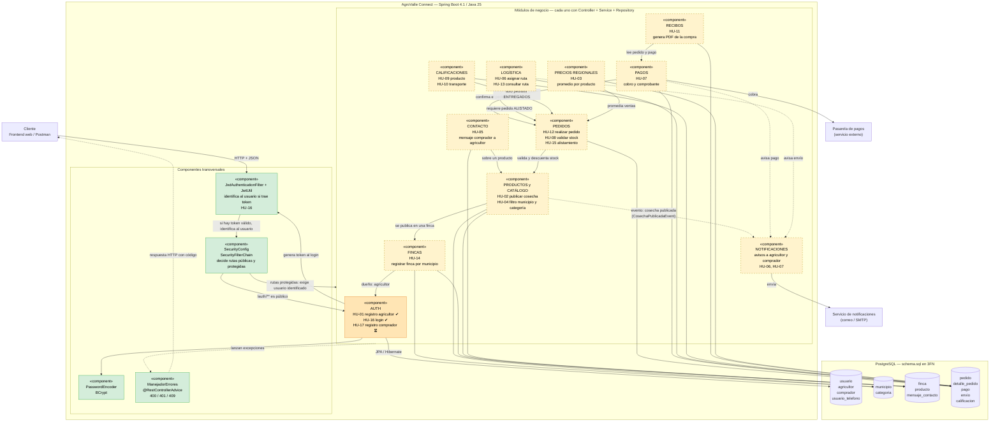
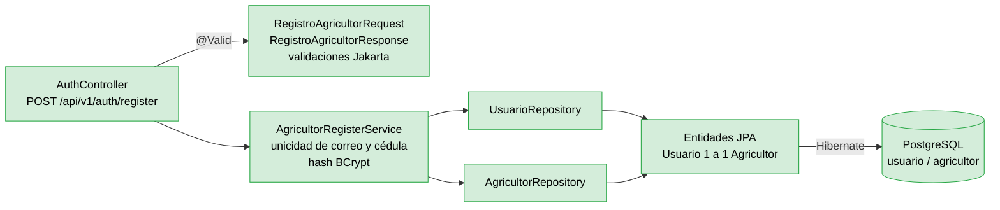
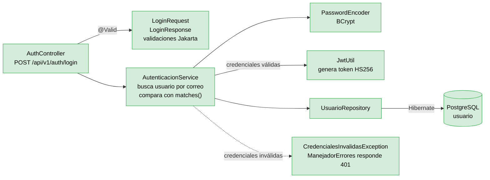

# Diagrama de Componentes — AgroValle Connect

> Documento asociado a **T06-DIS (#79)**, parte del **Sprint de Diseño (#73)**.

> **Notación:** se usa una notación UML simplificada en Mermaid: cada caja es un componente (estereotipo `«component»`) y cada flecha, una dependencia («usa a»).
> **Leyenda:**  verde = implementado en `develop` ·  naranja = parcialmente implementado · amarillo punteado = diseñado, pendiente.
> Línea continua = dependencia existente · línea punteada = dependencia futura.

---

## 1. Vista general del sistema

---

## 2. Detalle por capas del módulo AUTH

Todos los demás módulos seguirán este mismo patrón de capas.

### 2.1 Registro de agricultor (HU-01)

### 2.2 Inicio de sesión (HU-16)

---

## 3. Catálogo de componentes

| Componente | HU | Responsabilidad | Tablas que usa | Estado |
| :--- | :---: | :--- | :--- | :---: |
| **JwtAuthenticationFilter + JwtUtil** | HU-16 | `JwtUtil` genera y valida tokens HS256; el filtro lee el token en cada petición e identifica al usuario. | — | ✅ |
| **SecurityConfig** | HU-16 | Con el filtro JWT conectado, decide qué rutas son públicas y cuáles exigen autenticación (401 sin token). Sesión sin estado. | — | ✅ |
| **PasswordEncoder (BCrypt)** | HU-01, 16 | Hash irreversible al registrar y verificación con `matches()` al iniciar sesión. | `usuario.password_hash` | ✅ |
| **ManejadorErrores** | todas | Traduce excepciones a HTTP: 409 (duplicados), 401 (credenciales inválidas) y 400 (validación, con detalle por campo). | — | ✅ |
| **AUTH** | HU-01, 16, 17 | Registro de agricultor y login (hechos). Registro de comprador (HU-17) pendiente. | `usuario`, `agricultor`, `comprador`, `usuario_telefono` |  parcial |
| **FINCAS** | HU-14 | Registrar fincas asociadas a un municipio del Valle. | `finca`, `municipio` | pendiente |
| **PRODUCTOS y CATÁLOGO** | HU-02, 04 | Publicar cosechas (publica el evento `CosechaPublicadaEvent`); filtrar por municipio y categoría. | `producto`, `finca`, `categoria`, `municipio` | pendiente |
| **CONTACTO** | HU-05 | Mensaje directo del comprador al agricultor. | `mensaje_contacto` | pendiente |
| **PEDIDOS** | HU-12, 08, 15 | Crear pedido, validar stock, marcar alistamiento. | `pedido`, `detalle_pedido`, `producto` | pendiente |
| **PAGOS** | HU-07 | Cobrar vía pasarela y registrar el pago. | `pago`, `pedido` | pendiente |
| **LOGÍSTICA** | HU-06, 13 | Programar ruta, generar código de seguimiento, consultarlo. | `envio`, `pedido` | pendiente |
| **CALIFICACIONES** | HU-09, 10 | Calificar producto y transporte (una por tipo y pedido). | `calificacion`, `pedido` | pendiente |
| **RECIBOS** | HU-11 | Generar el PDF de la compra. | `pedido`, `detalle_pedido`, `pago` | pendiente |
| **PRECIOS REGIONALES** | HU-03 | Calcular el precio promedio por producto. | `detalle_pedido`, `producto` | pendiente |
| **NOTIFICACIONES** | HU-06, 07 | Avisar a agricultor y comprador; escucha eventos como `CosechaPublicadaEvent` (patrón Observer). | — | pendiente |

## 4. Reglas de arquitectura

1. **Las flechas solo bajan:** Controller → Service → Repository → BD. Un controller nunca toca la BD (atributo ISO 25010 de **Mantenibilidad**).
2. **Un módulo habla con otro por su Service**, nunca por su Repository, para que cada módulo proteja sus propias reglas (alta cohesión, bajo acoplamiento).
3. **Seguridad en dos pasos:** el filtro JWT solo *identifica* al usuario en cada petición; `SecurityConfig` es quien *decide* qué rutas exigen autenticación.
4. **Seguridad y manejo de errores son transversales:** se escriben una vez y aplican a todos los módulos.
5. **Los servicios externos** (pasarela, correo) quedan aislados en su propio componente para poder cambiarlos o simularlos en las pruebas.
6. **Comunicación por eventos:** cuando un módulo solo necesita *avisar* algo (cosecha publicada), lo hace con un evento en vez de llamar directamente a NOTIFICACIONES (patrón Observer).