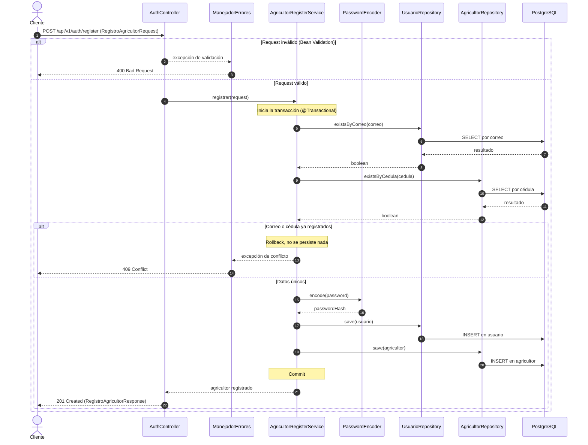

    # Diagramas de secuencia (HU-01 y HU-16) - AgroValle Connect

Documento de diseño asociado a la tarea **T05-DIS (#78)**, parte del Sprint de Diseño (#73).

## 1. Contexto y objetivo

Un diagrama de secuencia muestra **en qué orden** se envían mensajes los componentes del sistema para cumplir un caso de uso, incluyendo los caminos de error. Este documento modela dos historias de usuario:

| Historia | Descripción | Sección |
|---|---|---|
| HU-01 | Registro de un agricultor | 3 |
| HU-16 | PENDIENTE: completar con el nombre de la historia | 4 |

Los componentes que aparecen son los de la arquitectura de 4 capas descrita en `arquitectura-mvc-gof.md` (Presentación/REST, Servicio/Dominio, Repositorio/Acceso a datos y Persistencia/PostgreSQL) y se despliegan según `diagrama-despliegue.md`.

## 2. Participantes

| Participante | Capa | Rol en los diagramas |
|---|---|---|
| Cliente | Externo | Aplicación web o móvil que consume la API REST |
| `AuthController` | Presentación / REST | Recibe la petición HTTP, dispara la validación de los datos y construye la respuesta |
| `ManejadorErrores` | Presentación / REST | Traduce las excepciones a respuestas HTTP (400 y 409) en un único punto |
| `AgricultorRegisterService` | Servicio / Dominio | Aplica las reglas de negocio y controla la transacción |
| `PasswordEncoder` | Servicio / Dominio | Genera el hash BCrypt de la contraseña (patrón Strategy) |
| `UsuarioRepository` y `AgricultorRepository` | Repositorio / Acceso a datos | Consultan y persisten mediante Spring Data JPA |
| PostgreSQL | Persistencia | Almacena las tablas `usuario` y `agricultor` |

## 3. HU-01: Registro de un agricultor

### 3.1 Descripción

| Elemento | Detalle |
|---|---|
| Actor | Persona que desea registrarse como agricultor |
| Endpoint | `POST /api/v1/auth/register` |
| Entrada | `RegistroAgricultorRequest`: `nombre`, `ubicacion_valle`, `cedula`, `correo`, `password` |
| Resultado exitoso | `201 Created` con `RegistroAgricultorResponse` (`nombre` y `mensaje`) |
| Resultados de error | `400 Bad Request` si el request no cumple las validaciones; `409 Conflict` si el correo o la cédula ya están registrados |
| Garantía | Se crean `Usuario` y `Agricultor` juntos o no se crea ninguno (una sola transacción) |

### 3.2 Diagrama

### 3.3 Explicación del flujo

**Flujo principal (mensajes 1 a 19, camino exitoso):**

1. El cliente envía el request y se validan sus campos con Jakarta Validation (nombre, ubicación, cédula de 6 a 10 dígitos, correo con formato válido y contraseña con complejidad mínima).
2. El controller delega en `AgricultorRegisterService.registrar(...)`. Spring abre la transacción antes de ejecutar el método, porque `@Transactional` funciona mediante un proxy.
3. El servicio verifica que el correo y la cédula no existan. Estas consultas van **antes** de generar el hash para no gastar el costo de BCrypt en un registro que será rechazado.
4. Si ambos datos son únicos, se genera el hash de la contraseña, se guarda el `Usuario` y después el `Agricultor`, que referencia al usuario por `usuario_id`. El orden importa: `Agricultor` es el lado dueño de la relación `@OneToOne`, así que el usuario debe existir primero.
5. Como las entidades usan `GenerationType.IDENTITY`, cada `INSERT` se ejecuta en el momento del `save` para obtener el `id`.
6. Al terminar el método, la transacción se confirma y el controller responde `201 Created`.

**Flujos alternos:**

| Camino | Qué ocurre | Respuesta |
|---|---|---|
| Request inválido | La validación falla antes de llegar al servicio; no hay transacción ni consultas | `400 Bad Request` |
| Correo o cédula duplicados | El servicio lanza una excepción, la transacción termina sin cambios y `ManejadorErrores` la traduce | `409 Conflict` |
| Falla al guardar | Cualquier excepción durante los `save` revierte la transacción completa, incluyendo el `Usuario` ya insertado | Error del servidor |

## 4. HU-16

> **PENDIENTE:** esta sección se completa con los datos de la historia HU-16 (descripción, endpoint, clases involucradas y resultados posibles). No subir el documento al repositorio hasta reemplazar este bloque.

## 5. Relación con la arquitectura y los patrones

| Elemento del diagrama | Patrón o decisión |
|---|---|
| `AuthController` → `AgricultorRegisterService` → repositorios | Dependencias solo hacia la capa inferior (arquitectura de 4 capas) |
| `RegistroAgricultorRequest` y `RegistroAgricultorResponse` | DTO: las entidades nunca salen por la API |
| `PasswordEncoder` | Strategy: el algoritmo de hash se puede cambiar sin modificar el servicio |
| `@Transactional` | Proxy: Spring controla el inicio, la confirmación y el rollback |
| `registrar(...)` como único punto de entrada | Facade: oculta la coordinación de repositorios, hash y transacción |
| `UsuarioRepository` y `AgricultorRepository` | Repository: el servicio no escribe SQL |
| `ManejadorErrores` | Manejo centralizado de errores: un solo lugar traduce excepciones a códigos HTTP |

## 6. Decisiones de diseño

- **Validar primero, consultar después:** los datos mal formados se rechazan en la capa de presentación sin tocar la base de datos.
- **Unicidad verificada antes del hash:** BCrypt es costoso a propósito, así que solo se ejecuta cuando el registro tiene posibilidad de completarse.
- **Una sola transacción:** `Usuario` y `Agricultor` se confirman juntos o se revierten juntos.
- **Errores en un único punto:** los controllers no construyen respuestas de error; lanzan excepciones y `ManejadorErrores` define el código HTTP.
- **Respuesta mínima:** el response contiene solo `nombre` y `mensaje`; nunca el hash ni el `id`.
