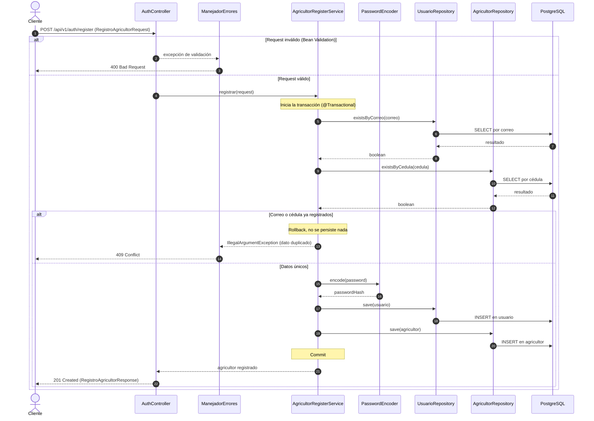
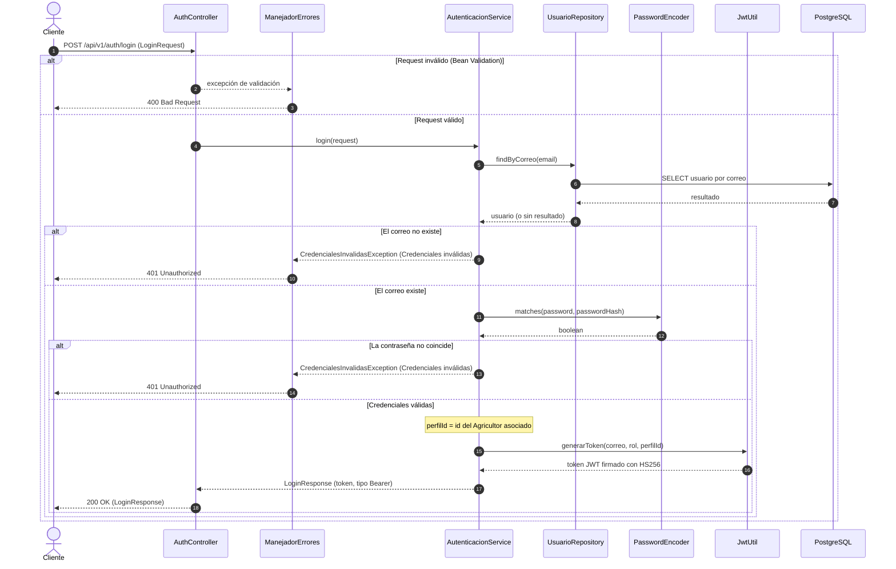
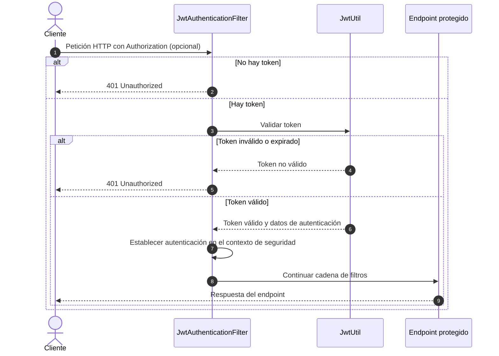

# docs(T05-DIS): diagramas de secuencia de HU-01 y HU-16

Documento de diseño asociado a la tarea **T05-DIS (#78)**, parte del Sprint de Diseño (#73).

## 1. Contexto y objetivo

Un diagrama de secuencia muestra **en qué orden** se envían mensajes los componentes del sistema para cumplir un caso de uso, incluyendo los caminos de error. Este documento modela dos historias de usuario y el uso del token JWT en un endpoint protegido:

| Historia | Descripción | Sección |
|---|---|---|
| HU-01 | Registro de un agricultor | 3 |
| HU-16 | Inicio de sesión (login) con generación de token JWT | 4 |\n| Uso de JWT | Autenticación en un endpoint protegido | 5 |

Los componentes que aparecen son los de la arquitectura de 4 capas descrita en `arquitectura-mvc-gof.md` (Presentación/REST, Servicio/Dominio, Repositorio/Acceso a datos y Persistencia/PostgreSQL) y se despliegan según `diagrama_de_despliegue.md`.

El diseño de HU-16 refleja las piezas integradas en los PR #87 y #88.

## 2. Participantes

| Participante | Capa | Rol en los diagramas | Historia |
|---|---|---|---|
| Cliente | Externo | Aplicación web o móvil que consume la API REST | HU-01, HU-16 |
| `AuthController` | Presentación / REST | Recibe la petición HTTP, dispara la validación de los datos y construye la respuesta | HU-01, HU-16 |\n| `JwtAuthenticationFilter` | Presentación / REST | Extrae y valida el token de la cabecera `Authorization` antes de permitir el acceso a endpoints protegidos | Uso de JWT |
| `ManejadorErrores` | Presentación / REST | Traduce las excepciones a respuestas HTTP en un único punto | HU-01, HU-16 |
| `AgricultorRegisterService` | Servicio / Dominio | Reglas de negocio del registro y control de la transacción | HU-01 |
| `AutenticacionService` | Servicio / Dominio | Verifica las credenciales y emite el token | HU-16 |
| `PasswordEncoder` | Servicio / Dominio | Genera el hash BCrypt (`encode`) y lo compara (`matches`); patrón Strategy | HU-01, HU-16 |
| `JwtUtil` | Servicio / Dominio | Genera y valida el token JWT firmado con HS256 | HU-16, uso de JWT |
| `UsuarioRepository` y `AgricultorRepository` | Repositorio / Acceso a datos | Consultan y persisten mediante Spring Data JPA | HU-01, HU-16 |
| PostgreSQL | Persistencia | Almacena las tablas `usuario` y `agricultor` | HU-01, HU-16 |

## 3. HU-01: Registro de un agricultor

### 3.1 Descripción

| Elemento | Detalle |
|---|---|
| Actor | Persona que desea registrarse como agricultor |
| Endpoint | `POST /api/v1/auth/register` |
| Entrada | `RegistroAgricultorRequest`: `nombre`, `ubicacion_valle`, `cedula`, `correo`, `password` |
| Resultado exitoso | `201 Created` con `RegistroAgricultorResponse` (`nombre` y `mensaje`) |
| Resultados de error | `400 Bad Request` si el request no cumple las validaciones; `409 Conflict` si el correo o la cédula ya están registrados |
| Garantía | Se crean `Usuario` y `Agricultor` juntos o no se crea ninguno (una sola transacción) |

### 3.2 Diagrama

### 3.3 Explicación del flujo

**Flujo principal (camino exitoso):**

1. El cliente envía el request y se validan sus campos con Jakarta Validation (nombre, ubicación, cédula de 6 a 10 dígitos, correo con formato válido y contraseña con complejidad mínima).
2. El controller delega en `AgricultorRegisterService.registrar(...)`. Spring abre la transacción antes de ejecutar el método, porque `@Transactional` funciona mediante un proxy.
3. El servicio verifica que el correo y la cédula no existan. Estas consultas van **antes** de generar el hash para no gastar el costo de BCrypt en un registro que será rechazado.
4. Si ambos datos son únicos, se genera el hash de la contraseña, se guarda el `Usuario` y después el `Agricultor`, que referencia al usuario por `usuario_id`. El orden importa: `Agricultor` es el lado dueño de la relación `@OneToOne`, así que el usuario debe existir primero.
5. Como las entidades usan `GenerationType.IDENTITY`, cada `INSERT` se ejecuta en el momento del `save` para obtener el `id`.
6. Al terminar el método, la transacción se confirma y el controller responde `201 Created`.

**Flujos alternos:**

| Camino | Qué ocurre | Respuesta |
|---|---|---|
| Request inválido | La validación falla antes de llegar al servicio; no hay transacción ni consultas | `400 Bad Request` |
| Correo o cédula duplicados | El servicio lanza `IllegalArgumentException`, la transacción termina sin cambios y `ManejadorErrores` la traduce | `409 Conflict` |
| Falla al guardar | Cualquier excepción durante los `save` revierte la transacción completa, incluyendo el `Usuario` ya insertado | Error del servidor |

## 4. HU-16: Inicio de sesión con token JWT

### 4.1 Descripción

| Elemento | Detalle |
|---|---|
| Actor | Usuario registrado que desea iniciar sesión |
| Endpoint | `POST /api/v1/auth/login` |
| Entrada | `LoginRequest`: `email` y `password`, ambos obligatorios; `email` con formato válido. Sin reglas de fortaleza de contraseña, que aplican solo al registro |
| Resultado exitoso | `LoginResponse` con el `token` y `tipo = "Bearer"` |
| Resultados de error | `400 Bad Request` si el request no cumple las validaciones; `401 Unauthorized` si las credenciales no son válidas |
| Garantía | El mensaje de error es siempre el mismo (`"Credenciales inválidas"`), sin revelar si falló el correo o la contraseña |

Estado de cada pieza:

| Pieza | Estado |
|---|---|
| `JwtUtil` (generación y validación de token HS256) | Implementado, PR #87 |
| `LoginRequest`, `LoginResponse` y `CredencialesInvalidasException` | Implementado, PR #88 |
| `AutenticacionService.login(...)` con sus pruebas unitarias | Implementado, PR #88 |
| Endpoint `POST /api/v1/auth/login` en `AuthController` | Integrado tras la fusión de T04 (#91) y T05 (#92) |
| Mapeo de `CredencialesInvalidasException` a `401` en `ManejadorErrores` | Integrado tras la fusión de T04 (#91) y T05 (#92) |

El diagrama modela el flujo completo de la historia, incluyendo la respuesta `401 Unauthorized` para credenciales inválidas.

### 4.2 Diagrama

### 4.3 Explicación del flujo

**Flujo principal (camino exitoso):**

1. El cliente envía `email` y `password`. Se validan con Jakarta Validation: ambos con `@NotBlank` y `email` además con `@Email`. No se exige complejidad de contraseña, porque la regla se aplicó al crearla y el login solo compara.
2. El controller delega en `AutenticacionService.login(...)`.
3. El servicio busca el usuario por correo con `usuarioRepository.findByCorreo(email)`.
4. Si existe, compara la contraseña con `passwordEncoder.matches(password, passwordHash)`. La comparación la hace BCrypt sobre el hash guardado; la contraseña nunca se recupera ni se descifra.
5. Si coincide, el servicio toma el `perfilId` (el id del `Agricultor` asociado al usuario) y el rol (`usuario.getRol().name()`), y llama a `jwtUtil.generarToken(correo, rol, perfilId)`.
6. El servicio devuelve `LoginResponse` con el token y `tipo = "Bearer"`; el cliente lo enviará en la cabecera `Authorization` de las siguientes peticiones.

**Flujos alternos:**

| Camino | Qué ocurre | Respuesta |
|---|---|---|
| Request inválido | La validación falla antes de llegar al servicio; no se consulta la base de datos | `400 Bad Request` |
| Correo inexistente | El servicio lanza `CredencialesInvalidasException` con el mensaje genérico | `401 Unauthorized` |
| Contraseña incorrecta | El servicio lanza la misma excepción con el mismo mensaje | `401 Unauthorized` |

En ambos casos de error nunca se genera el token.

### 4.4 Consideración de seguridad

El mensaje genérico evita que la respuesta revele si el correo existe. Queda una diferencia sutil: cuando el correo no existe no se ejecuta `matches`, y como BCrypt es costoso a propósito, la respuesta tarda menos que cuando el correo existe con una contraseña incorrecta. Un atacante podría medir esa diferencia de tiempo para enumerar correos. Una mitigación posible, fuera del alcance de esta tarea, es comparar contra un hash ficticio cuando el usuario no existe, para igualar los tiempos.

## 5. Uso del token JWT en un endpoint protegido

### 5.1 Descripción

El cliente envía el token recibido durante el login en la cabecera `Authorization: Bearer <token>` al acceder a un endpoint protegido. `JwtAuthenticationFilter` comprueba la presencia y validez del token antes de permitir que la petición continúe.

### 5.2 Diagrama

### 5.3 Flujos

| Camino | Qué ocurre | Respuesta |
|---|---|---|
| Sin token | El filtro rechaza la petición porque no hay credenciales de autenticación | `401 Unauthorized` |
| Token inválido o expirado | La validación falla y el filtro impide el acceso al endpoint | `401 Unauthorized` |
| Token válido | El filtro establece la autenticación y deja continuar la petición al endpoint protegido | La respuesta definida por el endpoint |

## 6. Relación con la arquitectura y los patrones

| Elemento del diagrama | Patrón o decisión |
|---|---|
| `AuthController` → servicios → repositorios | Dependencias solo hacia la capa inferior (arquitectura de 4 capas) |
| `RegistroAgricultorRequest`, `RegistroAgricultorResponse`, `LoginRequest` y `LoginResponse` | DTO (`record`): las entidades nunca salen por la API |
| `PasswordEncoder` (`encode` y `matches`) | Strategy: el algoritmo de hash se puede cambiar sin modificar los servicios |
| `@Transactional` en el registro | Proxy: Spring controla el inicio, la confirmación y el rollback |
| `registrar(...)` y `login(...)` como puntos de entrada | Facade: ocultan la coordinación de repositorios, hash, token y transacción |
| `UsuarioRepository` y `AgricultorRepository` | Repository: los servicios no escriben SQL |
| `ManejadorErrores` | Manejo centralizado de errores: un solo lugar traduce excepciones a códigos HTTP |
| `CredencialesInvalidasException` | Excepción propia por tipo de error, en lugar de reutilizar una genérica |

## 7. Decisiones de diseño

- **Validar primero, consultar después:** los datos mal formados se rechazan en la capa de presentación sin tocar la base de datos.
- **Unicidad verificada antes del hash (HU-01):** BCrypt es costoso a propósito, así que solo se ejecuta cuando el registro tiene posibilidad de completarse.
- **Una sola transacción (HU-01):** `Usuario` y `Agricultor` se confirman juntos o se revierten juntos.
- **Mensaje genérico en el login (HU-16):** un solo mensaje para correo inexistente y contraseña incorrecta, para evitar la enumeración de usuarios.
- **Excepción propia en el login (HU-16):** `IllegalArgumentException` ya se traduce a `409 Conflict`, y un login fallido debe responder `401`. Con `CredencialesInvalidasException`, cada tipo de error tiene su propio código HTTP.
- **Errores en un único punto:** los controllers no construyen respuestas de error; lanzan excepciones y `ManejadorErrores` define el código HTTP.
- **Respuestas mínimas:** el registro devuelve solo `nombre` y `mensaje`, y el login solo el token y su tipo; nunca el hash ni el `id`.
- **Clave de firma del token:** la clave HS256 que usa `JwtUtil` es un secreto; debe inyectarse por variable de entorno, como el resto de la configuración sensible descrita en `diagrama_de_despliegue.md`, y no guardarse en el repositorio.

## 8. Relación con atributos de calidad (ISO 25010)

| Atributo | Cómo lo respalda el diseño |
|---|---|
| Adecuación funcional | Cada historia tiene definidos su flujo exitoso y sus caminos de error, con el código HTTP correspondiente |
| Seguridad | Contraseñas almacenadas solo como hash BCrypt, mensaje genérico en el login, token firmado y respuestas que no exponen datos sensibles |
| Mantenibilidad | Responsabilidades separadas por capa y errores traducidos en un único punto |
