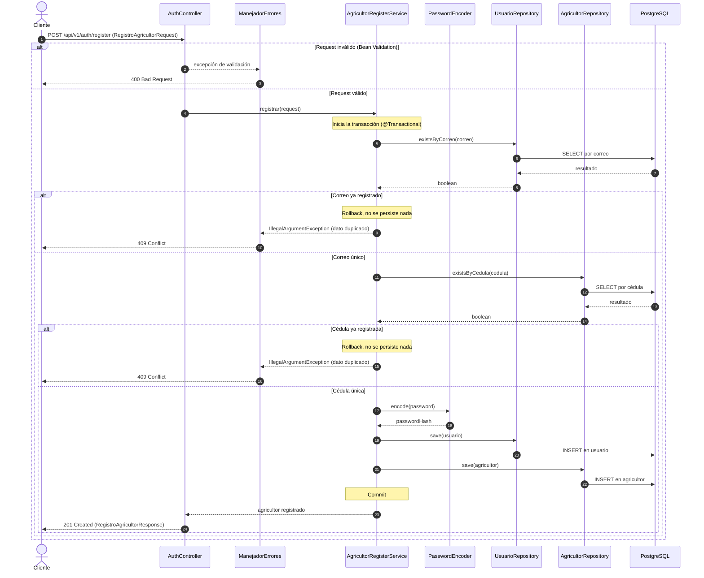
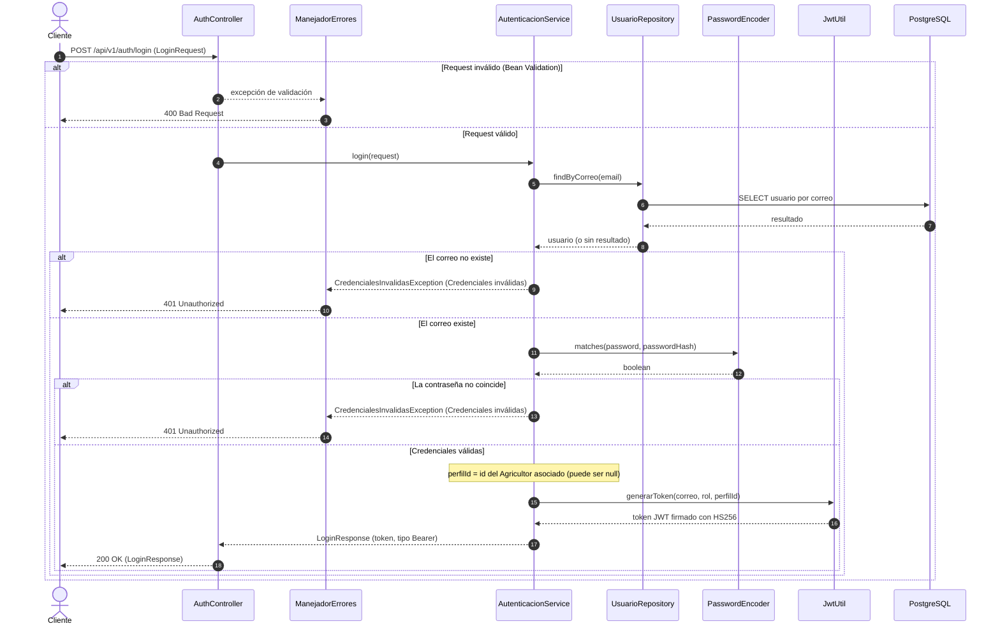
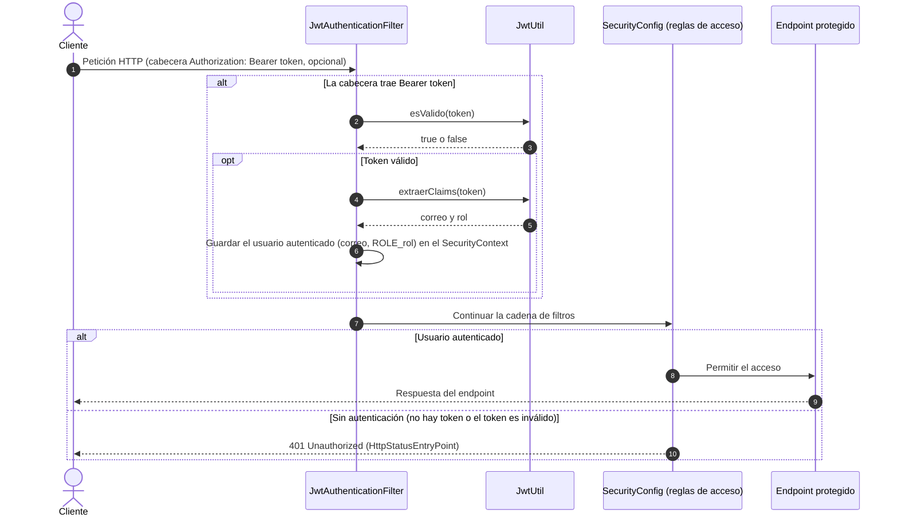
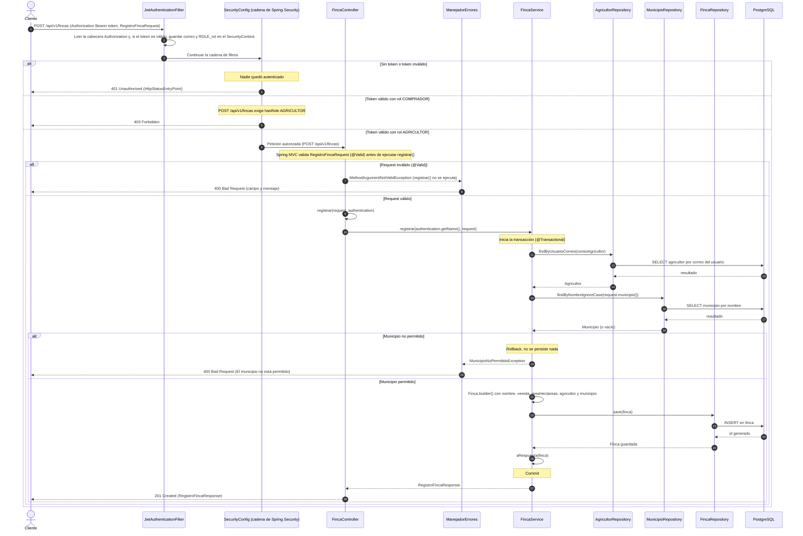
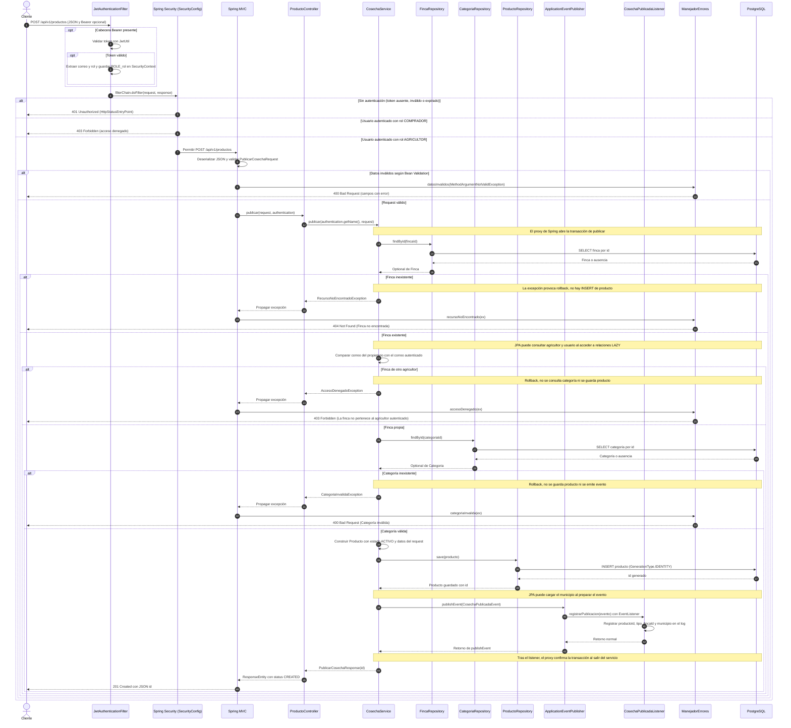
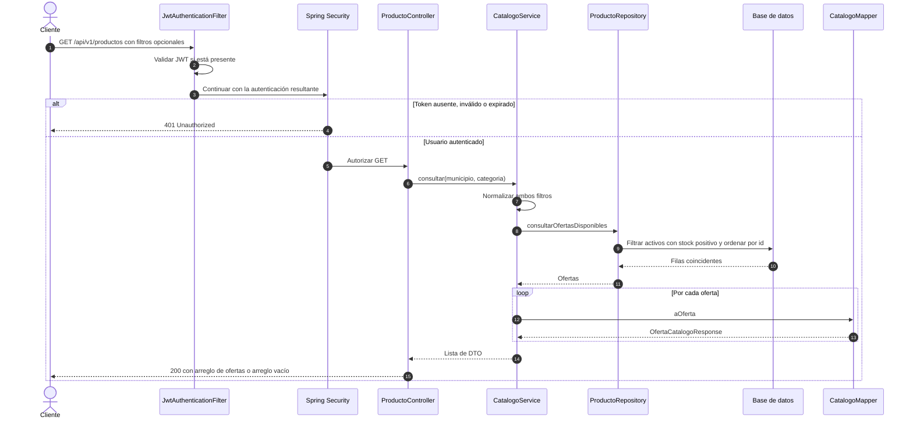

# Diagramas de secuencia (HU-01, HU-16, HU-14, HU-02, HU-04 y uso del token JWT) - AgroValle Connect

Documento de diseño asociado a las tareas **T05-DIS (#78)** y **T10-DIS (#145)**, parte del Sprint de Diseño (#73).

La sección 9 incorpora **T11-DIS (#146)** para la publicación de cosechas de HU-02. La sección 10 incorpora T06-HU04 para consultar el catálogo. La secuencia de HU-17 (T08-HU17, #159) está en un archivo aparte, [secuencia-registro-comprador-hu17.md](../architecture/secuencia-registro-comprador-hu17.md), porque la docente pidió el 19/11 que los diagramas nuevos fueran en archivos separados.

## 1. Contexto y objetivo

Un diagrama de secuencia muestra **en qué orden** se envían mensajes los componentes del sistema para cumplir un caso de uso, incluyendo los caminos de error. Este documento modela cinco historias de usuario y el uso del token JWT en un endpoint protegido:

| Historia | Descripción | Sección | 
| ----- | ----- | ----- | 
| HU-01 | Registro de un agricultor | 3 | 
| HU-16 | Inicio de sesión (login) con generación de token JWT | 4 | 
| Uso de JWT | Autenticación en un endpoint protegido | 5 | 
| HU-14 | Registro de una finca por un agricultor autenticado | 6 | 
| HU-02 | Publicación de una cosecha con evento Observer | 9 |
| HU-04 | Consulta del catálogo por municipio y categoría | 10 |
| HU-17 | Registro e inicio de sesión de un comprador | [Archivo aparte](../architecture/secuencia-registro-comprador-hu17.md) |

Los componentes que aparecen son los de la arquitectura de 4 capas descrita en `arquitectura-mvc-gof.md` (Presentación/REST, Servicio/Dominio, Repositorio/Acceso a datos y Persistencia/PostgreSQL) y se despliegan según `diagrama_de_despliegue.md`.

El diseño de HU-16 refleja las piezas integradas en los PR #87, #88, #91 y #92. El de HU-14 refleja el código de `FincaController`, `FincaService` y sus repositorios en la rama `develop` (Sprint 2).

## 2. Participantes

| Participante | Capa | Rol en los diagramas | Historia | 
| ----- | ----- | ----- | ----- | 
| Cliente | Externo | Aplicación web o móvil que consume la API REST | HU-01, HU-16, HU-14 | 
| `AuthController` | Presentación / REST | Recibe la petición HTTP, dispara la validación de los datos y construye la respuesta | HU-01, HU-16 | 
| `JwtAuthenticationFilter` | Presentación / REST | Extrae y valida el token de la cabecera `Authorization` (si existe) para guardar el usuario en el contexto de seguridad, y luego continúa la cadena de filtros | Uso de JWT, HU-14 | 
| `SecurityConfig` | Presentación / REST | Representa la cadena de filtros de Spring Security: define las reglas de acceso (rutas públicas vs protegidas) y rechaza peticiones sin autenticación (401) o sin el rol requerido (403) | Uso de JWT, HU-14 |
| `ManejadorErrores` | Presentación / REST | Traduce las excepciones a respuestas HTTP en un único punto | HU-01, HU-16, HU-14 | 
| `FincaController` | Presentación / REST | Recibe `POST /api/v1/fincas`, valida el `RegistroFincaRequest` y responde `201 Created` | HU-14 | 
| `FincaService` | Servicio / Dominio | Busca al agricultor autenticado y el municipio, arma la `Finca` y la guarda dentro de una transacción | HU-14 | 
| `AgricultorRegisterService` | Servicio / Dominio | Reglas de negocio del registro y control de la transacción | HU-01 | 
| `AutenticacionService` | Servicio / Dominio | Verifica las credenciales y emite el token | HU-16 | 
| `PasswordEncoder` | Servicio / Dominio | Genera el hash BCrypt (`encode`) y lo compara (`matches`); patrón Strategy | HU-01, HU-16 | 
| `JwtUtil` | Servicio / Dominio | Genera y valida el token JWT firmado con HS256 | HU-16, uso de JWT | 
| `UsuarioRepository` y `AgricultorRepository` | Repositorio / Acceso a datos | Consultan y persisten mediante Spring Data JPA | HU-01, HU-16, HU-14 | 
| `MunicipioRepository` y `FincaRepository` | Repositorio / Acceso a datos | Buscan el municipio permitido por nombre y guardan la finca | HU-14 | 
| PostgreSQL | Persistencia | Almacena las tablas `usuario`, `agricultor`, `municipio` y `finca` | HU-01, HU-16, HU-14 | 
| `UsuarioRepository` y `AgricultorRepository` | Repositorio / Acceso a datos | Consultan y persisten mediante Spring Data JPA | HU-01, HU-16 | 
| `ProductoController` | Presentación / REST | Publica cosechas y devuelve `201` con el ID. Atiende `GET /api/v1/productos`, delega los filtros al servicio y devuelve `200` con ofertas o `[]` | HU-02, HU-04 |
| `CatalogoService` | Servicio / Dominio | Normaliza los filtros, consulta ofertas disponibles en una transacción de lectura y solicita su conversión a DTO | HU-04 |
| `CatalogoMapper` | Mapeo | Convierte cada producto en `OfertaCatalogoResponse` con los ocho campos públicos del contrato | HU-04 |
| Spring MVC | Presentación / REST | Resuelve el DTO validado y delega excepciones al advice | HU-02 |
| `CosechaService` | Servicio / Dominio | Valida finca, propiedad y categoría, guarda el producto y emite el evento | HU-02 |
| `FincaRepository`, `CategoriaRepository` y `ProductoRepository` | Repositorio / Acceso a datos | Consultan la finca y la categoría y persisten el producto. `ProductoRepository` consulta ofertas disponibles según los filtros del catálogo | HU-02, HU-04 |
| `ApplicationEventPublisher` | Infraestructura de eventos de Spring | Distribuye `CosechaPublicadaEvent` a sus observadores | HU-02 |
| `CosechaPublicadaListener` | Servicio / Dominio | Recibe el evento de forma síncrona y registra la publicación | HU-02 |
| PostgreSQL | Persistencia | Almacena usuarios, agricultores, fincas, municipios, categorías y productos | HU-01, HU-16, HU-02 |

## 3. HU-01: Registro de un agricultor

### 3.1 Descripción

| Elemento | Detalle | 
| ----- | ----- | 
| Actor | Persona que desea registrarse como agricultor | 
| Endpoint | `POST /api/v1/auth/register` | 
| Entrada | `RegistroAgricultorRequest`: `nombre`, `ubicacion_valle`, `cedula`, `correo`, `password` | 
| Resultado exitoso | `201 Created` con `RegistroAgricultorResponse` (`nombre` y `mensaje`) | 
| Resultados de error | `400 Bad Request` si el request no cumple las validaciones; `409 Conflict` si el correo o la cédula ya están registrados | 
| Garantía | Se crean `Usuario` y `Agricultor` juntos o no se crea ninguno (una sola transacción) | 

### 3.2 Diagrama

### 3.3 Explicación del flujo

**Flujo principal (camino exitoso):**

1. El cliente envía el request y se validan sus campos con Jakarta Validation (nombre, ubicación, cédula de 6 a 10 dígitos, correo con formato válido y contraseña con complejidad mínima).

2. El controller delega en `AgricultorRegisterService.registrar(...)`. Spring abre la transacción antes de ejecutar el método, porque `@Transactional` funciona mediante un proxy.

3. El servicio verifica primero que el correo no exista. Si ya está registrado, lanza la excepción de inmediato para abortar la transacción sin hacer consultas adicionales.

4. Si el correo es único, verifica que la cédula no exista. Estas consultas van **antes** de generar el hash para no gastar el costo de BCrypt en un registro que será rechazado.

5. Si ambos datos son únicos, se genera el hash de la contraseña, se guarda el `Usuario` y después el `Agricultor`, que referencia al usuario por `usuario_id`. El orden importa: `Agricultor` es el lado dueño de la relación `@OneToOne`, así que el usuario debe existir primero.

6. Como las entidades usan `GenerationType.IDENTITY`, cada `INSERT` se ejecuta en el momento del `save` para obtener el `id`.

7. Al terminar el método, la transacción se confirma y el controller responde `201 Created`.

**Flujos alternos:**

| Camino | Qué ocurre | Respuesta | 
| ----- | ----- | ----- | 
| Request inválido | La validación falla antes de llegar al servicio; no hay transacción ni consultas | `400 Bad Request` | 
| Correo o cédula duplicados | El servicio lanza `IllegalArgumentException`, la transacción termina sin cambios y `ManejadorErrores` la traduce | `409 Conflict` | 
| Falla al guardar | Cualquier excepción durante los `save` revierte la transacción completa, incluyendo el `Usuario` ya insertado | Error del servidor | 

## 4. HU-16: Inicio de sesión con token JWT

### 4.1 Descripción

| Elemento | Detalle | 
| ----- | ----- | 
| Actor | Usuario registrado que desea iniciar sesión | 
| Endpoint | `POST /api/v1/auth/login` | 
| Entrada | `LoginRequest`: `email` y `password`, ambos obligatorios; `email` con formato válido. Sin reglas de fortaleza de contraseña, que aplican solo al registro | 
| Resultado exitoso | `LoginResponse` con el `token` y `tipo = "Bearer"` | 
| Resultados de error | `400 Bad Request` si el request no cumple las validaciones; `401 Unauthorized` si las credenciales no son válidas | 
| Garantía | El mensaje de error es siempre el mismo (`"Credenciales inválidas"`), sin revelar si falló el correo o la contraseña | 

Estado de cada pieza:

| Pieza | Estado | 
| ----- | ----- | 
| `JwtUtil` (generación y validación de token HS256) | Implementado, PR #87 | 
| `LoginRequest`, `LoginResponse` y `CredencialesInvalidasException` | Implementado, PR #88 | 
| `AutenticacionService.login(...)` con sus pruebas unitarias | Implementado, PR #88 | 
| Endpoint `POST /api/v1/auth/login` en `AuthController` | Integrado tras la fusión de T04 (#91) y T05 (#92) | 
| Mapeo de `CredencialesInvalidasException` a `401` en `ManejadorErrores` | Integrado tras la fusión de T04 (#91) y T05 (#92) | 

El diagrama modela el flujo completo de la historia, incluyendo la respuesta `401 Unauthorized` para credenciales inválidas.

### 4.2 Diagrama

### 4.3 Explicación del flujo

**Flujo principal (camino exitoso):**

1. El cliente envía `email` y `password`. Se validan con Jakarta Validation: ambos con `@NotBlank` y `email` además con `@Email`. No se exige complejidad de contraseña, porque la regla se aplicó al crearla y el login solo compara.

2. El controller delega en `AutenticacionService.login(...)`.

3. El servicio busca el usuario por correo con `usuarioRepository.findByCorreo(email)`.

4. Si existe, compara la contraseña con `passwordEncoder.matches(password, passwordHash)`. La comparación la hace BCrypt sobre el hash guardado; la contraseña nunca se recupera ni se descifra.

5. Si coincide, el servicio toma el `perfilId` (el id del `Agricultor` asociado al usuario) y el rol (`usuario.getRol().name()`), y llama a `jwtUtil.generarToken(correo, rol, perfilId)`.

6. El servicio devuelve `LoginResponse` con el token y `tipo = "Bearer"`; el cliente lo enviará en la cabecera `Authorization` de las siguientes peticiones.

**Flujos alternos:**

| Camino | Qué ocurre | Respuesta | 
| ----- | ----- | ----- | 
| Request inválido | La validación falla antes de llegar al servicio; no se consulta la base de datos | `400 Bad Request` | 
| Correo inexistente | El servicio lanza `CredencialesInvalidasException` con el mensaje genérico | `401 Unauthorized` | 
| Contraseña incorrecta | El servicio lanza la misma excepción con el mismo mensaje | `401 Unauthorized` | 

En ambos casos de error nunca se genera el token.

### 4.4 Consideración de seguridad

El mensaje genérico evita que la respuesta revele si el correo existe. Queda una diferencia sutil: cuando el correo no existe no se ejecuta `matches`, y como BCrypt es costoso a propósito, la respuesta tarda menos que cuando el correo existe con una contraseña incorrecta. Un atacante podría medir esa diferencia de tiempo para enumerar correos. Una mitigación posible, fuera del alcance de esta tarea, es comparar contra un hash ficticio cuando el usuario no existe, para igualar los tiempos.

## 5. Uso del token JWT en un endpoint protegido

### 5.1 Descripción

El cliente envía el token recibido durante el login en la cabecera `Authorization: Bearer <token>` al acceder a un endpoint. `JwtAuthenticationFilter` comprueba la presencia y validez del token para establecer el contexto de seguridad. El filtro siempre permite que la petición continúe; es `SecurityConfig` (que representa la cadena de filtros de Spring Security) quien finalmente autoriza el acceso al endpoint protegido o lo rechaza con `401 Unauthorized`.

### 5.2 Diagrama

### 5.3 Flujos

| Camino | Qué ocurre | Respuesta | 
| ----- | ----- | ----- | 
| Sin token | El filtro no autentica y deja seguir la petición; `SecurityConfig` la rechaza porque la ruta exige autenticación | `401 Unauthorized` | 
| Token inválido o expirado | `esValido` devuelve `false`; pasa lo mismo que sin token | `401 Unauthorized` | 
| Token válido | El filtro guarda el usuario y su rol en el contexto de seguridad; `SecurityConfig` permite el acceso | La respuesta del endpoint | 
| Ruta pública (`/api/v1/auth/**`) | `SecurityConfig` no exige autenticación, con o sin token | La respuesta normal del endpoint | 

## 6. HU-14: Registro de una finca

### 6.1 Descripción

| Elemento | Detalle | 
| ----- | ----- | 
| Actor | Agricultor que ya inició sesión (tiene un token JWT con rol `AGRICULTOR`) | 
| Endpoint | `POST /api/v1/fincas` con la cabecera `Authorization: Bearer <token>` | 
| Entrada | `RegistroFincaRequest`: `nombre` (obligatorio, máx. 100), `municipio` (obligatorio, máx. 80), `vereda` (opcional, máx. 100) y `area_hectareas` (opcional, mayor que cero, máx. 8 enteros y 2 decimales) | 
| Resultado exitoso | `201 Created` con `RegistroFincaResponse` (`id`, `nombre`, `municipio`, `vereda`, `area_hectareas`) | 
| Resultados de error | `401 Unauthorized` sin token o con token inválido; `403 Forbidden` si el rol es `COMPRADOR`; `400 Bad Request` si los datos no cumplen las validaciones o si el municipio no está permitido (`MunicipioNoPermitidoException`) | 
| Garantía | La finca queda asociada al agricultor dueño del token (nunca a otro) y a un municipio de la lista permitida; si algo falla, no se guarda nada (una sola transacción) | 

### 6.2 Diagrama

### 6.3 Explicación del flujo

**Flujo principal (camino exitoso):**

1. El cliente envía los datos de la finca junto con el token que recibió en el login (HU-16).

2. `JwtAuthenticationFilter` lee la cabecera `Authorization`, valida el token y guarda en el `SecurityContext` el correo del usuario y su rol (`ROLE_AGRICULTOR`). Luego `SecurityConfig` comprueba la regla `POST /api/v1/fincas` → `hasRole("AGRICULTOR")` y deja pasar la petición.

3. Spring MVC valida el `RegistroFincaRequest` (`@Valid`) antes de ejecutar `FincaController.registrar(...)`. Si la validación falla, el método nunca se ejecuta.

4. El controller no recibe el id del agricultor en el cuerpo: lo toma del token con `authentication.getName()` (el correo) y delega en `FincaService.registrar(correo, request)`. Así un agricultor no puede registrar fincas a nombre de otro.

5. Spring abre la transacción (`@Transactional`). El servicio busca al agricultor con `agricultorRepository.findByUsuarioCorreo(correo)`.

6. Busca el municipio con `municipioRepository.findByNombreIgnoreCase(...)`. Como ignora mayúsculas, `"palmira"` y `"Palmira"` encuentran el mismo registro. Solo existen en la tabla los municipios permitidos que carga `CargadorMunicipios` (Dagua, Palmira y Buga).

7. Con ambos datos, arma la entidad con `Finca.builder()` y la guarda con `fincaRepository.save(finca)`. Como `Finca` usa `GenerationType.IDENTITY`, el `INSERT` se ejecuta en ese momento para obtener el `id`.

8. `aRespuesta(...)` convierte la entidad en `RegistroFincaResponse` (DTO), la transacción se confirma y el controller responde `201 Created`.

**Flujos alternos:**

| Camino | Qué ocurre | Respuesta | 
| ----- | ----- | ----- | 
| Sin token o token inválido | El filtro no autentica a nadie; `SecurityConfig` rechaza la petición con `HttpStatusEntryPoint` antes de llegar al controller | `401 Unauthorized` | 
| Token de un `COMPRADOR` | El usuario está autenticado pero no tiene `ROLE_AGRICULTOR`; Spring Security niega el acceso antes de llegar al controller | `403 Forbidden` | 
| Datos inválidos | Falla `@Valid` (nombre o municipio vacíos, textos demasiado largos, área cero o negativa); `ManejadorErrores.datosInvalidos` devuelve cada campo con su mensaje. No se abre transacción ni se consulta la base de datos | `400 Bad Request` | 
| Municipio no permitido | `findByNombreIgnoreCase` no encuentra el municipio, el servicio lanza `MunicipioNoPermitidoException`, la transacción termina sin cambios y `ManejadorErrores.municipioNoPermitido` la traduce | `400 Bad Request` | 

Los rechazos `401` y `403` los produce Spring Security, no `ManejadorErrores`, porque ocurren antes de que la petición llegue al controller.

**Caso no esperado:** si un token con rol `AGRICULTOR` no tuviera un `Agricultor` asociado, `buscarAgricultor` lanza `IllegalStateException`. No ocurre en el uso normal, porque el registro (HU-01) crea `Usuario` y `Agricultor` juntos, y por eso no se dibuja en el diagrama; hoy `ManejadorErrores` no la traduce, así que respondería `500`.

## 7. Relación con la arquitectura y los patrones

| Elemento del diagrama | Patrón o decisión | 
| ----- | ----- | 
| `AuthController` → servicios → repositorios | Dependencias solo hacia la capa inferior (arquitectura de 4 capas) | 
| `RegistroAgricultorRequest`, `RegistroAgricultorResponse`, `LoginRequest` y `LoginResponse` | DTO (`record`): las entidades nunca salen por la API | 
| `PasswordEncoder` (`encode` y `matches`) | Strategy: el algoritmo de hash se puede cambiar sin modificar los servicios | 
| `@Transactional` en el registro | Proxy: Spring controla el inicio, la confirmación y el rollback | 
| `registrar(...)` y `login(...)` como puntos de entrada | Facade: ocultan la coordinación de repositorios, hash, token y transacción | 
| `UsuarioRepository` y `AgricultorRepository` | Repository: los servicios no escriben SQL | 
| `ManejadorErrores` | Manejo centralizado de errores: un solo lugar traduce excepciones a códigos HTTP | 
| `CredencialesInvalidasException` | Excepción propia por tipo de error, en lugar de reutilizar una genérica | 
| `MunicipioNoPermitidoException` (HU-14) | Excepción propia que `ManejadorErrores` traduce a `400 Bad Request` | 
| `Finca.builder()` en `FincaService` (HU-14) | Builder (Lombok): arma la entidad campo por campo de forma legible | 

## 8. Decisiones de diseño

* **Validar primero, consultar después:** los datos mal formados se rechazan en la capa de presentación sin tocar la base de datos.

* **Unicidad verificada antes del hash (HU-01):** BCrypt es costoso a propósito, así que solo se ejecuta cuando el registro tiene posibilidad de completarse.

* **Una sola transacción (HU-01):** `Usuario` y `Agricultor` se confirman juntos o se revierten juntos.

* **Mensaje genérico en el login (HU-16):** un solo mensaje para correo inexistente y contraseña incorrecta, para evitar la enumeración de usuarios.

* **Excepción propia en el login (HU-16):** `IllegalArgumentException` ya se traduce a `409 Conflict`, y un login fallido debe responder `401`. Con `CredencialesInvalidasException`, cada tipo de error tiene su propio código HTTP.

* **Errores en un único punto:** los controllers no construyen respuestas de error; lanzan excepciones y `ManejadorErrores` define el código HTTP.

* **Respuestas mínimas:** el registro devuelve solo `nombre` y `mensaje`, y el login solo el token y su tipo. El cuerpo de la respuesta no incluye el hash ni el id; el token sí lleva `perfil_id` (el cual puede ser nulo para compradores).

* **Clave de firma del token:** la clave HS256 que usa `JwtUtil` es un secreto; debe inyectarse por variable de entorno, como el resto de la configuración sensible descrita en `diagrama_de_despliegue.md`, y no guardarse en el repositorio.

### 8.1 Relación con atributos de calidad (ISO 25010)

| Atributo | Cómo lo respalda el diseño | 
| ----- | ----- | 
| Adecuación funcional | Cada historia tiene definidos su flujo exitoso y sus caminos de error, con el código HTTP correspondiente | 
| Seguridad | Contraseñas almacenadas solo como hash BCrypt, mensaje genérico en el login, token firmado y respuestas que no exponen datos sensibles | 
| Mantenibilidad | Responsabilidades separadas por capa y errores traducidos en un único punto. El diagrama de HU-14 documenta el registro de fincas con los nombres reales del código, lo que facilita analizar el impacto de un cambio (analizabilidad) | 
| Mantenibilidad | Responsabilidades separadas por capa y errores traducidos en un único punto |

## 9. HU-02: Publicación de una cosecha

### 9.1 Alcance y participantes

Esta sección corresponde a [T11-DIS (#146)](https://github.com/Angel-uniajc/AgrovalleConnect/issues/146). Describe el endpoint implementado en la línea base de develop `41e5782` y complementa el [Observer de la sección 5.2 de arquitectura](arquitectura-mvc-gof.md#52-observer-en-la-publicación-de-cosechas-t04-hu02).

| Elemento | Detalle |
|---|---|
| Actor | Agricultor autenticado que publica en una finca propia |
| Endpoint | `POST /api/v1/productos` |
| Autenticación | Cabecera `Authorization: Bearer <token>` con JWT válido |
| Entrada | `PublicarCosechaRequest`: `finca_id`, `categoria_id`, `tipo`, `cantidad`, `precio_unitario` y `fecha_cosecha` |
| Éxito | `201 Created` con `PublicarCosechaResponse` que contiene el `id` |
| Evento | `CosechaPublicadaEvent(productoId, tipo, fincaId, municipio)` después de `save`, dentro de la transacción |
| Persistencia | Tablas `producto`, `finca`, `agricultor`, `usuario`, `municipio` y `categoria` |

Spring Security representa las reglas declaradas en `SecurityConfig`. Spring MVC representa la deserialización, Bean Validation y la resolución de excepciones mediante `@RestControllerAdvice`. Ambos son componentes del framework y permiten distinguir los rechazos de seguridad de los que maneja `ManejadorErrores`.

### 9.2 Diagrama completo

### 9.3 Explicación del flujo

1. El filtro JWT autentica la petición cuando recibe un token válido. Siempre continúa la cadena, incluso si el token está ausente o es inválido. Las reglas de Spring Security exigen el rol `AGRICULTOR` para este POST.
2. Una petición sin autenticación válida termina en `401`. Un comprador autenticado recibe `403`. Estos caminos terminan antes de entrar al controlador, al servicio o a los repositorios.
3. Spring MVC construye y valida `PublicarCosechaRequest` por el `@Valid` del argumento del controlador. Los identificadores son obligatorios, el tipo es obligatorio y admite hasta 80 caracteres, cantidad y precio son positivos con hasta 10 enteros y 2 decimales, y la fecha debe ser hoy o futura. La validación rechazada produce `400` mediante `ManejadorErrores`.
4. El controlador toma el correo desde `Authentication.getName()` y delega en el servicio. El proxy de `@Transactional` abre la transacción alrededor de `publicar`.
5. El servicio busca primero la finca. Si existe, verifica la propiedad mediante `finca.getAgricultor().getUsuario().getCorreo()`. Solo después de comprobar la propiedad busca la categoría.
6. Con finca y categoría válidas, el servicio guarda un `Producto` en estado `ACTIVO`. El identificador se obtiene con el INSERT porque la entidad usa `GenerationType.IDENTITY`.
7. Después de que `save` retorna, el servicio construye y publica el evento con valores simples. El publicador entrega el evento al listener síncrono, que registra la publicación en el log.
8. Tras el retorno normal del listener, el método entrega la respuesta al proxy. Spring confirma la transacción antes de devolver el control al controlador. Este construye la respuesta `201` con el identificador.

Los accesos JPA se resumen como operaciones de repositorio. La carga diferida de las asociaciones puede producir SELECT adicionales, según el estado del contexto de persistencia. Las notas transaccionales representan el proxy de Spring y evitan atribuir llamadas manuales de commit o rollback al servicio.

### 9.4 Rechazos y evidencia de verificación

Los nombres de prueba de la tabla pertenecen a `ProductoControllerIntegrationTest`.

| Escenario | Punto de rechazo | Respuesta | Prueba |
|---|---|---|---|
| Datos inválidos | Bean Validation, antes de ejecutar el servicio | `400` con errores de campos | `publicarCosecha_conFechaPasada_retorna400` y `publicarCosecha_conCantidadInvalida_retorna400` |
| Categoría inexistente | Servicio, después de verificar finca y propiedad | `400` | `publicarCosecha_conCategoriaInexistente_retorna400` |
| Sin token | Cadena de Spring Security | `401` | `publicarCosecha_sinToken_retorna401` |
| Rol COMPRADOR | Regla de autorización de Spring Security | `403` | `publicarCosecha_conRolComprador_retorna403` |
| Finca ajena | Servicio, antes de consultar la categoría | `403` | `publicarCosecha_enFincaAjena_retorna403` |
| Finca inexistente | Servicio, al consultar la finca | `404` | `publicarCosecha_conFincaInexistente_retorna404` |

Las pruebas comprueban que los rechazos conservan la cantidad de productos. Los errores de validación utilizan nombres Java de los campos, como `fechaCosecha`, aunque el request utiliza `fecha_cosecha`.

El caso `publicarCosecha_conDatosValidos_retorna201YId` verifica el éxito y la persistencia. `CosechaServiceTest` comprueba el orden guardar → emitir y la ausencia de emisión si falla la validación de negocio o el guardado. `CosechaPublicadaIntegrationTest` comprueba persistencia, contenido del evento y ejecución del listener.

### 9.5 Alcance del Observer y de la transacción

La publicación del evento ocurre después del guardado y antes del commit. El evento anuncia la operación dentro de la transacción. Si `save` lanza una excepción, `publishEvent` queda sin ejecutar. Si un listener síncrono lanza una excepción no controlada, se propaga al servicio y puede provocar el rollback completo. Este caso es un fallo interno, distinto de los rechazos de negocio modelados en el diagrama.

El listener actual escribe en consola. Los futuros efectos externos, como correos o notificaciones, deben ejecutarse después de confirmar la transacción, mediante `@TransactionalEventListener(phase = TransactionPhase.AFTER_COMMIT)`, según la decisión de arquitectura de la sección 5.2.

### 9.6 Fuentes del flujo

- [Filtro JWT](../../src/main/java/com/agrovalleconnect/agrovalle_connect/security/JwtAuthenticationFilter.java) y [reglas de seguridad](../../src/main/java/com/agrovalleconnect/agrovalle_connect/config/SecurityConfig.java).
- [Controlador](../../src/main/java/com/agrovalleconnect/agrovalle_connect/controller/ProductoController.java), [DTO de entrada](../../src/main/java/com/agrovalleconnect/agrovalle_connect/dto/PublicarCosechaRequest.java) y [servicio](../../src/main/java/com/agrovalleconnect/agrovalle_connect/service/CosechaService.java).
- [Evento](../../src/main/java/com/agrovalleconnect/agrovalle_connect/event/CosechaPublicadaEvent.java), [listener](../../src/main/java/com/agrovalleconnect/agrovalle_connect/listener/CosechaPublicadaListener.java) y [manejo de errores](../../src/main/java/com/agrovalleconnect/agrovalle_connect/exception/ManejadorErrores.java).
- [Pruebas REST](../../src/test/java/com/agrovalleconnect/agrovalle_connect/controller/ProductoControllerIntegrationTest.java), [pruebas del servicio](../../src/test/java/com/agrovalleconnect/agrovalle_connect/service/CosechaServiceTest.java) y [prueba de integración del evento](../../src/test/java/com/agrovalleconnect/agrovalle_connect/event/CosechaPublicadaIntegrationTest.java).

## 10. HU-04 · Consulta del catálogo

Corresponde a T06-HU04 ([#165](https://github.com/Angel-uniajc/AgrovalleConnect/issues/165)). Describe el endpoint implementado en `develop` en el commit `caf1151`.

Dado un comprador autenticado y ofertas de varios municipios, cuando consulta Dagua y Frutas, recibe las ofertas disponibles que cumplen ambos filtros. El agricultor autenticado puede realizar la misma consulta. [Escenarios CAT-01 a CAT-15](../trazabilidad-bdd.md#hu-04--catálogo-y-filtros)

