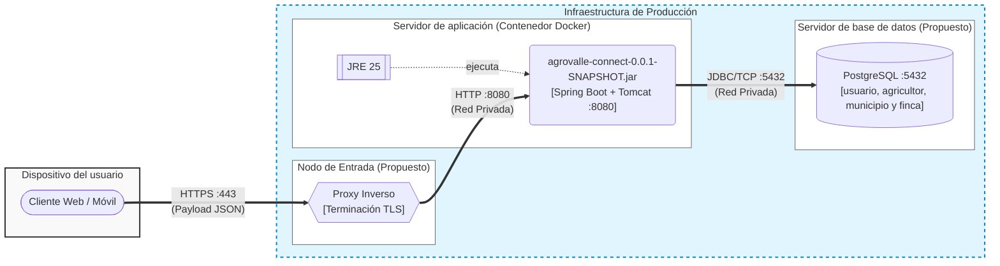
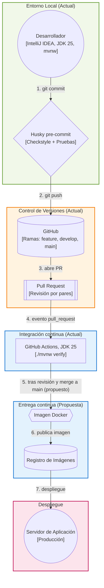

# Diagrama de despliegue - AgroValle Connect

Documento de diseño asociado a la tarea **T04-DIS (#77)**, parte del Sprint de Diseño (#73).

Actualizado en **T09-DIS (#110)** para reflejar Java 25, IntelliJ IDEA y la configuración de JWT.

## 1. Contexto y objetivo

AgroValle Connect es un backend **Java 25 + Spring Boot 4.1.1** que expone una API REST (`/api/v1`) y persiste en **PostgreSQL**. Este documento describe dónde se ejecuta cada componente del sistema, qué artefactos se despliegan en cada nodo, cómo se comunican y cómo llega el código desde el equipo de desarrollo hasta producción.

Para distinguir lo que ya existe de lo que es una decisión de diseño, el documento usa dos etiquetas:

- **Actual:** verificable en el repositorio (artefacto JAR, Java 25, PostgreSQL, H2 en pruebas, JWT, Checkstyle, Husky y GitHub Actions).
- **Propuesto:** decisión de diseño para el despliegue en producción, aún no implementada.

**Alcance:** el backend y su base de datos. El despliegue del cliente web o móvil queda fuera de este diagrama; el cliente aparece solo como consumidor de la API.

## 2. Nodos y artefactos

| Nodo | Tipo | Entorno de ejecución | Artefactos | Estado |
|---|---|---|---|---|
| Dispositivo del usuario | Dispositivo | Navegador web o app móvil | Aplicación cliente (fuera de alcance) | Externo |
| Nodo de entrada | Nodo de ejecución | Proxy inverso (Nginx o el del proveedor de despliegue) | Certificado TLS y configuración del proxy | Propuesto |
| Servidor de aplicación | Contenedor Docker | JRE 25 con Tomcat embebido de Spring Boot | `agrovalle-connect-0.0.1-SNAPSHOT.jar` | JAR actual, contenedor propuesto |
| Servidor de base de datos | Nodo de datos | PostgreSQL | Tablas implementadas: `usuario`, `agricultor`, `municipio` y `finca` | PostgreSQL actual, servidor propuesto |

## 3. Diagrama de despliegue (producción)



### 3.1 Comunicación entre nodos

| Origen | Destino | Protocolo y puerto | Exposición |
|---|---|---|---|
| Cliente | Proxy inverso | HTTPS, 443 | Pública |
| Proxy inverso | Servidor de aplicación | HTTP, 8080 | Red privada |
| Servidor de aplicación | PostgreSQL | JDBC sobre TCP, 5432 | Red privada, sin acceso desde Internet |

El tráfico viaja cifrado entre el cliente y el proxy (TLS). Los puertos 8080 y 5432 no se publican hacia Internet.

## 4. Entornos

| Entorno | Dónde corre | Base de datos | Estado |
|---|---|---|---|
| Desarrollo local | Máquina del desarrollador (IntelliJ IDEA, JDK 25, Maven Wrapper `mvnw`) | PostgreSQL | Actual |
| Pruebas automatizadas | Build local y pipeline de integración continua | H2 en memoria (`jdbc:h2:mem:testdb`, `create-drop`) | Actual |
| Producción | Contenedor Docker detrás de un proxy inverso | PostgreSQL en un servidor separado | Propuesto |

Las pruebas usan H2 para no depender de un servidor externo; el comportamiento específico de PostgreSQL se valida en desarrollo y producción.

## 5. Construcción y entrega (CI/CD)



| Etapa | Qué verifica o produce | Estado |
|---|---|---|
| Hook de Husky | Impide el commit si falla Checkstyle o las pruebas (Definition of Done del equipo) | Actual |
| Pull Request | Revisión y aprobación de al menos un compañero | Actual |
| Pipeline CI | GitHub Actions configura Temurin JDK 25 y ejecuta `./mvnw verify` en cada PR: compila, ejecuta Checkstyle y las pruebas | Actual |
| Construcción de imagen | Empaqueta el JAR en una imagen Docker y la publica en un registro | Propuesto |
| Despliegue | Reemplaza el contenedor en producción con la nueva imagen | Propuesto |

El workflow actual (`.github/workflows/ci.yml`) ejecuta la verificación en cada PR. La construcción de la imagen y el despliegue al fusionar a `main` son una propuesta pendiente de implementación.

## 6. Configuración y secretos

La configuración se externaliza mediante variables de entorno, de modo que la **misma imagen** sirve para cualquier entorno:

| Variable | Propósito |
|---|---|
| `SPRING_DATASOURCE_URL` | URL JDBC de PostgreSQL |
| `SPRING_DATASOURCE_USERNAME` | Usuario de la base de datos |
| `SPRING_DATASOURCE_PASSWORD` | Contraseña de la base de datos |
| `JWT_SECRET` | Clave para firmar y validar tokens JWT HS256; al menos 32 bytes en UTF-8 |
| `SPRING_PROFILES_ACTIVE` | Perfil de Spring activo (por ejemplo `prod`) |

Reglas de configuración:

- Las credenciales de despliegue se inyectan como secretos del entorno y no se guardan en el repositorio. `application.properties` incluye una clave JWT de respaldo solo para desarrollo; en producción se debe definir `JWT_SECRET` con una clave aleatoria propia.
- Todas las instancias de la aplicación deben recibir el mismo `JWT_SECRET` para validar los tokens emitidos por cualquiera de ellas. La expiración actual es de una hora (`jwt.expiration-ms=3600000`).
- En producción, `spring.jpa.hibernate.ddl-auto` debe ser `validate` o `none`. El valor `create-drop` se usa solo en las pruebas con H2, porque borra el esquema al cerrar la aplicación.

## 7. Seguridad del despliegue

- TLS terminado en el proxy inverso; el servidor de aplicación no se expone directamente.
- La base de datos vive en una red privada y solo acepta conexiones del servidor de aplicación.
- Usuario de base de datos con los privilegios mínimos necesarios para la aplicación.
- Contenedor ejecutado como usuario sin privilegios de administrador.
- Las contraseñas de los usuarios se almacenan únicamente como hash BCrypt (`passwordHash`).
- El cliente envía el JWT mediante `Authorization: Bearer <token>` sobre HTTPS. `JwtAuthenticationFilter` valida el token y Spring Security exige autenticación en las rutas protegidas, sin crear sesiones de servidor.

## 8. Relación con atributos de calidad (ISO 25010)

| Atributo | Cómo lo respalda el despliegue |
|---|---|
| Portabilidad | Una imagen Docker con el JAR y el JRE corre igual en cualquier entorno compatible; la configuración cambia solo por variables de entorno |
| Seguridad | TLS en el borde, red privada para la base de datos y secretos fuera del repositorio |
| Fiabilidad | Aplicación sin estado separada de la base de datos: el contenedor se puede reemplazar sin perder datos |
| Mantenibilidad | El mismo proceso de build y las mismas puertas de calidad en local y en integración continua |

## 9. Decisiones de diseño

- **JAR ejecutable con servidor embebido** en lugar de un WAR sobre un servidor externo: menos piezas que instalar y mantener.
- **Contenedor Docker** como unidad de despliegue, para obtener entornos reproducibles.
- **Aplicación sin estado** separada de la base de datos, lo que permite reemplazar o escalar el contenedor de la aplicación sin tocar los datos.
- **Configuración externalizada** mediante variables de entorno, sin credenciales en el código.
- **Mismas puertas de calidad** en el equipo y en el pipeline: lo que bloquea un commit local también bloquea el merge.

## 10. Pendientes y riesgos

| Tema | Detalle |
|---|---|
| Proveedor de despliegue | El equipo debe elegir dónde se aloja el contenedor y la base de datos; el diagrama es válido para cualquier proveedor que ofrezca contenedores y PostgreSQL |
| Migraciones de esquema | Para producción conviene adoptar una herramienta de migraciones (Flyway o Liquibase) en lugar de depender de `ddl-auto` |
| Respaldos | Definir la frecuencia de copias de seguridad de PostgreSQL y probar la restauración |
| Monitoreo | Un endpoint de salud (requiere Spring Boot Actuator) permitiría que el proveedor verifique que el contenedor responde |
| Cliente | El despliegue del frontend queda pendiente de un diagrama propio |

## Anexo A. Dockerfile de referencia (propuesto)

El Dockerfile siguiente es una propuesta; se guardaría en la raíz del proyecto. `COPY . .` utiliza esa raíz como contexto de construcción. No se deben usar rutas locales como Downloads.

```dockerfile
FROM eclipse-temurin:25-jdk AS build
WORKDIR /app
COPY . .
RUN chmod +x mvnw && ./mvnw -B clean package -DskipTests

FROM eclipse-temurin:25-jre
WORKDIR /app
RUN groupadd --system agrovalle && useradd --system --gid agrovalle agrovalle
COPY --from=build /app/target/agrovalle-connect-0.0.1-SNAPSHOT.jar app.jar
USER agrovalle
EXPOSE 8080
ENTRYPOINT ["java", "-jar", "app.jar"]
```

## Anexo B. Docker Compose de referencia para desarrollo (propuesto)

El archivo Compose siguiente es una propuesta; se guardaría en la raíz junto al Dockerfile del anexo A. `DB_PASSWORD` y `JWT_SECRET` se leen desde un archivo `.env` que no se versiona. Se deben definir ambas variables; `JWT_SECRET` debe contener al menos 32 bytes en UTF-8.

```yaml
services:
  db:
    image: postgres:16
    environment:
      POSTGRES_DB: agrovalle
      POSTGRES_USER: agrovalle
      POSTGRES_PASSWORD: ${DB_PASSWORD:?Define DB_PASSWORD en .env}
    volumes:
      - pgdata:/var/lib/postgresql/data
    healthcheck:
      test: ["CMD-SHELL", "pg_isready -U agrovalle -d agrovalle"]
      interval: 5s
      timeout: 5s
      retries: 10

  app:
    build: .
    ports:
      - "127.0.0.1:8080:8080"
    environment:
      SPRING_DATASOURCE_URL: jdbc:postgresql://db:5432/agrovalle
      SPRING_DATASOURCE_USERNAME: agrovalle
      SPRING_DATASOURCE_PASSWORD: ${DB_PASSWORD:?Define DB_PASSWORD en .env}
      JWT_SECRET: ${JWT_SECRET:?Define JWT_SECRET en .env}
      SPRING_JPA_HIBERNATE_DDL_AUTO: update
    depends_on:
      db:
        condition: service_healthy

volumes:
  pgdata:
```

`SPRING_JPA_HIBERNATE_DDL_AUTO=update` crea las tablas en la base vacía de este ejemplo de desarrollo. En producción se debe aplicar el esquema mediante migraciones y usar `validate` o `none`. El puerto 8080 se publica solo en localhost para desarrollo; en producción se mantiene detrás del proxy inverso.
