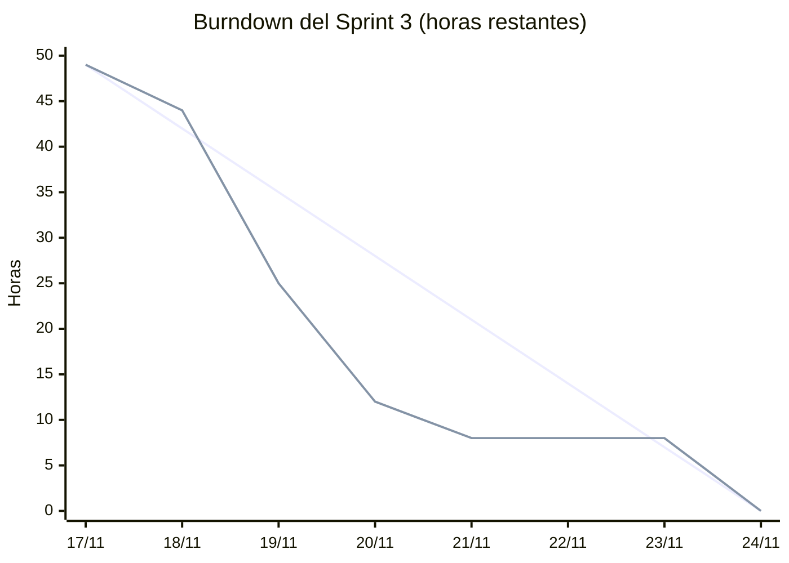
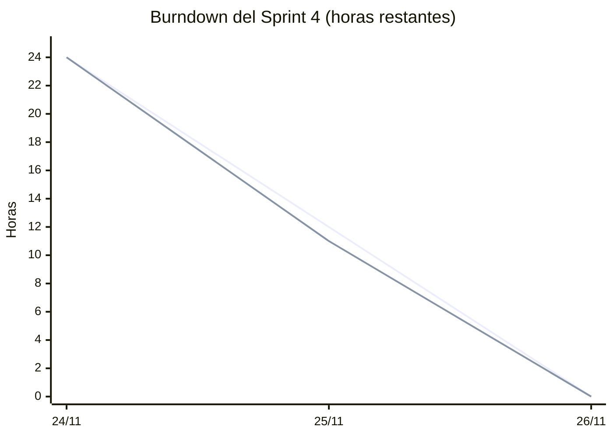
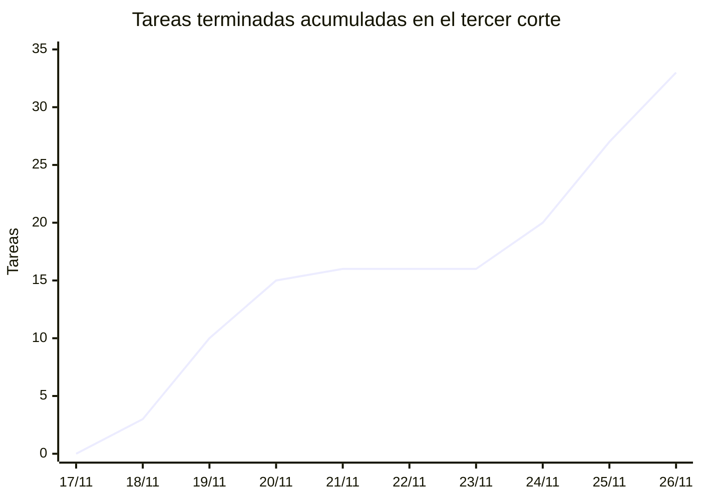

# Métricas ágiles del tercer corte · AgroValle Connect

**Fecha de corte:** 26 de noviembre de 2026.
**Fuentes:** tarjetas del Kanban ([tablero](https://github.com/users/Angel-uniajc/projects/2)), issues y PR de GitHub, ejecuciones de GitHub Actions y reporte local de JaCoCo. Las fechas están en hora de Colombia.

## 1. Velocidad

| Sprint | SP comprometidos | SP completados | Historias completadas |
|---|---:|---:|---|
| Sprint 1 | 8 | 5 | HU-01 (HU-16 quedó parcial) |
| Sprint 2 | 10 | 10 | HU-14, HU-02 |
| Sprint 3 | 11 | 11 | HU-17, HU-04, HU-05 |
| Sprint 4 | 8 | 8 | HU-12, HU-08 |
| **Promedio de los sprints completados** | **9,25** | **8,5** | |

```mermaid
xychart-beta
    title "Velocidad por sprint (Story Points)"
    x-axis ["Sprint 1", "Sprint 2", "Sprint 3", "Sprint 4"]
    y-axis "Story Points" 0 --> 12
    bar [8, 10, 11, 8]
    bar [5, 10, 11, 8]
```

En la gráfica, la primera barra de cada sprint es lo comprometido y la segunda lo completado. Desde el Sprint 2 el equipo completa todo lo que compromete. En el tercer corte entregó 19 SP en dos sprints, sin pasar el máximo de 12 SP por sprint que fija la materia.

**Proyección:** el backlog suma 72 SP y van completados 37, incluidos los 3 SP de HU-16. Quedan 35 SP: HU-03, HU-06, HU-07, HU-09, HU-10, HU-11, HU-13 y HU-15. Con la velocidad promedio de 8,5 SP, faltan unos 4 sprints. Siguiendo la recomendación de la docente, se dejan para después del semestre.

## 2. Burndown

El burndown se mide en horas estimadas de las tareas que siguen abiertas al final de cada día. Las horas son las del Kanban. En puntos de historia el gráfico sería escalonado: las tres historias del Sprint 3 se cerraron el mismo día.

### Sprint 3 (49 horas)

| Día | 17/11 | 18/11 | 19/11 | 20/11 | 21/11 | 22/11 | 23/11 | 24/11 |
|---|---:|---:|---:|---:|---:|---:|---:|---:|
| Ideal | 49 | 42 | 35 | 28 | 21 | 14 | 7 | 0 |
| Real | 49 | 44 | 25 | 12 | 8 | 8 | 8 | 0 |

La línea real (la segunda) va por debajo de la ideal desde el 19/11, es decir, el avance fue más rápido de lo planeado. Del 21 al 23 de noviembre queda plana porque no hubo cierres: las cuatro tareas de documentación que faltaban (8 horas) se cerraron el 24/11.

### Sprint 4 (24 horas)

| Día | 24/11 | 25/11 | 26/11 |
|---|---:|---:|---:|
| Ideal | 24 | 12 | 0 |
| Real | 24 | 11 | 0 |

El Sprint 4 siguió casi exacto la línea ideal.

## 3. Diagrama de flujo acumulado (CFD)

El CFD se reconstruyó con las fechas de GitHub, porque el tablero no exporta el historial de columnas. *En revisión* cuenta las tareas con un PR abierto al final del día, *Hecho* las tarjetas cerradas, y *Por hacer o en curso* el resto.

| Día | Por hacer o en curso | En revisión | Hecho |
|---|---:|---:|---:|
| 17/11 | 20 | 0 | 0 |
| 18/11 | 16 | 1 | 3 |
| 19/11 | 10 | 0 | 10 |
| 20/11 | 5 | 0 | 15 |
| 21/11 a 23/11 | 4 | 0 | 16 |
| 24/11 (cierre del Sprint 3) | 0 | 0 | 20 |
| 24/11 (inicio del Sprint 4) | 12 | 1 | 0 |
| 25/11 | 4 | 2 | 7 |
| 26/11 | 0 | 0 | 13 |

**Lectura:** la franja *En revisión* nunca pasó de 2, el límite WIP de esa columna, así que las revisiones no se acumularon. La franja *Hecho* sube de forma constante, salvo el fin de semana del 21 al 23 de noviembre.

## 4. Lead time y cycle time

**Definiciones de la materia:** el *lead time* va desde que se crea la historia hasta que queda terminada, y el *cycle time* desde que pasa a *In progress* hasta que se aprueba su PR. El tablero no guarda la fecha de entrada a *In progress*. Por eso, el cycle time de una historia se mide desde que se abrió el primer PR de sus tareas, y el de una tarea desde que se abrió su PR hasta el merge.

### Por historia

| Historia | Sprint | Creada | Terminada | Lead time | Cycle time |
|---|---|---|---|---:|---:|
| HU-17 | 3 | 26/09 | 24/11 | 59,2 días | 6,2 días |
| HU-04 | 3 | 24/09 | 24/11 | 61,1 días | 6,1 días |
| HU-05 | 3 | 24/09 | 24/11 | 61,1 días | 6,0 días |
| HU-12 | 4 | 24/09 | 26/11 | 62,8 días | 1,4 días |
| HU-08 | 4 | 24/09 | 26/11 | 62,8 días | 0,8 días |
| **Promedio** | | | | **61,4 días** | **4,1 días** |

El lead time es largo porque todas las historias se escribieron en el backlog del Sprint 0 y esperaron su turno. El cycle time muestra lo que tardó el equipo una vez empezó cada historia.

### Por tarea

| Medida | Sprint 3 (20 tareas) | Sprint 4 (13 tareas) |
|---|---:|---:|
| Lead time de la tarjeta (de creada a cerrada), promedio | 2,9 días | 1,2 días |
| Cycle time del PR (de abierto a fusionado), promedio | 2,1 horas | 3,5 horas |
| Cycle time del PR, mediana | 1,0 hora | 1,1 horas |
| PR que más tardó | 15,5 horas (#175) | 11,4 horas (#216) |

**Throughput:** 20 tareas en 8 días en el Sprint 3 (2,5 por día) y 13 tareas en 3 días en el Sprint 4 (4,3 por día).

## 5. Calidad del código y del pipeline

| Indicador | Meta | Resultado | Fuente |
|---|---|---|---|
| Cobertura de instrucciones (JaCoCo) | ≥ 60 % | 98,7 % (2.103 de 2.130) | Reporte local del 25/11 a las 22:31, durante el Sprint 4. El CI de la release #228 confirmó el mínimo del 60 %. |
| Cobertura de ramas (JaCoCo) | ≥ 60 % | 95,7 % (67 de 70) | Reporte local del 25/11 a las 22:31, durante el Sprint 4. El CI de la release #228 confirmó el mínimo del 60 %. |
| Violaciones de Checkstyle | 0 | 0 | `target/checkstyle-result.xml` y CI |
| Pruebas | 100 % en verde | 381 pruebas, 0 fallos | Validación de la release [#228](https://github.com/Angel-uniajc/AgrovalleConnect/pull/228) |
| Ejecuciones del CI en verde (17 al 26/11) | 100 % | 80 de 81 terminadas (98,8 %) | [GitHub Actions](https://github.com/Angel-uniajc/AgrovalleConnect/actions) |

La única ejecución fallida fue la #171, del 26/11, sobre el PR #224, porque la rama estaba atrasada frente a `develop`. El PR no se fusionó en rojo: se actualizó la rama y la ejecución siguiente pasó.

## 6. Conclusiones

- El equipo estabilizó la velocidad entre 8 y 11 SP y cumple lo que compromete desde el Sprint 2.
- El trabajo se reparte de forma pareja: en el Sprint 3 cada integrante cerró entre 4 y 6 tareas. En el Sprint 4 Ángel cerró 6 de 13, porque tomó tareas que estaban a nombre de otros.
- El tiempo de revisión es bajo (mediana de una hora), pero en algunos PR la rapidez dejó pasar fusiones sin aprobación. Ver las retrospectivas de los sprints [3](../sprints/sprint-3/retrospective.md) y [4](../sprints/sprint-4/retrospective.md).
- **Falta medir:** las horas reales de cada tarea, para comparar lo estimado con lo real, y el despliegue a staging, que todavía no existe.
